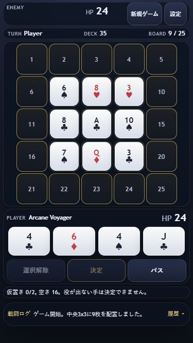

# モバイルUI検証結果

2026-10-14、ローカルChromeで検証。iPhone Safari実機では未検証。

- 320×568 / 375×667 / 390×844 / 430×932: HP、ターン、盤面、4枚の手札、選択解除・決定・パス、最新ログが画面内。文書のscrollWidth/scrollHeightは各viewport幅/高さと一致。
- 盤面タップ対象は最小44×44px、主要操作は高さ44px。
- 320×480: 縦スクロール可能で操作が切り捨てられない。
- カード選択、仮置き、選択解除、ワンペアの予測→決定（2ダメージ）、CPU応答、パスを確認。
- ログ履歴の展開・折りたたみ、設定から「戻る」によるゲーム復帰を確認。
- 入力欄を編集可能。CSSのuser-selectはゲーム操作でnone、入力でtext。touch-actionはmanipulation。viewportにズーム禁止指定なし。
- 1280×900: 3列のPCレイアウト、通常手札・操作・ログを維持。
- 不要な一覧リンクなし（a要素0件）。ブラウザーの警告・エラーログなし。
- JS全ファイルの構文チェック成功。ai.js / battle.js / board.js / deck.js / poker.js / state.js / main.jsは作業開始時の内容と一致。

## 実機での残確認

iPhone Safariのダブルタップ拡大抑止、長押し選択・ドラッグ、ピンチズーム、ノッチ・ホームインジケーターのSafe Area、アドレスバー伸縮、ソフトキーボード表示時の設定操作。Safe Area対応のCSSは実装済み。画面が低い場合は縦スクロールに退避する。

スマホの戦闘結果・予測は盤面下部の一時表示。ログを展開すると盤面上に履歴を表示し、折りたたむとプレイ表示へ戻る。小さい画面では敵手札を省略するが、敵HPは常時表示する。

