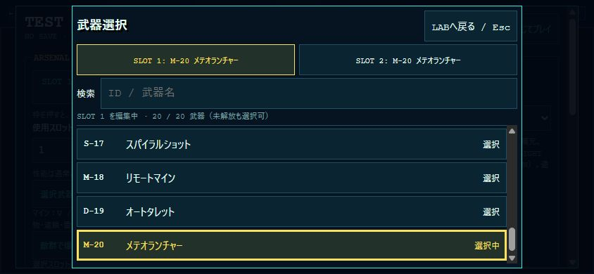

# Version 0.3.0 — DEBUG PLAYGROUND / TEST LAB UI

## M03の検証

「ステージ」でM03・AREA01〜05を選んで指定開始、B-03ボタンでボス戦直接開始。4兵科・20武器・QA区分・密度・計測をそのまま使用できます。「敵・ボス」にE-07/E-08/E-09/B-03とM03地形を追加。敵数は通常敵200まで、ボスは1体です。

「M03：海上侵攻・対空砲台の検証」HELPを開くと、海上侵攻30体の再配置と、現在のM03砲台ON/OFFを操作できます。再配置は位置・敵・弾・タイマー・計測を初期化する実行操作。砲台の検証にはAREA03でC/Bを開始するか、新敵E-08を砲台の射程へ誘導します。AはAI／砲台攻撃を停止し、純粋な地形到達性を検証します。

見た目は従来4スタイル・320/640比較を維持。M03専用の旧素材セットはないため、港湾・新敵は全スタイル共通のCOASTAL 01、既存兵科・武器・共通FXには選択スタイルを適用します。通常アートはUNIFIED／320を継続。計測JSONにM03・5エリア・B-03結果が既存形式で入ります。通常セーブは変更しません。

[M03のQA結果・制約](MISSION_03.md) ／ [3ミッション比較](../reports/mission-art-comparison/README.md)。通常攻略D、A到達性、無敵QA Cを混同しないでください。

## 現在の操作：5タブ

`?debug=1` → TEST LAB。LABを開いている間は戦闘を停止し、ゲームへの入力を遮断します。通常セーブへの書込はありません。

| タブ | 設定と実行 |
| --- | --- |
| ステージ | M01/M02/M03・AREA・M02ルート・QA・密度。フッターの「選択地点から開始」、B-01/B-02/B-03直接開始 |
| 兵科・武器 | 正式兵科／実験性能・無敵・使用スロットは即時。SLOT 1/2から20武器リストへ。試射・爆発プレビューは明示ボタン |
| 敵・ボス | 地形・敵・数・配置は候補。地形適用・生成・消去を押して実行。ボス直接開始はステージへ案内 |
| 見た目 | ORIGINAL / STUDY 01 / STUDY 01-B / UNIFIED 01、320/640、AUTO/FIXED、撃破LEVEL1〜3、揺れを即時反映。停止比較もここ |
| 計測 | FPS表示、直近有効区間のFPS/p95/CPU、現在の敵・弾・FX数、BENCH、MISSION REPORT・武器別ダメージ・JSONコピー |

ヘッダーとフッターは固定、中央だけスクロールします。閉じる／Esc／F2は状態維持で再開（GAME OVER試行はGAME OVERへ）。再度開くと最後のタブとタブ別スクロールを保持します。武器リストは別ダイアログのままで、LABとの二重スクロールを避けています。

サマリーは現在の実ミッション／試行・自由配置・BENCH／性能・密度と、ステージタブの次回開始候補を区別します。QA B/Cは実際の無敵に従うため、選択値と実効値が違えば矢印表示。アートは読み込み完了した実表示を示します。

中央末尾「よく使う設定」に4プリセット。説明で変更項目を確認し「適用」を押します。アート比較＝FIXED0.50・揺れOFF、ボス＝AREA05候補、大量敵＝E-01・200・密集候補、通常攻略＝QA D・無敵OFF。選択のみでは無変更、適用しても再開始や敵消去はしません。通常攻略は開始時に正式兵科・解放装備を検証します。

Tab／Shift+TabはLAB内循環、タブ上の左右矢印／Home／Endで切替、Enter／Spaceで実行。詳細説明・リセット・LAB終了はHELPに整理しました。全項目の移動先と初期化範囲：[TEST_LAB_UI.md](TEST_LAB_UI.md)。[5サイズのブラウザ記録](../reports/test-lab-ui/README.md)。以下の旧版セクションは機能説明・開発履歴で、現在の配置は上記タブを優先してください。

## 新旧アートのゲーム内比較（0.2.3-A）

- `?debug=1` → TEST LAB → ART PREVIEWのART STYLEでORIGINAL / STUDY 01を切り替える。通常ゲームへ保存せず、通常ミッションは旧素材のまま。読込失敗時はORIGINALへ戻す。
- STAGE SELECTのM01/M02・エリア、兵科、武器を指定して比較可能。アートは再配置・チェックポイント開始をまたいで保持し、新規LABではリセットする。兵科・敵・弾・HP・スコアを変える切替ではない。
- 「同じ場面で比較（一時停止）」で比較バーへ移る。停止状態のまま新旧／320・実験640を選べる。Esc / F2 / LABへ戻るで停止したLABへ戻り、閉じると再開。ポーズ画面にも同じ切替がある。
- 640は描画密度だけ2倍、論理座標・HUDサイズ・カメラ倍率・入力位置は同じ。通常プレイの正式設定ではない。
- 対応範囲・原画／接地／銃口アンカー・テスト・未確認事項は [ART_DIRECTION.md](ART_DIRECTION.md#ゲーム内試用版023-a)。今回の実ブラウザ表示／比較撮影／描画性能は、ブラウザ自動承認の利用上限で未確認。

## STAGE SELECT・攻略計測（0.2.3）

1. `?debug=1` → TEST LAB。「兵科・武器」で正式兵科・2武器、「見た目」で演出レベルを選ぶ。
2. STAGE SELECTでミッション、エリア、検証区分、密度を指定。M02 AREA03のみ上/下ルートを選べる。「指定地点から開始」で完全に新しい試行を開始する。ミッション密度は30/50/100のまま、ENCOUNTER/BENCHの200体は別の自由配置試験。
3. 「M01 / B-01直接開始」「M02 / B-02直接開始」は現在のエリア指定に関係なく、該当アリーナでHP満タン・初期行動のボスを開始する。装備・性能・無敵は保持、カメラはAUTO。Aではボス戦を開始しないためB/C/Dを選ぶ。
4. LAB / F2で停止してMISSION REPORTを読む。パネル表示中は射撃・移動・タイマーを進めない。「テスト状態を初期化」とGAME OVERのRETRYは同じチェックポイントを再生成する。GAME OVERからは「LAB計測結果 / 指定再開」またはF2でパネルを開ける。閉じるとGAME OVERへ戻る。
5. ボス撃破後は通常報酬の代わりにQA結果へ移る。Aはボス入口到達で終了。JSONコピーは現在と直近20試行（ABORTEDも含む）、直近12件のBENCHをまとめる。コピー失敗時は下の読み取り専用JSONを手動選択する。自動ダウンロード・通常localStorageへの記録はしない。

| 区分 | 用途・制約 |
| --- | --- |
| A 地形到達性 | 自動出現・巣の増援・敵AI/攻撃を停止。地形と破壊障害物は残す。HPは減らない。ボス入口で終了 |
| B 戦闘QA | 出現・AI・被弾あり。実験性能や未解放武器も使えるが、通常攻略とは扱わない |
| C 無敵QA | 実際の出現・攻撃・武器・ボスイベント、HP損失なし。無敵ONならB指定でも記録はC |
| D 通常プレイ条件 | 正式兵科、通常HP、解放済み武器2枠、無敵OFFのみ開始可能。人手操作や全編攻略を自動認定しない |

- 無敵の実態に従ってB/Cを記録する。Dの開始後に武器・兵科・無敵・カメラ・演出・検証条件を変更するとBまたはCへ降格し、変更内容を残す。Aは敵を再生成しない限りAのまま。
- 途中開始は `CHECKPOINT_ONLY`、AREA01開始は `FROM_MISSION_START`。`normalClearCertified` は常にfalse。通常プレイDを名乗るには実操作の記録と条件確認が別途必要。
- 時刻は既存のゲーム内アクティブ時間（ポーズ・パネル停止を除く）。武器別与ダメージは弱点補正後の実HP減少、オーバーキルを除外。撃破数・最大生存数はゲームの既存カウンターに合わせ、ネスト・破壊障害物も含む。
- 進行不能は「疑い」のログのみ。移動入力＋停止＋地形側面接触、solid内部侵入、開始イベント/結果遷移欠落、出現上限と中ボス待ち等を組み合わせる。単なる待機・一方向足場の合法的な通過は異常としない。現M01/M02に必須ネスト撃破条件はなく、その診断は `required:true` の将来/テスト対象だけに適用する。
- FPSはRAF間隔、更新/描画CPUはPerformance APIで別計測。非表示・ポーズで基準時刻を切り、250ms超を中断として除外。攻略試行のp95は0.5ms幅の固定ヒストグラム。従来BENCHのraw値は互換情報として残すが、中断が混ざるため正常な実効FPSとして使用しない。パネル/JSONは `acceptedPerformance` の有効区間を表示する。
- 既存武器選択ダイアログは変更なし。5タブそれぞれの中央スクロールで全項目へ到達でき、武器ダイアログを開くと背面LABはinertになる。

チェックポイントの座標・復元条件、検証結果・未確認事項は [MISSION_BALANCE.md](MISSION_BALANCE.md)。通常セーブキー・データ形式は変更なし。

## 地下ステージの検証（0.2.2）

- 「敵・ボス」の「検証地形」でM01 / M02を選択できる。0.2.3-Dでは選択のみは保留し、「地形だけ適用」または「生成」でテスト戦場を初期化する。LABの装備・演出設定・性能プリセットは保持する。通常のミッション解放状態は問わない。
- E-05ワーム・E-06スピッターは1〜200体の密集／分散、H-01ネスト・B-02クイーンは単体を生成。ネスト／クイーンは必要に応じてM02へ自動切替する。M02の初期ネストや通常ウェーブは自動配置しないため、個々の生成を繰り返し検証できる。
- H-01は250HP、4秒ごと2〜4体、巣由来12体まで。破壊後は停止。LABの共通上限と通常進行の30/50/100体上限は別で、通常ミッションにLAB上限を持ち込まない。
- B-02は専用アリーナ・カメラで酸弾／召喚／地上衝撃波／低HP突進を検証。腹部コアが開いている間は1.5倍。試射は通常の武器データと衝突処理を使用する。
- 正式GUARDIANで配管・足場、正式WINGでFLY / HOLDと天井を検証できる。旧実験用もM02の幅5,600pxとsolid衝突に対応。LABリトライ・リセットは選択地形を維持する。
- 地下では反射弾の法線、子弾の寿命、設置物の支持面、雷撃の遮蔽、メテオの天井着弾を比較する。再配置で弾・連鎖・設置物・死体を消去。LABでの撃破・箱・ボス討伐は通常セーブへ保存しない。
- 仕様・関連テスト・ブラウザ検証の範囲は [MISSION_02.md](MISSION_02.md)。M02のLABボス討伐は通常ミッションの全編クリア確認とは区別する。

## 武器選択UI（0.2.1）

### 操作

1. `?debug=1` → TEST LAB →「兵科・武器」のSLOT 1またはSLOT 2を押す。
2. 専用ダイアログ上段で編集スロットを選ぶ。黄色の枠が編集対象。スロットの現在装備も表示する。
3. 武器ID・武器名で検索するか、一覧を上下スクロールする。半角・全角、大文字・小文字、IDのハイフンや空白の有無を正規化する。検索結果0件では説明を表示し、装備は変更しない。
4. 武器ボタンをタップすると対象スロットだけへ即時反映。「選択中」と黄色の強調を表示し、一覧のスクロール位置を維持する。全20武器・未解放武器・両枠に同じ武器の装備が可能。
5. 「LABへ戻る / Esc」で閉じる。戦闘は停止したままLABへ戻り、対応する枠にフォーカスを戻す。「使用スロット」は射撃側の選択なので別途切り替える。さらにEscまたは「閉じてプレイ」で戦闘再開。

PCではTab / Shift+Tabでダイアログ内を移動し、Enter / Spaceで選択する。末尾からのTabは戻るボタンへ循環し、背面のゲームにフォーカスを移さない。検索欄には自動フォーカスせず、スマホのキーボードが意図せず開くのを避ける。

### 原因・レイアウト・入力保護

- 旧UIは20項目のネイティブselect。展開領域はOS・ブラウザが管理するため、ゲームのCSSで高さや内部スクロールを保証できなかった。武器用selectを独自のボタン一覧へ置き換え、2項目だけの「使用スロット」selectは維持。
- 一覧は既存の `WEAPONS` から生成する。武器名・ID・性能・解放状態の別定義は作らない。変更先も従来の `changeLabSetting()` → `game.lab.equipped` を利用する。セーブ形式の変更はない。
- 専用パネルは最大640×620 CSS px、実際の上限は `visualViewport.height` に追従する既存の `--app-height`（フォールバック100dvh）からsafe-area上下余白を引く。左右にもsafe-areaを確保。高さ420px以下では余白を縮める。
- ヘッダー・枠・検索・件数を固定し、余った高さを一覧へ割り当てる。武器一覧のみ `overflow-y:auto` / `touch-action:pan-y` / 慣性スクロールに対応。検索欄は16px、ボタンは44px以上を確保する。
- 背面LABはinertかつaria-hidden。専用パネルはLABのスクロール階層の外にあり、開いている間はスクロール領域が入れ子にならない。ポインター・タッチ・ホイールの伝播だけを停止し、ネイティブスクロールはpreventDefaultしない。戦闘入力は停止・リセットされる。

### 関連検証（2026-10-23）

Chrome実ブラウザで各サイズに切り替え、一覧の最下部M-20を実選択し、装備枠への反映・閉じるボタン・横はみ出しなしを確認した。これはCSS viewportサイズの確認であり、iPhone実機の確認ではない。

| CSS viewport | パネルの上下 | 一覧の高さ（約） | M-20選択 |
| --- | --- | ---: | --- |
| 844×390 | 8〜382px | 197px | 成功 |
| 780×360 | 8〜352px | 167px | 成功 |
| 667×375 | 8〜367px | 182px | 成功 |
| 390×844 | 112〜732px | 421px | 成功 |
| 320×568 | 8〜560px | 353px | 成功 |

- 全20武器を実ブラウザで順に選択し、SLOT 2の表示更新を確認。SLOT 1を維持したままSLOT 2を変更、ID検索、Enter / Space選択、Tabの循環、EscでLAB復帰も確認した。844×390ではホイールで一覧の上下端（scrollTop 0〜763px）へ移動でき、ゲームはLAB停止状態・カメラ座標不変だった。
- `node --test tests/data.test.mjs tests/playground.test.mjs tests/lab-weapon-picker.test.mjs`：33件成功。UI専用9件を含み、全20選択・即時装備・実射撃・検索・スロット独立性・フォーカス・入力遮断・通常セーブのバイト単位不変性を検証。
- 未確認：iPhone Safari実機、実際のsafe-area、指での慣性スクロール、ソフトキーボード表示中の挙動。武器性能・敵AI・兵科・カメラ・M01・Arcadeの031番リンクは変更していない。

## 正式兵科と旧実験用プリセット

- 「兵科 / 実験性能」の正式兵科RANGER / SCOUT / GUARDIAN / WINGは通常ミッションと同じHP・移動・固有能力を使用する。SCOUTはC / DASH、WINGはW / FLYで上昇、Space / HOLDでホバー。ENの枯渇・地上回復も検証できる。
- 切替・再配置時はHP/EN/CDを初期化。飛行から地上兵科へ切替時は安全に着地する。
- 旧STANDARD / SPEED / HEAVY / FLIGHTは「旧実験用」として維持。全HP100・固有能力なし、SPEEDのジャンプは220、FLIGHTは無制限飛行・無入力ホバー。正式兵科の性能を検証する際は正式兵科側を選ぶ。
- LABは `lab.preset` の一時値のみ変更し、通常の `selectedClass`・武器・進行・設定を書き換えない。初期値は従来どおりSTANDARD。
- 全20武器、無敵、200体、撃破3レベル、カメラAUTO/FIXED、FPS表示を使用できる。詳細は [PLAYER_CLASSES.md](PLAYER_CLASSES.md)。

## 起動・終了

- ゲームURLの末尾に `?debug=1` を付け、タイトルの **TEST LAB** を押す。`debug=0` やパラメータなしでは表示しない。
- ローカルの実験環境であり、認証・管理権限を提供する機能ではない。
- M01の地形・素材・戦闘処理を再利用するが、通常ミッションのSpawnDirectorは停止し、エリア進行・ボス自動発動・クリア報酬を無効化した独立セッションとなる。
- ゲーム中の「LAB / F2」でパネルを開く。「閉じてプレイ」またはEscで閉じる。パネル表示中は戦闘停止・入力リセット。モーダルはsafe area内で内部スクロールし、閉じるボタンを上部固定する。
- 「LAB終了 → TITLE」で終了する。左上TITLEの既存確認も利用可能。「テスト状態を初期化」は装備を通常ゲームの装備へ戻し、無敵ON・STANDARD・敵なし・AUTO・計測ONでLABを作り直す。
- GAME OVER時のRETRYもLABへ戻り、通常ミッションには切り替わらない。

## 武器・無敵

- スロット1・2に全20武器から任意に設定する。同じ武器を両方へ設定してもよい。「使用スロット」で即時切替、プレイ中はQ/E/ShiftまたはSWを使用する。
- 未解放武器もLAB内だけ使用できる。攻撃力・速度・間隔・射程・貫通・爆発半径などは通常の `WEAPONS` レコードをそのまま参照し、コピーした別調整値を使わない。

### 新武器の比較手順（0.2.0）

1. 敵E-01、200体、密集または分散を選び再配置。試したい武器と兵科・演出レベルを指定する。
2. 「選択武器を1回試射」で敵群方向へ通常発射する。近距離武器は接近してFIREで検証する。照準地点型の雷雲・メテオは範囲内へマウス照準、またはFIREドラッグで方向を指定する（タッチ指定距離は従来の200px）。
3. R-10の5分裂、X-11の撃破連鎖、G-14の8子爆弾、T-16の8落雷、M-20の6降下を観察。D-19は最大2基を置き、敵が射程へ入ると自動射撃する。
4. M-18は最大3個設置、PCのVまたはSW長押し450msで一斉起爆。マインがあるときのみ短いSWは離した時点で武器切替する。ボタン数は増えない。
5. 再配置すると設置物・新旧弾・連鎖キュー・雷雲・メテオ予約を破棄。同じ初期条件から再試験する。LAB内の箱・武器解放は保存しない。

仕様と上限・追加手順は [WEAPON_EXPANSION.md](WEAPON_EXPANSION.md)。`node tools/benchmark-weapons.mjs` のNode更新CPU値はブラウザの実FPSと区別する。
- 無敵は初期ON。衝突判定と敵弾の命中・消滅処理は行い、HP減少・ノックバックだけを抑制する。OFFへ戻すと通常ダメージ処理となる。
- R-04/G-07を選び、密集100体を生成して範囲攻撃を試せる。通常の爆発・同時撃破・画面振動・演出上限を使用する。

## プレイヤー性能

| プリセット | 水平速度 px/s | ジャンプ初速 px/s | 操作 |
| --- | ---: | ---: | --- |
| STANDARD | 95 | -220 | 通常操作 |
| SPEED | 180 | -220 | 通常操作 |
| HEAVY | 65 | -176（80%） | 通常操作 |
| FLIGHT | 110 | 重力なし | W/S・↑/↓で上下110px/s、無入力でホバー |

- FLIGHT中はスマホのJUMPをUP/DOWNへ置換する。左右移動と射撃・照準は従来と共通で、上下移動しながら射撃可能。
- 地面・世界上端0px・左右端を制限し、既存足場を厚さ8pxの地形として上下・側面の交差を解決する。衝突はワールド座標、HUDとパッドはズーム対象外。
- FLIGHTから地上型へ切替時は、足元の足場または地面へ安全着地する。絵は既存プレイヤーと共用。通常ゲームの兵科やプレイヤー定数は変更しない。

## 敵出現・再現

- E-01（地上）/ E-02（天井）/ E-03（飛行）：1 / 10 / 30 / 50 / 100 / 200体を選べる。E-04（中ボス）/ B-01（ボス）は個体数指定を無効化し、単体生成する。
- 「生成 / 同条件で再配置」は既存敵・弾・演出・アイテムを消去し、プレイヤー位置・HP・射撃待ち・撃破数・スコア・時間をリセットする。同じ配置と個体ID由来の速度・初期位相を再現できる。以降のAI乱数や操作タイミングまで固定するリプレイ機能ではない。
- 通常敵はプレイヤーx=1000px、敵との水平距離220px以上から開始する。密集は約7px列間隔、分散は8px×個体番号の広い配置。飛行敵は高度も分散する。SpawnDirectorの安全位置計算を再利用し、通常のM01出現定義は変更しない。
- ボスは既存AIのアリーナ座標を維持するため、プレイヤーx=4100px・ボスx=4420pxで開始する。召喚は既存のMASSIVE上限18体を使用する。
- 「敵・弾・演出を全消去」はプレイヤーを動かさず、戦場だけを空にする。死亡による空き枠は既存処理で回収する。LABのみ上限200体で、通常ミッションの密度設定は30/50/100体を維持する。

## カメラ

- AUTO：既存DYNAMIC BATTLE CAMERA。最小0.35・最大0.85・敵なし0.50。敵集団評価・ボス構図は通常と共通。
- FIXED：0.35〜0.85を0.01刻みで指定する。倍率は即時反映し、ワールド幅に応じてプレイヤー中心のカメラ位置を端で制限する。パネルに現在倍率と指定固定倍率を表示。
- マウス・タッチ照準は現在のカメラ倍率を使用する。通常モードのAUTOには影響しない。

## 実プレイ計測

- 計測ON時、FPS、平均/最大フレーム時間、平均更新CPU時間、平均描画CPU時間、生存敵数、プレイヤー弾＋敵弾数、演出数（通常演出＋破片）、死亡状態数BODY、現在倍率を表示する。
- `requestAnimationFrame` の時刻差がフレーム時間。`performance.now()` でゲーム更新（固定刻みループを含む）とCanvas描画呼び出しを別々に計測する。CPU値は同期処理時間であり、GPU完了や表示までの時間ではない。
- 240サンプルの固定長リングを使用し、0.5秒ごとに表示更新する。フレームごとのソートはしない。
- 非表示タブ、パネル・ポーズ・確認画面・GAME OVERは通常FPS集計から除外する。パネル再開時は集計を初期化する。250msを超える間隔は極端な中断として除外し、**中断除外件数も表示する**。中断中は古いFPSを保持せず「中断区間を除外・計測再開待ち」を表示する。したがって除外の多い測定を全体の実効FPSや60FPS保証として扱わない。
- ブラウザQAではオーバーレイの `data-metrics` に同じ測定値を出す。非表示切替は表示だけを止める。
- BENCH 30/50/100/200は6秒補充・自動射撃テスト。LABを初期化してアサルト・無敵で開始し、測定中のみ音声OFF。こちらは中断を含む実間隔・1% low・更新＋描画の同期処理時間を出す。通常プレイの中断除外集計と区別する。測定後も通常セーブには記録しない。

## 破壊演出・200体の検証（0.1.6）

1. R-04またはG-07をスロットへ設定し、敵E-01・200体・密集を選び「生成 / 同条件で再配置」。
2. 閉じてプレイし、敵の接近を待って射撃する。G-07は弾速や重力を変えていないため、斜め上の照準と適切な距離を使う。
3. 爆心地の左右へ飛ぶ敵・回転・破片・爆風リング・短い揺れ・連続撃破表示を見る。分散配置へ切り替え、同じ爆発半径では離れた敵にダメージが入らないことも確認する。
   「敵群で爆発テスト（R-04 / G-07）」は選択スロットがR/Gの場合に有効。既存の爆風処理を敵群先頭で起動してパネルを閉じる。敵がいなければ現在の出現設定で再配置する。通常の射撃・弾道の検証とは別の、再現しやすい演出確認用。
4. 同条件再配置で繰り返す。敵・弾・死亡状態・破片・ヒットストップ・揺れも初期化する。
5. 50 / 100 / 200体を比較する。200体では破片と爆発の表示上限を下げるが、威力・撃破数・スコアは省略しない。

演出の詳細・定数と計測結果は [IMPACT_EFFECTS.md](IMPACT_EFFECTS.md) を参照。

## DESTRUCTION LEVEL切替（0.1.7）

- LABパネルのCAMERA / PERFORMANCE内にLEVEL 1〜3と「LAB画面揺れON」を追加。切替は次の撃破・爆発から即時適用し、既に生成済みの死亡状態・破片・爆発は生成時の強さを維持する。
- パネルを閉じたプレイ画面にも、FPS表示とは独立した `LEVEL 1 / 2 / 3` バッジを表示する。
- 初期値は通常設定のコピー。LAB内の変更は `game.lab.settings` だけで保持し、通常セーブを書き換えない。再配置は選択を維持、LAB初期化／再入場は通常設定からコピーし直す。
- 200体・密集・R-04またはG-07を選び、再配置→爆発プレビュー→パネル→次レベル→再配置を繰り返す。生成時点のレベル比較にするため、各回で再配置する。
- BENCH 50 / 100 / 200は現在のLABレベルと揺れ設定を維持する。結果にもLEVELを記録する。連続した全体FPSと中断除外後FPSは区別し、除外の多い測定値を正常な実効FPSとみなさない。
- LEVEL 3でも生存敵数は減らさず、破片48個・爆発4個（200体時）、死亡状態256体、追加残像合計32描画の上限を使う。

## 通常セーブの保護

1. `game.lab` に装備2枠・音声等の設定コピー・無敵・性能・敵配置・カメラ・表示設定を保持し、localStorageには保存しない。
2. 射撃・HUDは `activeEquipment()`、音声・振動は `activeSettings()` を参照する。LAB中の変更は `save` 本体へ代入しない。
3. LAB中は `storeSave()` を拒否し、`completeMission()` も即時終了する。ボス撃破でも通常クリアタイマーを発行しない。
4. キル・スコア・武器箱は一時的な `game` 内だけ。LAB終了時にタイマー・入力・計測・セッションを破棄し、通常装備・音声設定を復元する。
5. 起動時の既存セーブ移行は従来どおり。LABの設定を保存する別キーは新設しない。進行・武器解放・スコア・最短タイム・装備・密度設定は維持する。

## 関連テスト

`npm test` で既存回帰テストと `tests/playground.test.mjs` を実行する。全武器、無敵、各速度・ジャンプ、飛行の地形・境界・安全着地、入力遮断、出現数と再配置、爆発、カメラ、計測の除外処理、セーブ不変性、通常プレイへの復帰を対象とする。

iPhone Safari実機のフレームレート・マルチタッチ・safe areaは別途実機確認が必要。

## Version 0.1.5 検証結果（2026-10-20）

- `npm test`：57件成功、失敗0。既存40件にLAB関連17件を追加。再配置時に予約済みGAME OVER遷移も破棄する。構文チェック・`git diff --check -- .`も実施。
- Chromeでdebug起動→LAB→武器選択→30/50/100体生成→パネル開閉→LAB終了→通常装備画面を確認。通常装備A-01/S-02と未解放6武器のロックが維持された。パラメータなしの通常起動ではTEST LAB非表示。
- 844×390横：パネルはx=22〜822 / y=8〜382、横溢れなし、372pxの表示高に対して内部730pxをスクロール。FLIGHT・FIXED 0.35の選択、UP/DOWNとFIREの画面内配置を確認。
- 320×568縦：パネルはx=8〜312 / y=8〜560、横溢れなし、550pxの表示高に対して内部1259pxをスクロール。末尾まで移動しても閉じるボタンは上部に残る。UP/DOWNは48×48px、FIREは104×104pxで右端312px以内。計測OFFでオーバーレイが非表示となる。
- 旧キャッシュのprofilerに新しいexportがない起動エラーを検出したため、変更モジュールのimportにバージョンを付加。再読込後のLAB操作は正常。

デスクトップChromeの短時間観測（AUTO・STANDARD・無敵ON、地上敵密集、射撃なし）。下表は**250ms超の中断を除外した有効区間の値**で、連続長時間ベンチマークではない。

| 生存敵数 | 有効サンプル | 除外中断 | 有効区間FPS | 平均frame ms | 最大frame ms | 平均更新CPU ms | 平均描画CPU ms |
| ---: | ---: | ---: | ---: | ---: | ---: | ---: | ---: |
| 30 | 26 | 2 | 29.42 | 34.00 | 149.8 | 0.412 | 0.654 |
| 50 | 23 | 2 | 27.03 | 36.99 | 200.2 | 0.361 | 0.617 |
| 100 | 36 | 2 | 29.57 | 33.82 | 133.3 | 0.747 | 0.719 |

観測環境に長い中断が混在しており、全経過時間の実効FPSはこの表より低くなる。原因の切り分けや60FPS達成の確認はできていない。射撃・爆発中の長時間FPSと実機iPhoneの値は未確認。爆発の複数体ダメージ・同時撃破・リセットは自動テストで確認した。実ブラウザでは、同条件再配置や6秒BENCHを使って継続測定できる。
