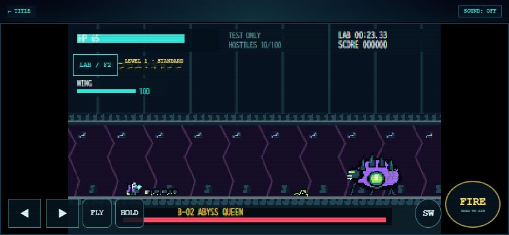

# M02 地下侵攻作戦 — UNDERGROUND INVASION

Version 0.2.2で追加、0.2.3で攻略検証環境を拡張。M01を保持し、M02を開始からB-02撃破・リザルト・報酬保存まで実装する。M03は未実装。

## 0.2.3の検証入口

- TEST LABのSTAGE SELECTから5エリアを指定開始。AREA03は下 `(2220,116)` と上 `(2220,40)` を選択可能。B-02直接開始は `(4800,116)`、女王HP2400・初期行動・専用カメラを復元する。
- 通常ミッション生成後に過去の出現イベントを消化済みとし、開始地点より後のネスト・障害物だけを復元する。AREA01は全配置を保持。新規試行ごとに弾・設置物・巣由来敵・タイマーを再生成し、前の試行を混ぜない。
- 正式4兵科でAREA01からボス入口までワープなしのA地形検証を実施。RANGER/L-03/無敵のC自動QAでは5エリア→女王撃破→QA結果まで確認した。通常報酬経路の既存関連テストも維持。
- 通常条件の人手攻略や6〜10分目標の達成確認とは区別する。武器性能、兵科性能、地形、敵配置・AI、ネスト間隔、女王パターン、通常報酬・進行は変更していない。
- 詳細な開始条件と今回の計測結果は [MISSION_BALANCE.md](MISSION_BALANCE.md)。

## ステージ構造

ワールド幅5,600px、地面y=148、内部画面320×180。ミッション専用の幅をプレイヤー・カメラ・空間グリッド・弾・設置物・死亡演出へ渡す。グローバルWORLDはM01用4,800pxのまま保持する。M01の足場・敵配置・B-01パターンは変更しない。

| AREA | X範囲 | 内容 |
| --- | --- | --- |
| 01 地下入口 | 0〜900 | 地下鉄跡、ワームの少数WAVE、天井敵 |
| 02 配管区画 | 900〜2000 | y=28〜44の衝突する配管、24px段差、SWARM、H-01、固定箱x=1950 |
| 03 増殖区画 | 2000〜3300 | 上下分岐、飛行・天井敵、下ルートのネスト・地上大群、破壊障害物 |
| 04 地下深部 | 3300〜4500 | 合流、固定箱x=3370、28px段差、WAVE/SWARM、ネスト、破壊障害物 |
| 05 中央巣穴 | 4500〜5600 | 進入区間、x>4780で専用アリーナとB-02、撃破演出→リザルト |

基本天井はx=0〜4500でy=-16〜8、ボス区画はy=-24〜0。床・壁・配管はhを持つsolid矩形。ジャンプ・飛行とも側面と下面に衝突する。地下向けの背景と暗い構造物を画面端まで描画する。地形・出現データとネスト／クイーン制御は `js/mission02.js` に分離した。

### 分岐と到達可能性

- 上ルート：x=2000/y=120 → x=2080/y=96 → x=2160〜3160/y=72。24pxずつの段差と16pxの隙間。飛行敵・天井敵を射撃する高所ルート。x=3200/y=104の降り足場から合流する。
- 下ルート：床y=148、上足場の下面y=80との間は68px。プレイヤー高さ32pxで通行可能。H-01(x=2720)、地上SWARM、障害物(x=2520)を配置する。
- 破壊障害物は24×32px・HP48。A-01/S-02でも破壊可能。ジャンプ／飛行でも迂回でき、特殊武器が必須の通路は作らない。x=4140にも同型を配置する。破壊時は参照している地形のactiveをfalseにし、描画だけでなく衝突からも除外する。
- 下ルートの引き返しも実移動で検証済み。ボス戦開始後のみx=4780〜5560へ制限する。

| 兵科 | ジャンプ初速 | 60Hzの上昇量 | 平地ジャンプ飛距離 | M02通過検証 |
| --- | ---: | ---: | ---: | --- |
| RANGER | -220px/s | 約37.22px | 約66.50px | 開始x=64→ボス入口x≥4785、衝突重なりなし |
| SCOUT | -253px/s | 約49.53px | 約144.00px | 同上、ダッシュを使わず通過 |
| GUARDIAN | -209px/s | 約33.50px | 約43.33px | 同上、上ルートも通過 |
| WING | 飛行110px/s | EN制御 | — | 同上、必要な場所のみ上昇。配管下面y=44で停止、EN仕様維持 |

数値だけではなく、実際の地形モデル・14×32px移動用ボディ・60Hz移動処理を使い、全ステップでsolidとの重なりがないことを確認する。戦闘用プレイヤー当たり判定14×27pxは従来どおり。4兵科のHP・速度・防御・ダッシュ・EN（ホバー8/s）は変更していない。

全長・エリア境界は依頼どおり。上ルートの高さは、GUARDIANの実飛距離とジャンプ高度を満たす24px段差で設計した。最短の無敵QA通過は約80秒であり、6〜10分は通常難易度のプレイテストで確認する目標値。時間を合わせるための移動低速化や強制待機は追加しない。

## H-01 スポーンネスト

| 項目 | 設定 |
| --- | --- |
| HP / スコア | 250 / 1500（通常の命中スコアは別） |
| 生成 | 4秒ごと、2→3→4体の循環、E-05 |
| 評価距離 | プレイヤーから600px以内 |
| 所有上限 | nestIdで紐付く生存敵12体まで |
| 共通上限 | ネスト・通常WAVE・召喚を含むLIGHT30 / STANDARD50 / MASSIVE100 |
| 上限時 | 0.4秒後に再評価。未生成分をキューへ積み上げない |
| 破壊 | 即座に生成停止、HPバー消去、既存死亡演出＋専用爆散。爆散自体は周囲へダメージを与えない |

固定位置x=1520/2720/3500/4320。地上へ安全距離72pxを空けて生成する。撃破時の回復／武器箱抽選は既存処理を利用し、撃破・スコアの重複加算を防ぐ。ボス開始時に通常群とネストを終了し、召喚は既存の密度別上限8/12/18体を使う。

## 新敵・B-02

| ID | 名前 | HP | 攻撃 | 挙動 |
| --- | --- | ---: | --- | --- |
| E-05 | トンネルワーム | 32 | 接触9 | 72px/sを基準に既存の個体差・分離。地上重力と地形の掃引衝突、地形内スポーン回避 |
| E-06 | シーリングスピッター | 55 | 酸弾12 | 天井下面に付着、300px以内で照準射撃。AttackDirectorで集中発射を抑制 |
| B-02 | アビス・クイーン | 2400 | 接触25、酸弾15、地上衝撃波15 | 120×96px、専用HPバー・アリーナ・ボスカメラ |

B-02は通常2.5秒間隔で酸弾5方向→ワーム3体召喚→左右の地上衝撃波を循環。HP1200以下では1.8秒間隔、酸弾7方向、衝撃波を高速化し、120px/s・1.1秒の突進を追加する。召喚がカメラ倍率を大きく変えないよう、既存のボス優先フレーミングを利用する。

腹部コアは中心(x+4,y+60)、半径19px。4秒周期のうち2.6秒と突進中に開き、ダメージ1.5倍。見た目の腹部コアに黄色の枠を表示する。弾は外殻の前面で命中するため、入射軌道がコアを通るかも評価する。全兵科の地上射撃・飛行照準で狙える。撃破時は5回の時間差爆発後、1回だけクリア処理を予約する。TITLE復帰・リトライで演出予約を破棄する。

E-05/E-06/H-01/B-02は既存の死亡エンティティ・破片・LEVEL1〜3と連携する。死亡後の敵は攻撃・衝突・再加点対象から除外する。

## 武器・カメラ

- 20武器のID・威力・発射間隔・射程・弾速・上限は変更しない。
- M02のみ旧8武器にも地下地形との掃引衝突を適用。新武器は既存terrainContactを高さ付き矩形とミッション幅へ拡張する。反射は実際に当たった面の法線を使用する。
- ロケット分裂・クラスター・連鎖は既存の世代数／キュー／同時処理数を維持。M02の範囲ダメージは大きなボスの外殻への着弾も拾うよう、対象矩形への最短距離で判定する（威力・半径は変更しない）。
- マイン／タレットは有効な支持面上に設置し、壁の内部なら設置しない。雷雲から対象への線が地形で遮られる場合はダメージを通さない。メテオは上空から降下して天井上面で爆発し、天井をすり抜けない。このため地下では使いどころが限定される。
- DYNAMIC BATTLE CAMERAは0.35〜0.85、敵なし0.50を維持。M02の右端5,600pxを使い、M01の右端や計算式を上書きしない。地形の高さは従来画面内に収め、追加のYカメラ変換は不要とした。HUD・仮想パッドは画面座標のまま。

## 解放・保存・報酬

同じlocalStorageキー `pixel-defense-front-save-v1`、保存形式v2を継続する。

- `cleared`（旧v1）または `clearedMissions` のM01からM02の解放を復元する。GAME OVER・リトライ・TITLE・再読込で巻き戻さない。
- `clearedMissions` / `unlockedMissions` を既存方式で更新。M02クリアでM03の解放記録を作るが、実装フラグfalseのため選択できない。
- 追加の省略可能フィールド `missionStats: {M01:{highScore,bestTime},M02:{highScore,bestTime}}`。旧データのM01クリア時は既存highScore/bestTimeから補完。既存グローバル記録・武器・兵科・設定は保持する。
- M02クリア時の武器箱は未所持から1回抽選。初回の確定未所持1武器はこの箱と同じ報酬であり、二重抽選しない。再クリアも未所持優先、全20所持なら+500と代替表示。道中の箱とは独立。
- LABではstoreSave・completeMissionの既存ガードを維持。地形・敵種・武器・撃破・設定を変えても通常の保存文字列は不変。

## 検証

関連モジュール（地形移動、武器、出現、カメラ、撃破、保存、LAB）に限定してテストした。M02専用テストは `tests/mission02.test.mjs`。

最終結果：関連テスト199件成功・失敗0（12ファイルの198件と、最終描画修正後のM02カメラ端テスト1件）。うちM02専用44件（`node --test tests/mission02.test.mjs`）。共有変更の影響先としてdata / runtime / weapons / invasion / classes / class-movement / camera / impact / destruction / playground / lab-weapon-pickerを実行した。別プロジェクトや無関係な全画面GUI巡回は対象外。構文チェックと `git diff --check` も成功。

| 項目 | 結果 |
| --- | --- |
| 旧M01クリア→M02 OPEN、GAME OVER/リトライ/再読込 | 成功、M03は選択不可 |
| 4兵科の開始〜ボス入口、上下分岐・合流・引き返し | 実移動・全ステップ衝突チェックで成功 |
| WING天井／配管衝突、EN維持 | 成功 |
| LIGHT/STANDARD/MASSIVE、巣由来上限・破壊後停止 | 成功 |
| 初期A-01/S-02による障害物破壊 | 成功 |
| E-05地形衝突、E-06付着・12ダメージ酸弾 | 成功 |
| B-02全攻撃・低HP突進・弱点・カメラ | 成功 |
| 大型外殻への爆発ダメージ、入射軌道の弱点判定 | 成功、重複ダメージなし |
| 全20武器＋地下地形＋敵200体 | 発射・更新・上限・有限座標を検証 |
| 反射法線、メテオ天井着弾、最終800pxの設置物 | 成功 |
| クリア・報酬1回・全所持代替・missionStats | 成功 |
| M01の進行・4兵科・B-01、既存武器性能 | 関連回帰テスト成功 |
| LAB新要素・200体・通常セーブ隔離 | 成功 |
| 新素材 | 10 PNG・57フレーム＋JSON、再生成のSHA256一致、既存PNG変更なし |

全5エリアのエンジン通し検証は、x=64から通常の移動・地形・SpawnDirector・射撃・ボスAIを使い、ワープなしでリザルトと保存まで到達した。唯一のQA補助は被ダメージ無効。RANGER＋L-03でシミュレーション79.90秒、59撃破。これは実ブラウザの手動クリア時間や通常難易度の保証ではない。

### 実ブラウザ

Chromeの独立ポートで `tests/browser-m02.html` の旧形式M01クリア済みフィクスチャから起動（既存セーブがあれば上書きしない）。M02 OPEN・M03 COMING SOON、通常装備画面から開始、移動・ジャンプ・射撃、AREA02到達を確認。LABではワーム200／スピッター30／ネスト1／クイーン1の実生成と専用ボスHPバー・新スプライト・WING操作UIを確認した。コンソールエラーなし。

844×390・780×360・390×844で横はみ出しなし。780×360のFLY/HOLD/SW/FIREは下端348px以内、844×390は378px以内。visualViewport変化後の高さ反映も確認した。

未確認：実ブラウザでM02の最初から最後まで連続クリア、iPhone Safari実機、実際のsafe-area／マルチタッチ、通常難易度の6〜10分・各兵科の難易度比較、実機FPS。LABのボス表示やエンジンQAを「ブラウザ全編クリア」としては扱わない。

## 変更箇所・次の改善候補

- データ／進行：`js/data.js`、新規`js/mission02.js`、`js/game.js`
- 共有処理のM02対応：`js/player.js`、`js/weapons.js`、`js/invasion.js`、`js/camera.js`、`js/impact.js`、`js/playground.js`
- UI／バージョン：`index.html`、`package.json`
- 素材：`tools/generate_assets.py`、上記10 PNG、`assets/underground.json`
- テスト：新規`tests/mission02.test.mjs`、`tests/browser-m02.html`、`tests/helpers/runtime.mjs`、`tests/data.test.mjs`、`tests/runtime.test.mjs`
- ドキュメント：README、GAME_SPEC、ASSET_MANIFEST、DEBUG_PLAYGROUND、本書、確認画像

次はiPhone実機での通しプレイと兵科別難易度・標準武器での攻略時間を優先する。地下向けの武器推奨表示、ネスト生成の予兆、酸弾の見やすさを実機の視認性に基づいて調整する。Arcade031リンクは変更しない。
