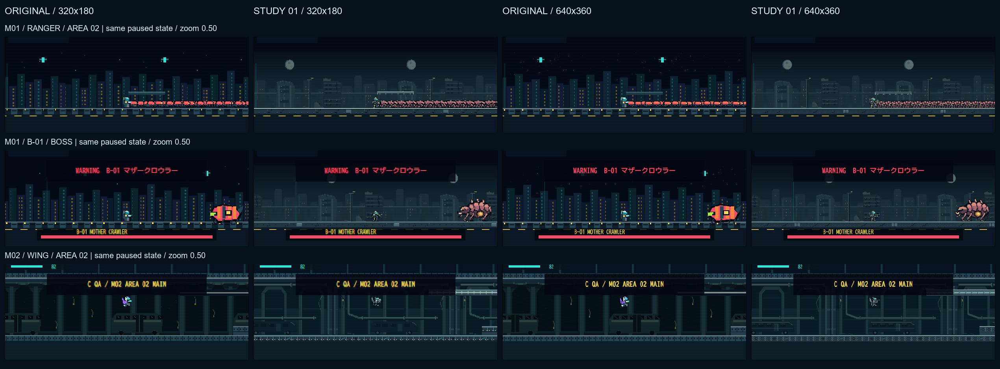

# 0.2.3-A 実ゲーム・アート比較

2026-10-24 JST / ChromeデスクトップのCSS viewport変更で確認。iPhone Safari実機ではない。**3シーン×4条件×3画面サイズ＝36枚を取得**。今回はゲーム本体・武器・当たり判定・セーブ・素材・Arcade031リンクを変更していない。

## 比較画像

4条件の配置は、左上ORIGINAL320／右上STUDY 01 320／左下ORIGINAL640／右下STUDY 01 640。以下は画面全体の2×2一覧。各JPEGは同じフォルダに `シーン-画面サイズ-original|study01-320|640.jpg` で保存している。

| シーン | 844×390 | 780×360 | 390×844 |
| --- | --- | --- | --- |
| M01 RANGER／市街地 | [4条件](m01-ranger-844x390-comparison.png) | [4条件](m01-ranger-780x360-comparison.png) | [4条件](m01-ranger-390x844-comparison.png) |
| M01 B-01ボス戦 | [4条件](m01-boss-844x390-comparison.png) | [4条件](m01-boss-780x360-comparison.png) | [4条件](m01-boss-390x844-comparison.png) |
| M02 WING／地下 | [4条件](m02-wing-844x390-comparison.png) | [4条件](m02-wing-780x360-comparison.png) | [4条件](m02-wing-390x844-comparison.png) |

戦闘部分だけを844×390の画面座標で等倍切り出しした詳細：[RANGER](m01-ranger-detail.png)／[B-01](m01-boss-detail.png)／[WING](m02-wing-detail.png)。[全3シーン一覧](overview.png)は横4条件×縦3シーン。切り出しのほかに拡大・シャープ化・描き直しはしていない。元JPEGにはヘッダー／比較バー／HUDも残っている。

## 固定条件と確認範囲

- 各シーンをTEST LABのSTAGE SELECT／ボス直接開始から準備し、FIXED **0.50倍**、無敵QA（C）、STANDARD密度、A-01装備、撃破LEVEL 1で停止比較した。通常攻略の成功確認ではない。
- 各シーンの12枚で、DOMに公開されているHP・プレイヤーX・敵数・カメラX・倍率・EN・チェックポイントが一致することを確認。Canvas内部寸法も320×180／640×360に一致する。描画品質差をCSS上の拡大率変更と混同していない。
- M01 RANGER：AREA02から実移動してX=1215、HP100、敵45、カメラX=895.50で固定。密集したE-01も写っている。
- M01 B-01：ボス直接開始、X=4160、HP100、敵1、カメラX=3840。ボス戦フラグ・ボスHP表示を確認。撃破／全攻撃フェーズは今回対象外。
- M02 WING：AREA02、実際のFLY→HOLD入力後に停止。X=940、HP65、EN82、敵6、カメラX=620。空中の新旧外観を比較した。
- 横画面のCanvas CSS枠は844時約619×348、780時約565×318。縦画面では390×219.4、上端Y=40。内部640化でも同じCSS枠・同じ可視範囲だった。
- 比較バーは横844で760×92（X42/Y42）、横780で760×92（X10/Y42）、縦390で374×142（X8/Y690）。最終状態では画面内に収まり、全条件の選択ができた。縦はゲームの下段に比較バー、間に大きな空白がある。比較モード中は操作面を隠す仕様であり、通常プレイの余白や操作感まで合格とはしない。
- viewport向き変更直後に、前の高さが残った一時的なCanvas枠も観測した。レイアウト安定後に撮り直し、36枚には含めていない。今回は調査のみで修正していない。
- Chromeの警告／エラーログは取得時0件。スクリーンショットはJPEGであり、圧縮の色にじみを元の素材の問題と断定しない。

記録：[verification.json](verification.json)。画像一覧の再生成は `py -3 reports/art-comparison/build_index.py`。実撮影JPEGを読み取ってPNG一覧を組むだけで、ゲームやアセット生成スクリプトは実行しない。36枚の寸法、原画像不変、主要比較の画素差も検査する。

## 見た目の評価

| 観点 | ORIGINAL | STUDY 01 | 判断・注意 |
| --- | --- | --- | --- |
| RANGER | 明るい青緑・黄色で小さくても見つけやすいが、四角い面の印象が強い | 頭・肩・脚・構えが人型としてまとまり、軍事SFらしい。彩度が低く背景に近い | 形は改善。一方、胸／腕の明度差と外周の抜けを補い、小倍率で埋もれない調整が必要 |
| WING | 紫の翼が背景と強く分離 | 開いたフィン／軽装の形が明確だが、灰青色が地下の配管や支柱に近い | 640で形が残る。色・外周コントラストは旧のほうが目立つ場面がある |
| E-01集団 | 単純な赤い帯へ見えやすい | 脚・甲殻の細かい輪郭が増える | 45体密集ではどちらもつながって見える。新素材だけで個体分離は解決していない |
| B-01 | 明るい楕円・矩形で判別容易だが、甲殻生物としての情報が少ない | 脚・大顎・重なる甲殻・腹部器官が読め、大物感が増す | 新方向が有効。旧より落ち着いた配色のため、暗所での器官／輪郭の見せ方は継続調整 |
| 市街地 | 等間隔ビル・窓の反復が強い | 損傷建物・道路構造・薄い遠景で雰囲気と深度が増す | 背景の主張は抑えられているが、灰色装甲との明度競合に注意 |
| 地下 | 柱と車両の反復、青緑の平面的な面 | アーチ・太い配管・奥の車両などで閉鎖的な施設感が強まる | M01との差が明確。天井／壁等は旧素材なので、全体の統一はまだ途中 |
| 武器の位置 | 従来の一体描画 | A-01を独立表示し、右向きの銃口は大きく外れていない | 取得した右向きの静止／ホバー姿勢では明確な浮き・接地ずれなし。左向き、他武器、全動作は未検証 |

### 320／640の差

- 320では新素材の細い脚、装甲の溝、配管・タイルの線が間引かれ、輪郭が階段状になりやすい。情報量を増やした分だけ、細部が縮小で潰れる箇所もある。
- 640では同じ画面上の大きさ・同じ0.50倍率でも、原画の細い輪郭と背景の継ぎ目が残りやすい。B-01の脚／甲殻、WINGの翼、M02の配管・床で差を確認できる。ORIGINALも文字・輪郭の欠落が減るが、新しい描き込みが増えるわけではない。
- 640でもピクセル表現を維持し、フィルターでぼかしていない。ただし縦の390幅では表示が小さく、横画面ほど差が大きく感じられない。640は低コントラストや敵の重なりそのものを解決しない。
- 比較バーが横画面のHUD上部を覆うため、本一覧は下部戦闘帯の評価を中心とする。HUD全体の視認性や通常の仮想パッド操作性を、この停止画像だけで確認済みとはしない。

## 性能計測：有効FPSは取得できず

既存BENCH 50を4条件で各1回実行。M01の同じベンチ位置、実験STANDARD、A-01自動射撃、LEVEL 1、敵数は各回50〜50体。100／200体は今回未実施。

| 条件 | 中断込みRAF間隔の参考値 | 生CPU平均／最大（更新＋描画合計） | 有効サンプル／中断除外 |
| --- | --- | --- | --- |
| ORIGINAL320 | 約1秒／回 | 6.767／13.5ms | 0／6 |
| STUDY 01 320 | 約1秒／回 | 4.017／5.8ms | 0／6 |
| ORIGINAL640 | 約1秒／回 | 4.183／7.0ms | 0／6 |
| STUDY 01 640 | 約1秒／回 | 3.217／3.7ms | 0／6 |

**上記は通常プレイのFPS比較・640の性能優位を示さない。** 接続セッションでは約1秒間隔のRAFとなり、既存250ms閾値を超えた6区間すべてが除外された。正式なFPS・p95・更新CPU／描画CPUはnull（計測不足）。生CPUは少数の中断後更新で、固定ステップの追い付き処理を含み、GPU時間でもない。条件ごと1回・6サンプルしかなく、ウォームアップや測定順も分離できない。

RANGER場面の履歴には約59.9fpsという値も出たが、わずか4有効サンプル／中断42回だったため採用していない。無敵QAの経過時間も壁時計と大きく異なり、通常の攻略時間には使わない。

[計測不足のUI表示](performance-insufficient-samples.jpg)。通常前景タブ／iPhone実機で十分な有効サンプルを採り直すまでは、640の性能負荷は未確認とする。640は画素数4倍なので負荷増加の可能性がある、という技術上の懸念に留める。

## 正式採用前の優先課題

1. RANGERの顔／胸／銃の向きとWINGの翼を、小倍率でも背景から分離する明度・外周へ調整する。大量の細線追加だけで解決しない。
2. 0.35／0.85、左向き、ジャンプ・被弾・死亡、全武器を確認する。暫定2ポーズと旧アニメーションの外観差を解消する制作計画が必要。
3. 密集敵の脚・胴体が帯になる問題を、前後の描き分けやシルエット簡略化も含めて検討する。今回はAIや分離処理を変えていない。
4. 横画面のHUDを覆わない比較UI、縦画面の大きな空白、向き変更直後の一時的な高さ不整合を今後の表示改善候補とする。
5. 実機で50／100／200体、演出LEVEL1〜3、発熱・電池・p95／描画CPUを測定してから640採否を決める。今回の数値で60fps達成や端末性能を保証しない。

未確認：iPhone Safari実機・safe-areaの実ノッチ／アドレスバー変化、滑らかな実時間アニメーション、通常難易度の全編攻略、全敵・全武器・全カメラ倍率、正常な前景FPS／GPU／省電力性。新素材は引き続き試用扱い。
