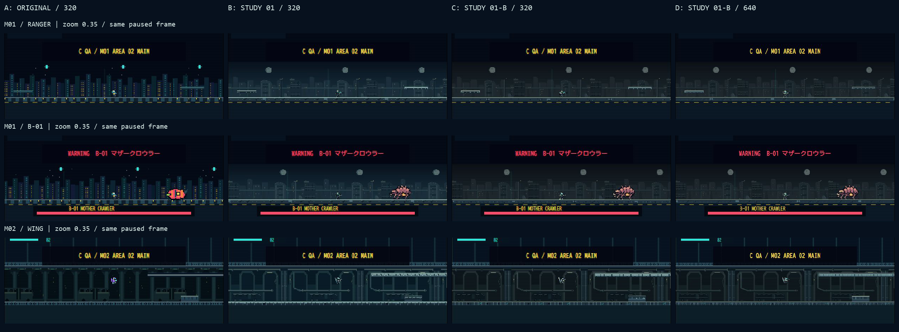

# 0.2.3-B / STUDY 01-B 比較試用

2026-10-24 JST。新旧アートの実ゲーム比較と、生成・切替・状態保護の検証結果。**正式採用・全素材差し替えではない。** ゲームロジック・武器20種・兵科4種の性能、AI、ステージ、カメラ、セーブ、Arcade031リンクは維持。実機iPhoneではなくChromeのCSS viewportで確認した。

## 1. 元の36枚からの課題と方針

元の [0.2.3-Aレポート](../README.md)、36枚の比較、総覧・RANGER/WING拡大を確認。RANGERの胸／腕、WINGの翼が灰青背景へ沈み、E-01が密集時に帯状になり、B-01の顔／脚が小倍率で弱いことを優先した。新しい世界観への変更や、細線の追加だけを目的にしない。

- 軍事SFの装甲兵士と分節甲殻生物という方向を維持。大きい明暗と局所アクセントを整理する。
- `assets/art-refresh/study-01-b/` に別出力。元Study 01と本番素材は変更しない。
- 全身発光／一色の太い縁／背景ぼかしは追加しない。比較用ハローUIも今回は不要として実装しない。

## 2. 比較画像一覧

配置は **左上A=ORIGINAL320、右上B=STUDY 01 320、左下C=STUDY 01-B 320、右下D=STUDY 01-B 640**。各リンクに4条件の全画面を掲載。原JPEGは同じフォルダの `scene-z050|035-WxH-A|B|C|D.jpg`。拡大・補正していない実撮影84枚を残している。

| シーン | 844×390 | 780×360 | 390×844 |
| --- | --- | --- | --- |
| M01 RANGER／市街地 | [0.50](m01-ranger-z050-844x390-comparison.png) / [0.35](m01-ranger-z035-844x390-comparison.png) | [0.50](m01-ranger-z050-780x360-comparison.png) / [0.35](m01-ranger-z035-780x360-comparison.png) | [0.50](m01-ranger-z050-390x844-comparison.png) / [0.35](m01-ranger-z035-390x844-comparison.png) |
| M01 B-01／ボス戦 | [0.50](m01-boss-z050-844x390-comparison.png) / [0.35](m01-boss-z035-844x390-comparison.png) | [0.50](m01-boss-z050-780x360-comparison.png) / [0.35](m01-boss-z035-780x360-comparison.png) | [0.50](m01-boss-z050-390x844-comparison.png) / [0.35](m01-boss-z035-390x844-comparison.png) |
| M02 WING／地下 | [0.50](m02-wing-z050-844x390-comparison.png) / [0.35](m02-wing-z035-844x390-comparison.png) | [0.50](m02-wing-z050-780x360-comparison.png) / [0.35](m02-wing-z035-780x360-comparison.png) | [0.50](m02-wing-z050-390x844-comparison.png) / [0.35](m02-wing-z035-390x844-comparison.png) |

- 戦闘帯の総覧：[0.50倍](overview-z050.png)／[0.35倍](overview-z035.png)。横A/B/C/D、縦3シーン。各シーンの `*-detail.png` は844画面の戦闘帯を等倍切り出し。
- 背景に埋もれる箇所の4倍nearest拡大：RANGER [0.50](m01-ranger-z050-844x390-focus.png)／[0.35](m01-ranger-z035-844x390-focus.png)、WING [0.50](m02-wing-z050-844x390-focus.png)／[0.35](m02-wing-z035-844x390-focus.png)。拡大は検査用であり、新しい細部を補っていない。
- 50体密集：全画面 [0.50](m01-swarm50-z050-844x390-comparison.png)／[0.35](m01-swarm50-z035-844x390-comparison.png)、戦闘帯 [0.50](m01-swarm50-z050-844x390-detail.png)／[0.35](m01-swarm50-z035-844x390-detail.png)。E-01・密集・実在50体、2倍率×4条件の8枚。
- E-03補足：10体・844×390・0.50倍の [全画面](m01-e03-z050-844x390-comparison.png)／[戦闘帯](m01-e03-z050-844x390-detail.png)、4条件を取得。0.35倍のE-03実画面は今回は未確認。
- [素材帳](asset-catalogue.png) は原画／代表ポーズの確認用。ゲーム画面の証拠とは区別する。



## 3. 色・明度・形の変更

| 対象 | 元Study 01からの変更 | 結果と残る課題 |
| --- | --- | --- |
| RANGER | ヘルメット上面と肩に灰象牙、胸を灰オリーブ、腕境界と腹を暗く、靴上端を明るく | 320でも顔／肩／足元が残りやすい。0.35では腕と武器の境界が数pixelに集約され、細部はまだ潰れる |
| WING | 翼の短い外縁と付け根、胸／前腕を強調。翼の内面・関節を暗く残す | 灰青の配管から翼と人体が分かれやすい。旧ORIGINALの高彩度紫ほど強い色差ではなく、背景との位置次第でまだ沈む |
| E-01 | 淡い頭部、暗い腹面、上部甲殻のまとまり、明るい脚根。3つの自然な甲殻配色 | 前列の頭と胴の段差が読みやすい。完全に重なった奥の個体や50体すべての識別はできない |
| E-03 | 暖色の翼縁、頭部の明色、胴との暗い境界。既存faceで中心反転 | 翼膜と体が分かれ、方向が読みやすい。10体重複の奥の羽根は依然隠れる |
| B-01 | 顔の上面／眼／大顎、膝・接地端と器官核を強調 | 頭部・顔・脚の位置が前案より拾いやすい。0.35では膝の細かい形は消える。B-01に弱点倍率はなく、新しい弱点判定は追加していない |
| M01/M02背景 | 遠景の彩度を抑え、戦闘帯の中景を中心に明度圧縮。遠／中／近の差は維持 | 兜・翼・甲殻の明色が背景から出やすい。窓・配管の雰囲気と材質は残す。未対応天井／巣穴は旧表示 |
| 対応地形 | 上端の灰緑リップ、従来の暗い側面 | 歩ける面を追いやすい。衝突面や地形配置は一切変更していない |

装甲の代表色 `#8b9b87`、選択的エッジ `#d2d9b8`、布 `#56624b`、関節 `#23323c`。E-01頭部 `#e3bd8c`／腹面 `#3d2834`。背景はRGBを直接ぼかさず、深度ごとに彩度係数0.58／0.72／0.80、戦闘帯の明度係数0.88／0.80／0.90（その他0.93／0.90／0.94）で整数pixelの色へ変換。どの面も一律に明るくする調整ではない。

## 4. 320／640と密集の評価

- **320の改善**：少ない画素でも顔・肩・翼根・敵頭部の明るい塊が残る。細部追加より、必要な部位の明暗差が効いている。ただし0.35では兵士の24×32world枠が約8.4×11.2 Canvas pxしかなく、顔や指の情報は復元できない。
- **640の改善**：同じCSSサイズ・同じワールド倍率で、脚・装甲・翼・配管の欠落が減り、D条件で最も細部を確認しやすい。worldサイズや判定が大きくなった結果ではない。
- **改善していない部分**：50体が同じground線の近いXへ重なると、暗い腹面と脚が帯になる。3配色と頭の明色で前面の区切りは増えたが、全個体のカウントや完全重複の解消は不可能。素材だけで解決済みとはしない。
- 既存の描画は敵配列順。今回はソート／配列コピー、描画Yずらし、当たり判定、移動・分離AI、カメラ倍率計算を変更していない。配色はuid%3による固定選択でちらつかせない。
- 横画面では比較バーがHUD上部を覆い、縦では停止中の操作面が隠れて大きな空白がある。これは既存比較モードの制約で、通常プレイのUI改善まで今回完了したわけではない。
- JPEG圧縮と既存のスキャンライン表示も細部の見え方に影響する。4倍拡大をそのまま原画の色／AAの有無の判断に使わない。

## 5. ポーズ・武器・フォールバック

RANGER/WINGは12列の既存フレーム表に合わせた代表サンプル。歩行の接地／交差、膝を曲げた跳躍、落下、射撃の肩、被弾の腕、横倒し死亡を描き分け、WINGの飛行／ホバーも同系統に統一した。互換用の未使用列は兵科能力の追加を意味しない。Bの敵は移動2／攻撃／死亡を用意し、既存の死亡回転・残像でもBの死亡画像を使う。

2枚の静止画を無理に全状態へ割り当てていない。一方、全状態を人手で動かして完成アニメーションとして評価したわけでもない。素材帳・描画呼び出しテスト・実移動更新での状態一致を確認し、滑らかな実時間での最終調整は残す。

5武器A-01/R-04/H-08/T-06/D-19は元Studyの4 PNG（アイコン・装備・弾・FX）を共用し、再制作していない。銃口／接地アンカー・サイズを維持し、死亡ポーズには装備を表示しない。右向き静止／飛行のA-01は実画像で位置を確認。左右×5武器の発射点・発射間隔は自動テストで確認し、全武器の全ポーズの外観までは未確認。

ORIGINAL／STUDY 01も選択可能。B画像の欠損／寸法不一致時はその画像を元Studyへ代替し、元も不足なら全体をORIGINALへ戻す。元画像に戻った部位は元の2ポーズ制約へ戻る。通常ゲームの初期表示はORIGINAL、640はLAB限定、設定はメモリのみ。

## 6. 検証条件・関連テスト

主72枚は各シーン・倍率で停止。HP／X／敵数／カメラX／EN／チェックポイントを比較し、条件間・3画面サイズ間で一致を検査した。敵全座標・武器・スコア・進行・saveの不変性はゲーム更新を実行するVMテストでも照合。ブラウザから非公開ゲーム状態を直接書き換えるQAワープは使っていない。

| 場面 | 開始・操作 | 固定値 |
| --- | --- | --- |
| RANGER | M01 AREA02指定開始 | X940、HP100、敵0、カメラX620／482.86 |
| B-01 | M01ボス直接開始 | X4160、HP100、敵1、ボス戦ON、カメラX3840／3702.86 |
| WING | M02 AREA02→実際のFLY/HOLD | X940、HP65、EN82、敵6、カメラX620／482.86 |
| 50体密集 | ENCOUNTERで50体、短時間再生後に停止 | X1000、HP100、敵50、カメラX680／542.86 |
| E-03 | ENCOUNTERで10体、短時間再生後に停止 | X1000、HP100、敵10、カメラX680、0.50倍のみ |

再配置直後は既存の公開デバッグ値が未更新だったため、追加12枚は短く再生・停止して取り直した。未更新値をもって状態一致と認定していない。生成UIやゲームロジックを修正せず、最終84枚のみ一覧化した。追加場面のLAB共通上限100は既存仕様であり、通常ゲームの30/50/100モード変更ではない。

```powershell
node --test tests/readability.test.mjs tests/art-preview.test.mjs tests/runtime.test.mjs tests/data.test.mjs
py -3 -m unittest discover -s tests -p "test_art*.py" -v
py -3 reports/art-comparison/study-01-b/build_index.py
```

- Node56件成功：新規14件を含む3スタイル／競合キャンセル／欠損代替、全game状態・保存バイト＋保存オブジェクト不変、発射点、320/640×0.35/0.50、代表ポーズ、死亡・残像、M02地形、RANGER歩行／WING飛行の実更新一致、関連する既存入力・カメラ・セーブ保護。
- Python15件成功：新規6件＋既存素材パイプライン9件。Bの2回生成バイト一致、全既存assetsのハッシュ不変、15 PNGの実寸・SHA256・二値透過、各兵科12画像の差、敵4ポーズ、フラグ混在拒否。ゲーム素材は固定形状・色変換のみでネットワークなし。
- 撮影後の寸法・条件・画面内への収まり、原JPEG不変、主要条件の画像差を確認。全画面コンタクト21枚、詳細9枚、キャラ拡大4枚、倍率別総覧2枚、素材帳1枚＝37 PNGを生成。Chromeの警告／エラー取得0件。
- 通常Saveは自動テストで確認。ブラウザで全編攻略・報酬獲得を行ったわけではない。無関係な全件回帰テストは実行していない。

記録：[verification.json](verification.json)。コンタクト生成コードは本フォルダの `build_index.py`。原JPEGを並べるだけで、ゲームアセットを生成・加工しない。素材帳だけは元PNGを読み取り、実画面と明確に区別する。

## 7. 性能：測定不能

既存BENCH 50をStudy 01-Bの320／640で各1回実行。いずれも敵50体維持、LEVEL1、有効サンプル0／中断6。約1秒間隔のRAFが既存250ms閾値をすべて超え、正式なFPS・p95・更新CPU／描画CPUはnullだった。

生の更新＋描画CPU平均は320で5.333ms、640で4.367msだったが、各6区間のみで中断後の追い付き更新を含む。**正常フレームの描画時間ではなく、640が速い根拠に使わない。** 中断込み約1fpsも通常性能の値ではない。性能計測のための大規模改修や閾値緩和は行っていない。前景実機で有効区間を十分に取得して再比較する必要がある。

## 8. 正式採用への判断材料と残課題

- 比較試用としては、前案の世界観・陰影を保ちながら重要部位の明度差が増えており、次の調整ベースにできる。正式な全差し替えや640採用の決定はしない。
- 0.35倍320では顔／腕／指／脚の細部が足りない。最小表示用に重要部位をさらに簡潔な面へ整理する余地がある。全身の縁や発光を太くする解決は避ける。
- 50体の完全な重なりを素材だけでは解決できない。今後の描画前後関係や戦闘情報の出し方の検討が必要だが、移動・当たり判定を見た目に合わせて変える判断とは分ける。
- 代表ポーズは揃えたが、左右向き・武器との重なり・飛行／着地／被弾遷移を正常速度で確認し、必要なら中割りを追加する。未制作SCOUT/GUARDIAN、他の敵・B-02・壁／天井／巣穴は次フェーズの素材対象で、今回制作していない。
- iPhone Safari実機、safe-area／ブラウザバー、指による操作感、正常な前景FPS・GPU・発熱、100/200体の性能、全武器・全アニメーション、0.85倍実画面は未確認。M03は未制作。

## 9. 作成・変更ファイル

- 実装：`index.html`、`js/art-preview.js`、`js/game.js`、`js/data.js`（Versionのみ）、`package.json`（Versionのみ）。
- 生成：`tools/generate_assets.py`（専用フラグ）、新規 `tools/art_readability.py`、`assets/art-refresh/study-01-b/` 内15 PNG＋`manifest.json`。
- テスト：新規 `tests/readability.test.mjs`／`tests/test_art_readability.py`、`tests/test_art_direction.py`（旧寸法表の検査対象を明示）、`tests/data.test.mjs`（Version期待値）。
- 文書：`README.md`、`docs/ART_DIRECTION.md`、`docs/ASSET_MANIFEST.md`。
- QA：本フォルダの84 JPEG・37 PNG・本書・`verification.json`・`build_index.py`。
- `js/player.js`／`js/weapons.js`／敵AI／ミッションデータ／カメラ／通常セーブ処理／旧Study生成コード・画像／Arcade031リンクは変更していない。
