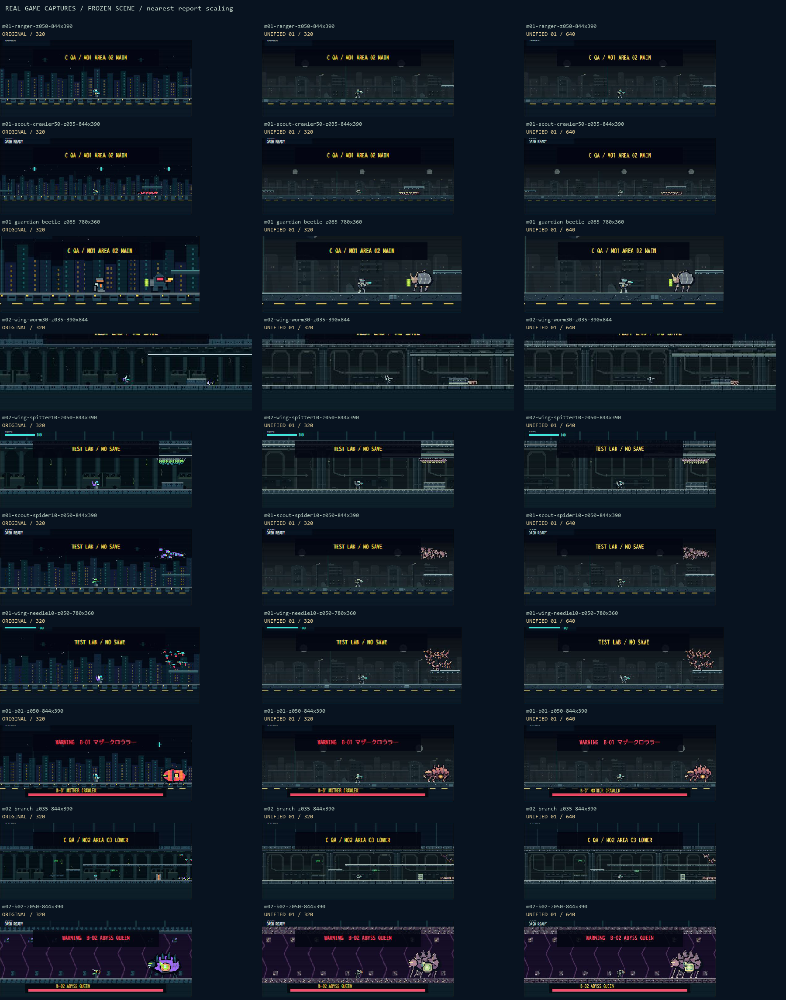

# UNIFIED 01 / 0.2.3-C — 実ゲーム比較

2026-10-24、ローカルChromeで確認。通常アートはORIGINAL、640はLAB限定。正式採用やM03制作ではない。

## 取得範囲

**31枚の実シーンJPEG＋10比較シート**。A=ORIGINAL320、B=Study 01-B320（最初の場面のみ）、C=UNIFIED320、D=UNIFIED640。各グループの停止状態／画面サイズ／カメラは同一。全組合せの撮影ではない。

| 場面 | 画面 | 倍率 | 条件／比較画像 |
| --- | --- | --- | --- |
| M01 RANGER・市街地 | 844×390 | 0.50 | [A/B/C/D](m01-ranger-z050-844x390-comparison.png) |
| M01 SCOUT・E-01密集50体 | 844×390 | 0.35 | [A/C/D](m01-scout-crawler50-z035-844x390-comparison.png) |
| M01 GUARDIAN・E-04 | 780×360 | 0.85 | [A/C/D](m01-guardian-beetle-z085-780x360-comparison.png) |
| M02 WING・E-05 30体／飛行後 | 390×844 | 0.35 | [A/C/D](m02-wing-worm30-z035-390x844-comparison.png) |
| M02 WING・E-06 10体 | 844×390 | 0.50 | [A/C/D](m02-wing-spitter10-z050-844x390-comparison.png) |
| M01 SCOUT・E-02 10体 | 844×390 | 0.50 | [A/C/D](m01-scout-spider10-z050-844x390-comparison.png) |
| M01 WING・E-03 10体 | 780×360 | 0.50 | [A/C/D](m01-wing-needle10-z050-780x360-comparison.png) |
| M01 RANGER・B-01 | 844×390 | 0.50 | [A/C/D](m01-b01-z050-844x390-comparison.png) |
| M02 RANGER・地下分岐／破壊障害物 | 844×390 | 0.35 | [A/C/D](m02-branch-z035-844x390-comparison.png) |
| M02 SCOUT・B-02 | 844×390 | 0.50 | [A/C/D](m02-b02-z050-844x390-comparison.png) |

[HTMLギャラリー](index.html)／[戦闘帯総覧](overview.png)／[素材アニメ帳](animation-atlas.png)／[20武器素材帳](weapon-atlas.png)。最後の2枚は原画から作った素材帳で、ゲーム表示の証拠と区別する。



## 状態の固定と証拠

- 既存のチェックポイント・ENCOUNTERをUIで使用。比較中は「同じ場面で比較」で停止し、アートと解像度のみ切り替えた。非公開ゲーム状態の読み書きや座標ワープは使用していない。
- 公開DOMのX／HP／兵科／EN／敵数／カメラX／倍率／チェックポイント／ボスフラグをグループ内で照合。Canvasと比較画面がviewport内にあることも検査。全ゲーム状態・saveの不変性は別途VMテストで検証。
- GUARDIANは実移動でX1086まで進めてE-04を映した。B-02初回のX4800構図はボスが見切れていたため不採用とし、SCOUTで実際に右移動してX5052へ進み、最終3枚を取り直した。ボスは右側に全身が見える。
- WINGの飛行・ホバーは実入力後、EN92.5で固定。31枚は静止比較のため、滑らかな実時間アニメーションの完成保証ではない。
- `verification.json`：31画像の状態・寸法、20武器選択／試射、武器リスト3画面、BENCH6条件、警告／エラー0件を保存。画像の状態不一致・不正解像度・画面外・生JPEG変更は`build_index.py`で失敗させる。

## 見た目の評価

| 項目 | 改善／確認できたこと | 残る課題 |
| --- | --- | --- |
| 兵科 | RANGERの標準装甲、SCOUTの軽装、GUARDIANの幅広い肩、WINGの翼が異なる外形。明るい装甲を暗い背景から分離 | 0.35・320では肩／脚が数pxになり、細部は落ちる |
| 敵 | E-02の放射脚、E-04の硬い背、E-05の低い体節、E-06の吊り袋を、B基準の甲殻／骨色で統一 | 密集奥の脚と腹は帯になる。50体すべてを数えられる状態にはならない |
| ボス | B-01の顎・器官・脚、B-02の冠・重なった装甲・腹部核が同一作品の形に。核の開閉と既存枠の位置を維持 | 低倍率の小関節と、弱点閉口／被弾の実時間視認性は追加確認が必要 |
| 武器 | 20アイコン、装備、弾、FXを制作。単筒／分裂筒、単電極／三電極、円盤／三脚などを区別。全20件をUI選択・試射 | 全武器FXの各瞬間を静止比較していない。原画の違いが実戦で十分伝わるかの仕上げは残る |
| 背景／地形 | 市街地と地下の奥行き・材質差。M02の壁／天井／岩／巣壁／障害物まで同パレットに接続、衝突は不変 | B-02の洞窟床・天井は明るい小エッジが多く、320で粒状に見える。正式採用前に頻度を整理したい |
| 320 | 既存の可視範囲・速度・HUDサイズで比較可能。大きい色面とシルエットは残る | 0.35兵士は約8.4×11.2内部pixel。細脚／銃の小部品の欠落は解決していない |
| 640 | 同じCSS寸法・world範囲で装甲／脚／翼や地形の欠落が減る。HUD・照準座標は維持 | 性能優位／実機60fpsは判断できない。正式採用ではない |
| 遠景版 | 0.40入／0.44出のヒステリシスと同サイズ色面簡略化。境界の細かい往復で切替を固定 | 完全重複の解消ではない。素材ごとの最適な色面は更なる実機確認が必要 |

JPEG圧縮と既存スキャンラインも見た目に影響する。素材帳は二値alpha／AAなしのPNG、実ゲームJPEGの補間・圧縮とは区別する。比較バーのHUD重なり、縦停止時の下部空白は今回の既存比較UI制約であり、本編操作レイアウトは変更していない。

## 武器選択・試射・UI

全20 IDを共有データから取得し、SLOT1へ順次選択、表示ラベルの一致を記録。各武器を「1回試射」で実行し、プレイ→LAB復帰まで確認。最後は敵50体から14体へ減少しており、戦闘更新も動作している。全武器の全弾道・全瞬間を撮影して確認済みとは扱わない。

| 画面 | M-20選択と内部スクロール | 一覧下端 |
| --- | --- | ---: |
| 844×390 | [SLOT1／20アイコン](weapon-picker-844x390.jpg)、scrollTop843、一覧高197 | 375px |
| 780×360 | [SLOT2／名前検索後、全一覧で最終項目](weapon-picker-780x360.jpg)、scrollTop873、高167 | 345px |
| 390×844 | [SLOT1／最終項目](weapon-picker-390x844.jpg)、scrollTop619、高421 | 721px |

SLOT2の選択も独立してM-20へ反映。旧武器リストの検索・Esc・Tab・入力遮断・通常save隔離は関連テストで確認。今回の通常装備画面はORIGINALを維持する。

## パフォーマンス

既存BENCH6秒、自動アサルト・継続補充、UNIFIED／LEVEL1。カメラAUTO・既存STANDARD実験性能。各密度のmin/max実在敵数は50/50、100/100、200/200。200はLAB限定。

| 敵 | 描画 | 有効区間 | 中断除外 | 有効FPS | 更新／描画CPU |
| --- | --- | ---: | ---: | --- | --- |
| 50 | 320 | 0 | 6 | 測定不能 | 測定不能 |
| 100 | 320 | 0 | 6 | 測定不能 | 測定不能 |
| 200 | 320 | 0 | 6 | 測定不能 | 測定不能 |
| 50 | 640 | 0 | 6 | 測定不能 | 測定不能 |
| 100 | 640 | 0 | 6 | 測定不能 | 測定不能 |
| 200 | 640 | 0 | 6 | 測定不能 | 測定不能 |

BENCH中のRAF間隔は約1001msで、既存250msの中断判定を全て超えた。rawの約0.999fpsやCPU合算値は中断・追いつき更新込みなので、正常FPS／描画時間／GPU負荷として使わない。UI操作直後に得た2〜3件の約30fps断片も正常プレイの性能保証に流用しない。320と640の優劣は判断不能。クラッシュなしと性能達成は別。

[200体320](bench200-320.jpg)／[200体640](bench200-640.jpg)を保存。描画はアトラス共用、カリング・死亡／FX上限・軌跡上限を維持。41画像は遅延読込・キャッシュ、背景レイヤー6枚はランタイムで読まない。RGBA寸法単純合計は約15.7 MiB。実機のメモリ/GPUコピーは未測定。

## 関連テスト

```powershell
node --test tests/unification.test.mjs tests/readability.test.mjs tests/art-preview.test.mjs tests/runtime.test.mjs tests/data.test.mjs
node --test tests/lab-weapon-picker.test.mjs tests/weapons.test.mjs
py -3 -m unittest discover -s tests -p "test_art*.py" -v
py -3 reports/art-comparison/unified-01/build_index.py
```

- Node **75＋46＝121件成功**。新規統合19件：41画像対応、4スタイル・競合・段階代替・全欠損、4兵科×20武器×左右、全敵／ボス、弱点、遠景ヒステリシス、プレイ／停止状態・save不変、2解像度×3倍率、200体・実更新一致、地下タイル。他は変更した描画呼出先・ピッカー・既存弾挙動の関連保護。
- Python **21件成功**（統合6＋旧素材15）。再生成バイト一致、48 PNG／740セル、寸法／二値alpha／SHA／フレームID、4外形・接地・各状態、B-02核、元パス対応、フラグ混在拒否、全既存素材不変。
- 画像生成後も生JPEGのハッシュ不変・全31枚の停止状態／解像度／画面内をビルダーで再検証。無関係な全件回帰や全面GUI試験は実施していない。

## 未確認・正式採用前

1. iPhone Safari実機の色・タッチ・GPU・メモリ・連続FPS。今回の画面サイズはChromeのCSS viewportであり、実機確認ではない。
2. 通常無敵なしの全編攻略、ボス撃破までの全パターン。本作業は描画比較QAであり、攻略成功ではない。
3. 全アニメーション・装備の全左右ポーズ、全20武器の全FXを滑らかな実時間でレビュー。素材帳／呼出テストと実動作の完成度を混同しない。
4. 洞窟タイルの明るいエッジ密度、完全密集の個体境界、遠景版の形状、HUDを覆う比較バーの整理。
5. 全対象のランタイム素材は制作・接続済み。未使用互換列、未配置のM01装飾候補、対象外の文字／バー／アイテム／小粒子は明記して残す。通常アートへ一括採用していない。

作成／変更ファイル一覧は[統合仕様](../../../docs/ART_UNIFICATION.md)とプロジェクトREADME。実装本体は`js/art-preview.js`、描画接続`js/game.js`／`js/weapons.js`、LAB選択`index.html`／`styles.css`、生成`tools/art_unification.py`／`generate_assets.py`、専用テスト2ファイル、バージョン情報`js/data.js`／`package.json`／関連期待値。素材と本レポート一式を別フォルダで追加した。
