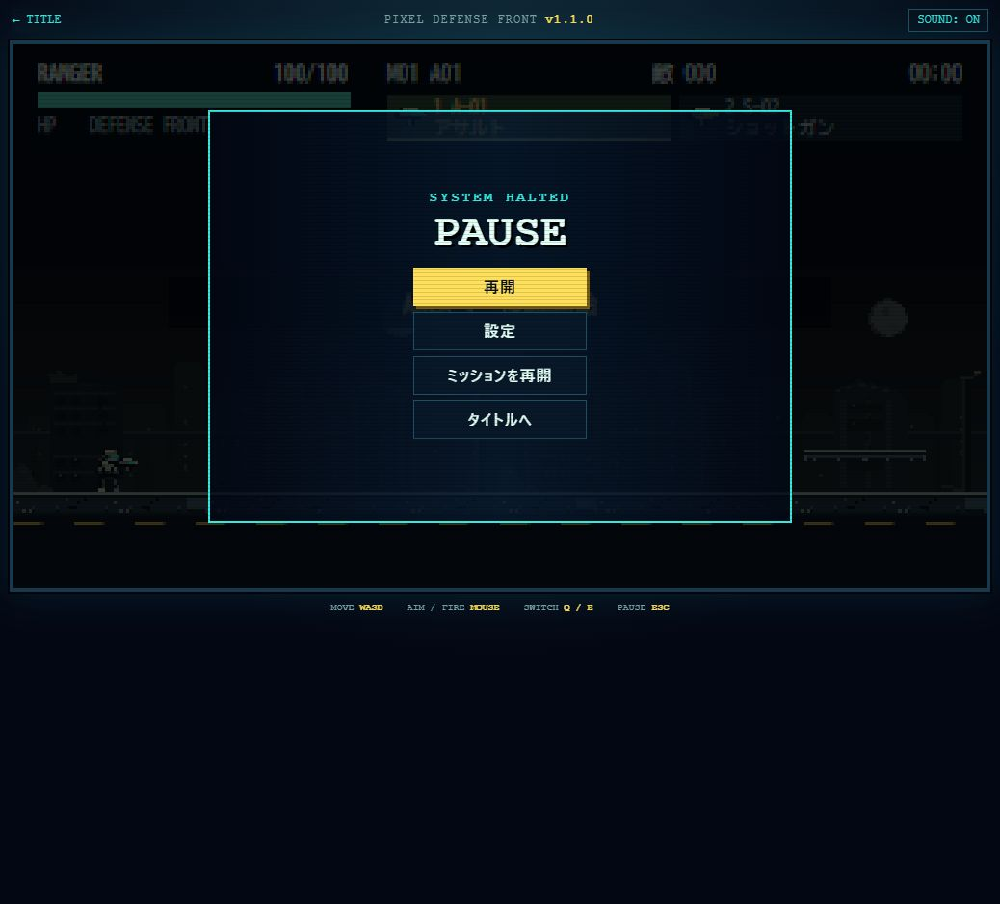

# 1.1.0 最小ブラウザ確認

2026-11-01（JST）、Chrome、Computer Use。ローカル専用HTTP `127.0.0.1:8911` の新規オリジンで実行し、普段のゲームURLの保存データを読み書きしていない。画面サイズ比較・FPS測定・全画面GUI巡回は行わない。

| 項目 | 今回の証拠 |
| --- | --- |
| 起動 | 通常URLでv1.1.0タイトル、開発UI非表示 |
| 司令部 | 4タブ、CAMPAIGN 0/8、M01 OPEN、M02〜M08 LOCKED |
| M01出撃 | 出撃準備→4兵科／20武器の装備画面→初期装備で出撃、M01 AREA1 RANGER HP100/100を確認 |
| ポーズ | EscでPAUSE、再開・設定・リトライ・TITLEの操作導線を確認 |
| リロード | 意図的再読込でタイトルへ戻り、CONTINUEで司令部0/8を復元。途中位置復元は仕様外 |
| コンソール | 確認中のJavaScriptエラー0件。favicon.ico未配置によるHTTP404はゲーム素材の読込障害ではない |
| M08解放済み通常URL／リザルト／エンディング／再出撃 | 今回の実ブラウザでは未実施。統合Node VMの正式連続進行・実射撃・保存・再初期化で代替検証。1.0.0の形態指定／結末UI確認は[旧レポート](../final-defense/README.md)にあり、今回再実施したとは扱わない |

追加のアート変更やUI最終調整は実施していない。iPhone Safari実機・無敵なし人手全編・タップ位置・正常前景FPSは1.2.0へ引継ぐ。確認終了時に所有タブと専用HTTPサーバーを閉じた。
