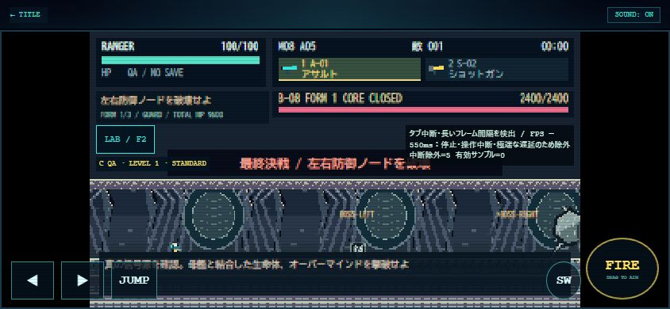

# FINAL DEFENSE / 1.0.0 検証レポート

確認日：2026-11-01。ローカル実装のみ。公開・commit・push・デプロイなし。Sitesのローカル実装手順とComputer Useによる代表ブラウザ操作を利用した。細かな全画面UI磨き込み・最終アート品質仕上げは次段階。

## テスト

```powershell
node --test --test-reporter=spec --test-reporter-destination=reports/final-defense/related-tests.txt tests/final-defense.test.mjs tests/mothership.test.mjs tests/campaign.test.mjs tests/challenges.test.mjs tests/camera.test.mjs tests/invasion.test.mjs
py -3 tests/test_final_defense_assets.py
node --test --test-name-pattern='legacy M05' tests/living-colossus.test.mjs
```

- 関連Nodeテスト **175/175成功**（M08固有49件を含む）、0失敗・0スキップ。[実行ログ](related-tests.txt)。約18.4秒のテストランナー時間はゲームのFPSではない。
- Pillow素材テスト1件成功。別一時ディレクトリで2回再生成し、30 PNG／185セルの再現性・寸法・透過・アンカー・出力隔離を検証。
- `node --check`（game／mission08／final-art／campaign-ending）と対象プロジェクトの`git diff --check`も成功。GitのLF→CRLF予告はあるが空白エラーなし。
- 旧M05記録からM06解放の限定テスト1件成功。無関係な全件回帰テストは実施していない。
- M07全5AREA・全4兵科・ボス・通常補助付き保存を再確認。M01〜M06は限定的な開始／ボス保護テストを含む。旧PNG253件の実行時HEADとのハッシュ一致、既存地形／AI／兵科／実績マスタ／Arcade親index不変のガード成功。253はM08追加分も既に追跡済みの作業ツリーに対する数値であり、0.9.0時点の枚数を意味しない。

### M08の重点項目

M07旧クリア記録からのM08解放、全AREAの反復初期化、3制御系統の全6停止順、形態1〜3の反復開始、全ノード状態、盾、余剰ダメージ／重複遷移防止、旧弾／攻撃／設置消去、最終撃破一度、全6シーン・スキップ・再視聴・リロード・一度だけ報酬・8/8・LAB隔離を確認。

E-22のE-19非重複指揮／解除、E-23の予兆と休止、E-24の有限ガード、予兆と実判定一致、4兵科の反応遅延.25秒付き実移動回避、SCOUTの隔壁衝突、WINGの天井／EN切れ／着地を確認。全20武器×4兵科×全3形態で発射と更新経路を実行。通常30/50/100とLAB200の上限・攻撃／FXの有限性を検証。200体の正常FPSを意味しない。

| 試験 | RANGER | SCOUT | GUARDIAN | WING |
| --- | ---: | ---: | ---: | ---: |
| A：敵攻撃なし、実移動＋必須制御射撃 | 87.55秒 | 49.13秒 | 127.95秒 | 75.62秒 |
| C：無敵、敵攻撃あり、全形態撃破まで通し | 308秒 | 254秒 | 350秒 | 278秒 |

どちらも開始後ワープなし。通常エンジン＋無敵補助の通し試験も296秒で開始→全形態→崩壊→エンディング全6シーン→リザルト→報酬保存まで成功。**A/Cや無敵補助を通常条件の攻略成功（D）とは扱わない。**

### 初期武器の実射撃（個別ボスQA）

| 兵科 | A-01 形態1/2/3の秒数 | S-02 形態1/2/3の秒数 |
| --- | --- | --- |
| RANGER | 61.27 / 53.28 / 85.17 | 87.20 / 83.12 / 135.10 |
| SCOUT | 53.27 / 53.28 / 83.97 | 89.77 / 83.13 / 132.52 |
| GUARDIAN | 59.53 / 53.28 / 86.50 | 97.57 / 83.13 / 137.07 |
| WING | 50.87 / 53.28 / 84.90 | 94.98 / 83.13 / 134.45 |

全8組で左右ノード・全形態を破壊、適用ダメージ2400／3200／4000。ターゲット接触時の成立率はログに収録。発射弾の全命中率とは異なる。初期HP・武器威力・兵科速度の調整はしていない。

## 最低限の実ブラウザ確認

Chrome／ローカルHTTP、Computer Use。正常なゲームUIから操作し、コンソールエラーなし。終了後は所有タブとHTTPサーバーを閉じた。

| サイズ | 実際に確認した操作・状態 |
| --- | --- |
| 844×390 | debug=1→TEST LAB→M08 AREA01→B-08形態1、HP2400・ノード・5タブ・閉じる操作 |
| 780×360 | 形態2 HP3200／形態3 HP4000の指定開始、開放状態、横にはみ出さないパネル、通常内部320描画 |
| 390×844 | SIGNALから最終CAMPAIGN COMPLETEまでの画面遷移、自然終了のLAB復帰、再プレビュー→即時スキップのLAB復帰 |
| 通常URL | 司令部0/8、M01 OPEN／M02〜M08 LOCKED、UNIFIED 01／320×180、LABボタンと未取得再視聴ボタン非表示 |

形態2指定時の大見出しに形態1のノード案内が残る不具合をこの確認で発見し、選択形態／ノード状態に合う文言へ修正。修正後の自動テスト成功、文言修正後のGUI再撮影は省略した。同画像を修正後の証拠に使わない。後続の軽微な胞子描画・エンディング装飾・地上分離修正も自動テスト対象であり、全GUIを再巡回してはいない。

### 保存した代表画像

- [形態1・844×390](b08-form1-844x390.jpg)
- [エンディングSIGNAL・390×844](ending-390x844.jpg)



素材一覧は[contact-sheet](../../assets/final-defense-01/contact-sheet.png)。画面証拠と生成素材の一覧は区別する。

## 性能

実ブラウザの計測は長いフレーム間隔（約533〜550ms）を中断として除外し、**有効サンプル0件、正常前景30秒未取得**。FPS・p95・CPU時間の妥当な比較値は測定不能。50/100/200体の性能優劣・iPhone60fpsを主張しない。自動操作由来の中断を含む値を正常FPSとして扱わず、同じ計測を繰り返していない。

手動測定：LABで対象地点・密度・敵数を選択→既存計測タブの30秒計測→パネルを閉じてブラウザを前景のまま操作→完了後JSONをコピー。50/100/200で同じ解像度・演出レベルを使い、サンプル不足／中断なら別記する。200体はLAB限定。

## 変更ファイル（1.0機能単位）

- 新規：`js/mission08.js`、`js/campaign-ending.js`、`js/final-art.js`、`tools/final_defense_assets.py`、`assets/final-defense-01/`、`tests/final-defense.test.mjs`、`tests/test_final_defense_assets.py`。
- 接続：`js/game.js`、`data.js`、`camera.js`、`invasion.js`、`impact.js`、`gameplay-ui.js`、`weapons.js`、`mission02.js`、`mission07.js`（再利用用export／状態ビュー）、`playground.js`、`mission-lab.js`、`campaign.js`。
- 画面／生成：`index.html`、`styles.css`、`package.json`、`tools/generate_assets.py`。
- 関連テスト：`tests/helpers/runtime.mjs`、`campaign.test.mjs`、`mothership.test.mjs`、`living-colossus.test.mjs`のミッション数／解放状態の期待値。
- 文書：`README.md`、`docs/GAME_SPEC.md`、`ASSET_MANIFEST.md`、`CAMPAIGN_COMMAND.md`、`CHALLENGE_OPERATIONS.md`、`TEST_LAB_UI.md`、新規`MISSION_08.md`、`CAMPAIGN_ENDING.md`、本レポート。

作業途中にリポジトリのHEADが外部更新されたため、現在のgit diffだけでは1.0の全機能ファイルを列挙できない。こちらからcommit操作は行っていない。他プロジェクトの変更は対象外として保持した。

## 未確認と次の改善

- D：無敵なし通常条件の人手M08全編攻略と、全複合攻撃の実戦難易度。
- iPhone Safari実機のタッチ・safe-area・継続フレームレート、実機50/100/200比較。
- 最小倍率ではボス全体と左右の遠いノードを常時一画面に収められない。既存カメラ仕様を維持し画面外方向マーカーで補助した。カメラ／アートの最終磨き込み候補。
- 縦エンディングの画面使用率、文字／装備位置など全画面の細部、最終1.2品質の素材仕上げ。機能完成と美術最終承認を混同しない。
- ブラウザの強制終了／容量不足等の保存失敗は既存の警告・再試行機構に従う。保存成功時のスキップ／リロード整合はテスト済み。
