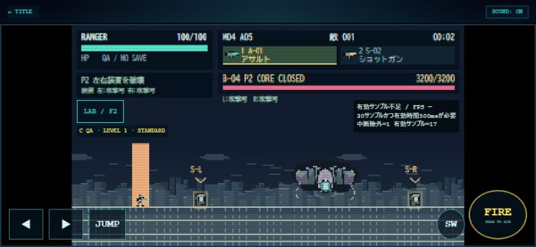

# FORTRESS BALANCE / 0.4.1 確認レポート

2026-10-28。実装・攻撃条件・8通りのQA時間・変更ファイルは[仕様と検証](../../docs/FORTRESS_BALANCE.md)。通常難度の人手攻略、iPhone Safari実機の合格判定ではない。

## ブラウザ確認

ローカルHTTP、Chrome、実UI操作。通常の320×180描画。LABのPhase直接開始、アート切替、QA設定、敵50体生成、30秒計測、AREA03とキー移動を使用。非公開ゲーム状態をブラウザから変更する撮影コードは追加していない。

| 画像 | 条件／確認内容 |
| --- | --- |
| [Phase1 844×390](phase1-844x390.jpg) | ORIGINAL、RANGER、C、砲台2基のT-L/T-Rと常設目標、左右装置は防御中 |
| [Phase2 780×360](phase2-780x360.jpg) | UNIFIED 01、RANGER、C、S-L/S-Rと左右装置目標、同一データの砲撃表示 |
| [Phase3 667×375](phase3-667x375.jpg) | UNIFIED 01、RANGER、C、コア露出、COREと開始案内 |
| [Phase3 390×844](phase3-390x844.jpg) | 同条件の縦画面、常設目標、下段操作領域 |
| [GUARDIAN QA 844×390](guardian-qa-844x390.jpg) | 既存5タブ内のショートカットを実行。GUARDIAN／QA:B／次回STANDARD／A-01/S-02、開始前なので現在M01と次候補M04を区別 |
| [E-11 50体 844×390](shields50-844x390.jpg) | ORIGINAL、自由配置、支援元4・防御対象12を公開canvas表示値でも確認。最大100のLAB自由配置に50体生成した条件 |
| [AREA03開始 844×390](platforms-844x390.jpg) | GUARDIAN、QA:B、開始地点。足場は右端方向 |
| [足場方向 844×390](platform-direction-844x390.jpg) | UNIFIED 01、GUARDIAN、QA:A、広角0.35。チェックポイントから実キー移動し、右端の足場に方向・乗車帯を表示 |

指定4サイズで攻略目標は上側、タッチ操作は下側にあり、重なり・横はみ出しなし。縦は既存の2段配置を維持。実機のセーフエリア／Safari可変ツールバーは未確認。マーカーの表示制限とオフスクリーン方向は実更新テストでも確認した。折返し瞬間・解除瞬間の代表画像は未取得で、タイマーと描画呼出しの自動テストを使用。

最初のQAショートカット操作は、読み込んでいた旧コードでは反映しなかった。再読込1回で現行0.4.1の無敵OFF・正式HP・装備・開始候補への反映を確認した。最終版にコンソールerrorなし。試験後にタブ・viewport設定とローカルサーバーを終了する。

## 30秒計測（既存0.3.3方式、1回）

M04自由配置、GUARDIAN、A-01/S-02、シールドドローン50体、UNIFIED 01、320×180、844×390。現在の戦闘を維持して実行。射撃なし、弾0・FX0。上限はLAB自由配置のMASSIVE100で、STANDARD50の通常戦闘ではない。

| 項目 | LAB結果の表示値 |
| --- | --- |
| 状態 | 計測完了（有効）、中断なしの観測RAF計測完了 |
| 有効時間／フレーム | 30.008秒／334 |
| 中断 | 0 |
| 観測RAF FPS／最低1秒 | 11.1／8.0 |
| P50／P95／P99 | 33.50／317.00／400.50ms |
| CPU更新／描画 | 1.14／1.27ms |
| 最大敵／弾／FX | 50／0／0 |

これは自動操作環境の観測参考値。計測器は前景・連続区間として受理したが、RAFとCPUの乖離が大きい。GPU時間／表示完了／iPhone性能の実測ではなく、武器連射中やボス戦の負荷を評価した値でもない。この値だけから描画ボトルネックや実機60fpsの達否は判断しない。異なる条件の再試行は行っていない。

JSONコピーボタンは画面で「コピーしました」と通知したが、自動操作側のクリップボード取得は空だったためJSON原本は未保存。表は画面上の結果欄から転記。通常セーブへは保存しない。

100体・200体の正常30秒実ブラウザ計測、STANDARD50の砲撃／ボス／足場同時戦闘は未実施（有効試行0）。これらにはFPS値を割り当てない。50/100/200体の生存数・盾表示上限・FX上限はNode実更新テストで確認済みで、性能測定とは区別する。

手動再確認：LABでM04を開始→兵科・初期武器・無敵OFF→敵数50/100/200か現在戦闘を選択→計測の「30秒計測開始 → プレイ」→回転・LAB・別タブ切替なしで前景30秒操作→完了後LABで値と中断理由を確認。中断した試行を正常値へ合算しない。

## 関連テスト

    node --test tests/fortress-balance.test.mjs tests/sky-fortress.test.mjs tests/lab-ui.test.mjs tests/gameplay-polish.test.mjs tests/mobile-playtest.test.mjs tests/mission-lab.test.mjs tests/data.test.mjs

192件成功／失敗0。内訳はM04の各Phase・状態初期化、全4兵科×初期2武器の実射撃破、無敵OFFの回避、複合攻撃、足場運搬／折返し／離脱／設置追従／被弾着地、占有済み復帰地点の回避、E-11解除、50/100/200体の表示上限、5タブ・武器選択・入力遮断、旧保存／報酬1回／LAB隔離、共有処理のM01〜M03基本進行、中断除外。

初期武器8通りはC無敵のボス指定開始。単独攻撃と代表的4秒複合攻撃はB無敵OFF。全編人手のD通常クリアとは異なる。M04のA到達性は開始後ワープなし。全編Cと通常エンジンの無敵補助テストも、正式難度の攻略とは記載しない。

## 残課題

- 無敵なしGUARDIAN／各兵科の人手ボス戦・全編攻略、射撃しながらの回避。
- 波のジャンプ時機はGUARDIANで遅めが必要。実機操作で理解しやすいか確認する。
- シールド50体密集では本体の重なりは残る。今回の盾マーカー上限は視覚過密を抑えるが、敵移動・シルエットは変更しない。
- 低倍率320の日本語は小さい。iPhone実機で可読性と触り心地を確認し、必要なら表示だけを調整する。
- 100/200体とボス／砲撃／足場が重なる条件の前景30秒、iPhone Safari実機。
- 先に実測と人手QAを行い、根拠があるM04固有パラメータだけ次に調整する。

