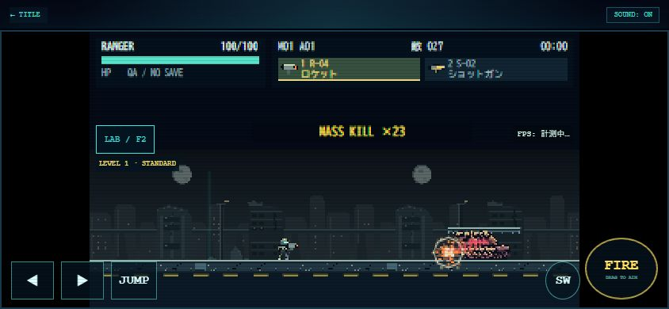

# 0.3.2 — GAMEPLAY POLISH 検証

実施日：2026-10-26。ローカルHTTP／Chrome、実機iPhoneではない。自動ブラウザでの前景継続実行には制限があった。通常の人手全編クリアとは区別する。

## 変更点と確認範囲

| 項目 | 結果と根拠 |
| --- | --- |
| 通常起動 | 通常URLのM01、RANGER、UNIFIED 01、320×180、新HUD、両武器・敵数・HP、開発用UI非露出をChrome確認 |
| ボス | LAB B-03をWING／RANGER・A-01/S-02で直接開始。上段HP／CORE状態／ENを目視。旧計測オーバーレイの重なりを修正。B-01/B-02のマーカー・分類はNode描画／ダメージテストで確認 |
| 画面サイズ | 844×390、780×360、667×375、390×844でWINGの6操作面すべて画面内、44px以上。横FIREは92×78px、縦は約121px角。SCOUTのDASH表示も667×375で確認 |
| 同時入力 | Node実ランタイムで複数pointerId、同一キー2所有者、移動＋ジャンプ＋射撃、FLY/HOLD、DASH、マイン長押し、cancel／lostcapture／回転解除を確認。実機の複数指入力は未確認 |
| 通常攻略QA | Chromeで第5プリセットを明示適用。SCOUT HP75、A-01/S-02、QA:B、次回STANDARD、現在の自由配置MASSIVE200を維持するサマリー。Nodeで開始後の通常被ダメージ・NO SAVEを確認 |
| 爆発・撃破 | Chromeで50体密集へR-04爆発プレビュー、MASS KILL×23・爆発・吹っ飛び・残り27体を確認。全50体撃破とは扱わない |
| GAME OVER | 上記LABで無敵OFF、敵攻撃を受けて到達。DOM上でM01／RANGER／AREA01侵略開始／00:13.03／撃破23／SCORE3335／再挑戦等を確認。撮影はタイムアウトし画像なし。最終追加したQA/NO SAVE見出しはNodeで確認 |
| 通常結果 | M01/M02/M03、クリア報酬・新規武器・M02解放表示・二重保存防止・GAME OVER／再挑戦をNode実ランタイムで確認。通常のボス撃破から結果までの人手ブラウザ通しは未確認 |
| 音声 | Web Audioのユーザー操作開始、resume、拒否、上限、後始末、ミュート・音量継承をモック単体テスト。Chrome操作中の例外なし。聴感・Safariの再開は未確認 |

### 画像

- [通常M01／844×390](normal-m01-844x390.jpg)
- [B-03・WING／844×390：HUD重なり修正後](b03-wing-844x390.jpg)
- [WING／844×390](wing-844x390.jpg) ・ [780×360](wing-780x360.jpg) ・ [667×375](wing-667x375.jpg) ・ [390×844](wing-390x844.jpg)
- [SCOUT／667×375](scout-667x375.jpg)
- [通常攻略QAプリセット／844×390](gameplay-qa-preset-844x390.jpg)
- [50体配置へロケット、23体撃破の瞬間](rocket-50-finish-844x390.jpg)
- [BENCH200・有効サンプル不足](bench-200-844x390.jpg)
- [修正前のB-03／RANGER比較用](b03-qa-844x390.jpg)：計測表示がボスHPを覆っていたため、この配置は不採用。現行は上記WING画像の位置。

## ブラウザ性能：測定不能

BENCH200を**1回だけ**実行。結果：INSUFFICIENT、有効0、連続有効区間0、短区間破棄17、ウォームアップ除外26、中断除外5、最大除外間隔1001ms、敵数最大200。FPS・RAF平均/p95・更新CPU・描画CPUはすべてnull。停止を含む見かけ上の約1fpsを実効FPSとは扱わない。

過去と同じ前景継続サンプル不足だったため、50/100のブラウザ再測定や200の再試行は行わなかった。通常プレイ中のライブ表示も有効0で、中断回数が増えていた。**ブラウザ・iPhoneの50/100/200体の性能優劣は未評価**。

後半にInput.dispatchMouseEventとPage.captureScreenshotのタイムアウトも発生。最初の入力失敗後にDOMを取り直すとGAME OVERだったため、その状態を確認して追加撮影は打ち切った。失敗画像を取得済みとは扱わない。通常M01、WING4サイズ、ロケット撃破までのブラウザ警告／エラーログは0件。

## Node CPU参考値（実描画・実音声なし、FPSではない）

既存`node tools/benchmark-impact.mjs`を1回実行。R-04／G-07、各LEVEL、120ウォームアップ＋600計測tick。60tickごとに全数を再配置して範囲攻撃し、実ロジック・死亡／粒子更新・Canvas呼出しを実行。ただしCanvasはno-op、Web AudioはOFF。値は両武器の最小〜最大、単位ms/tick。最大値は両武器の大きい側。

| 体数 | LEVEL | 平均CPU | p95 CPU | 最大CPU |
| --- | --- | --- | --- | --- |
| 50 | 1 | 0.187〜0.233 | 0.508〜0.685 | 1.882 |
| 100 | 1 | 0.199〜0.223 | 0.571〜0.692 | 2.270 |
| 200 | 1 | 0.283〜0.293 | 0.858〜0.877 | 3.093 |
| 50 | 2 | 0.293〜0.417 | 0.789〜0.952 | 3.332 |
| 100 | 2 | 0.432〜0.471 | 1.110〜1.151 | 3.997 |
| 200 | 2 | 0.708〜0.729 | 1.503〜1.608 | 5.097 |
| 50 | 3 | 0.560〜0.607 | 1.273〜1.425 | 10.873 |
| 100 | 3 | 0.647〜0.766 | 1.507〜2.117 | 9.727 |
| 200 | 3 | 0.976〜1.100 | 2.422〜2.472 | 10.902 |

各回の総撃破数は50体600／100体1200／200体2400で、死亡イベント重複・クラッシュなし。L3は平均だけでなく最大約10.9msのスパイクがあった。OS負荷・JIT/GCを分離した値ではなく、GPU、ラスタライズ、実端末速度、ブラウザ音声の性能保証には使えない。旧版と同条件での前後比較は未実施なので速度改善率も算出しない。

## 安全上限の検証

新規テストでは50/100/200×LEVEL1〜3を同時撃破。撃破数を維持したまま、100msの命中FX12個（LAB200は6）、FX80、粒子96（LAB200は48）、揺れ最大6.4、ヒットストップ秒予算66msを超えない。死亡／FX／粒子は2秒の実更新後に0へ戻る。音声100回同時要求は8音まで、同一秒の開始数は24まで。

これはクラッシュ・蓄積・判定省略防止のテストで、iPhone実効FPSの測定ではない。実機は[手動手順](../../docs/GAMEPLAY_POLISH.md#計測と確認手順)で音声付き／なしを分けて確認する。

## 関連テストと保護

新規`tests/gameplay-polish.test.mjs`22件。既存のimpact/destruction/playground/LAB UI・武器リスト・ボス予兆・アート正式採用・data・weapons・classes・runtime・mission-labを影響範囲として実行する。最終集計は完了報告を参照。

HUD再配置に合わせ、旧「HP文字は全restoreの後」というテストを、**実際のHP描画時のscaleが1**の検証に修正。既存runtimeテストに残っていた「M03未実装」を、M03はM02未クリア時LOCKED／M04はCOMING SOONへ更新。ゲーム仕様をテストに合わせて巻き戻してはいない。

0.3.1の保護ファイルとの比較で、data.jsはVERSIONだけの差分。player/weapons/mission02/mission03/camera/invasion/coastal-art、素材と生成スクリプト、親menu.jsに変更なし。武器・兵科・敵・ボス数値／地形・セーブ形式・Arcade031リンクは維持。QAの保存不変、通常の報酬保存・旧形式読込・タイトル復帰は実ランタイムで確認。

## 未確認・次の改善候補

- iPhone Safari実機：safe-area、ホームバー、ツールバー伸縮、複数指、音声復帰、低電力モード、実FPS。
- 無敵なしM01〜M03全編の人手攻略と、実機での通常リザルト目視。QA途中開始や無敵テストの成功で代用しない。
- 320の日本語HUD細字、弱点マーカーの小倍率時の見やすさ、音量／音色の聴感を実機で評価する。
- L3大量爆発の実描画CPU/GPUスパイクを有効な連続前景で確認後、必要な場合だけ粒子の描画負荷を見直す。敵数・威力を勝手に下げない。
