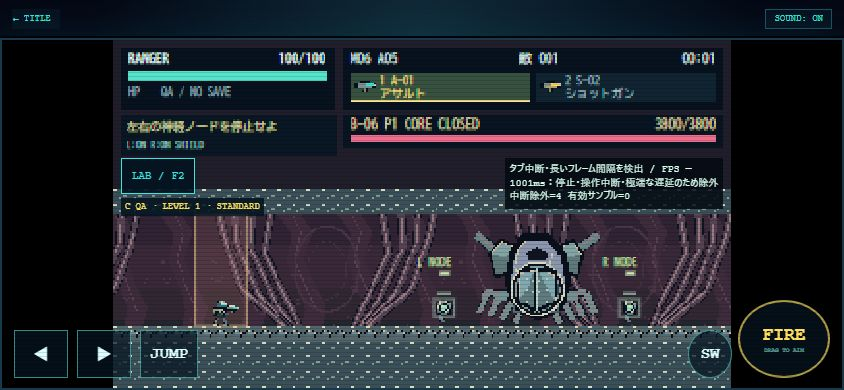

# LIVING COLOSSUS / Version 0.6.0 確認レポート

確認日：2026-10-31 JST。ローカルHTTPの実ブラウザ（Chrome）とNode VMを区別する。iPhone Safari実機ではない。公開・push・デプロイなし。

## 実装と保護

[M06詳細仕様・変更ファイル](../../docs/MISSION_06.md)。全5エリア、閉鎖延期付き脈動壁、衝突を通す体液流、再利用神経ノード、新敵3種、B-06の反復露出とHP段階、通常のリザルト／報酬保存まで接続。旧M05クリアのM06解放、M07未実装ガード、LAB保存隔離を検証。

新規素材26 PNG／174セル、固定seed6008400、専用フォルダのみへ生成。既存assetsとArcade親index.htmlにgit差分なし。M01〜M05専用地形・AI/ボス、player.js、20武器データ、カメラ数値は不変。共有コードには新ID分類・M06座標/表示/報酬接続を追加した。

ブラウザ調査で既存30秒計測の50体optionに不正な閉じタグを発見。HTMLだけ修正し、実ブラウザで50体の選択・生成を確認した。新しい性能測定器は実装していない。

## 自動QA

- M06専用61件成功：全チェックポイント、6ボス状態の再実行、初期化、神経網再起動、無人ゲート防止、占有閉鎖延期、SCOUT掃引、WING天井/壁/EN、逆流、全20武器、50/100/200体、読込失敗、通常保存不変。
- A（地形到達性）：RANGER73.12秒、SCOUT39.13秒、GUARDIAN107.93秒、WING62.93秒。実移動・必須設備の実射撃で通過し、開始後の座標ワープなし。
- C（無敵QA通し）：170／126／216／156秒。開始→全5AREA→ノード反復→B-06撃破。通常ゲームの正式クリアではない。
- 4兵科×A-01/S-02の8通りでノード停止とコアの実射撃破に成功。B-06時間：RANGER88/154、SCOUT82/136、GUARDIAN100/160、WING92/144秒（C）。外殻と神経網も8通りで射撃確認。
- 通常エンジン＋無敵補助：通し170秒→リザルト→通常報酬保存。2回目のcompleteMissionで記録/報酬が増えない。これはD（無敵なし通常攻略）ではない。
- 単独攻撃は無敵OFF、0.25秒反応後の実移動退避を全4兵科で確認。全編の人手攻略・複合攻撃の網羅評価ではない。
- Pillow：2回生成のカタログ/ハッシュ一致、寸法・透過・近遠アルファ・アンカー・出力先隔離に成功。

関連テストのみ：

```powershell
node --test tests/living-colossus.test.mjs tests/mobile-fortress.test.mjs tests/fortress-balance.test.mjs tests/mission-lab.test.mjs tests/lab-ui.test.mjs tests/data.test.mjs tests/mobile-playtest.test.mjs tests/sky-fortress.test.mjs
py -3 -m unittest discover -s tests -p test_living_colossus_assets.py
node --check js/game.js
node --check js/mission06.js
node --check js/living-art.js
git diff --check -- .
```

上記Node関連テストは合計303件成功（M06専用61件を含む）。M05の4兵科通し/8武器組合せ、M04の必須部位/初期武器/回避、M01〜M05基本進行、UI・セーブ・計測中断も関連範囲で成功。無関係な全件テスト・全画面GUIは実行していない。

## ブラウザ

通常URL：UNIFIED_01・320×180・TEST LAB非表示。debug=1からM06全AREA選択、AREA01〜04開始、B-06シールド/露出開始、5タブ、設定保持、50体計測選択、JSONコピー、閉じてプレイを実操作で確認。ブラウザエラーログなし。

| 画面 | 確認結果 |
| --- | --- |
| 844×390 | 背景・RANGER・B-06/ノード・目標HUD、LAB固定ヘッダー/フッター、スクロールでボス実行へ到達 |
| 780×360 | HUD・タッチ5操作の矩形が画面内。FIRE 92×78CSS px |
| 667×375 | ボス・タッチ5操作が画面内 |
| 390×844 | 縦2段、横向き推奨、タッチ5操作が画面内、LAB内部スクロール |

実UIから開始した画像11枚。異なる時刻・カメラの画像を同一フレーム比較とは扱わない。

| 画像 | 内容 |
| --- | --- |
| [侵入口](m06-entrance-844x390.jpg) | AREA01・RANGER・UNIFIED 01 |
| [脈動回廊](m06-pulse-844x390.jpg) | AREA02・脈動壁 |
| [体液循環](m06-fluid-844x390.jpg) | AREA03・流向 |
| [神経伝達網](m06-neural-844x390.jpg) | AREA04背景。ノード本体までは進んでいない |
| [LAB](m06-lab-844x390.jpg) | 状態選択と実行 |
| [B-06シールド](m06-boss-shielded-844x390.jpg) | 左右ノード・防御コア・HUD |
| [B-06露出](m06-boss-open-844x390.jpg) | 露出開始・残秒・マーカー |
| [780×360](m06-boss-780x360.jpg) | 横画面 |
| [667×375](m06-boss-667x375.jpg) | 小型横画面 |
| [390×844](m06-boss-390x844.jpg) | 縦画面 |
| [計測参考値](m06-measurement-844x390.jpg) | 50体の結果UI |



## 性能：正常な実効FPSは未測定

既存30秒機能をM06・RANGER・A-01/S-02・UNIFIED 01・320・844×390・50体で1回だけ実行。結果UIは「計測完了」だが、正常な前景実行としては採用しない。

| 項目 | 生の観測値（性能保証には不使用） |
| --- | ---: |
| 観測時間／RAF数 | 30.025秒／59フレーム |
| 観測RAF頻度 | 約2.0Hz |
| P50 / P95 / P99 | 33.50 / 1001.25 / 1001.25ms |
| 更新CPU平均／描画CPU平均 | 1.93 / 2.05ms |
| 最大敵／弾／FX | 50 / 0 / 0 |

約1秒RAFが混在し、別のLiveProfilerは長い区間を中断扱いにして有効サンプル0を表示。30秒記録器の59フレームを、正常な前景FPS・GPU描画完了時間として認定しない。CPU値もその観測区間の参考のみで、戦闘/射撃負荷の保証にはならない。

同条件の再試行や100/200体の自動30秒測定は行っていない。50/100/200体の機能・上限制御はNodeで確認したが、端末FPS比較は未測定。計測器の既存長フレーム保持仕様は変更していない。

### 手動計測

1. debug=1→LAB→M06/エリア開始。兵科・武器・アート・解像度を設定。
2. 計測条件50/100/200、またはエリア維持のCURRENTを選ぶ。敵数指定は自由配置へ初期化。「30秒計測開始」でプレイへ。
3. 実機前景で継続操作し、LAB・ポーズ・回転・他タブを挟まない。中断を継ぎ足さない。
4. 完了後RAFとCPUを分けて確認しJSONコピー。サンプル数・中断・実際の入力/描画状況も記録。

## 未確認・次の改善

無敵なし自動/人手の全編攻略、iPhone Safari実機、safe-area/可変バー、正常前景30秒。B-06以外のノード伝播/閉鎖はNodeテストが主で、実機の反応しやすさは評価を残す。

次はノード照準・B-06複合攻撃・低倍率予兆の体感、全編時間、実機計測を確認する。無敵QAの短いタイムだけで敵HP・武器・兵科を変更しない。
