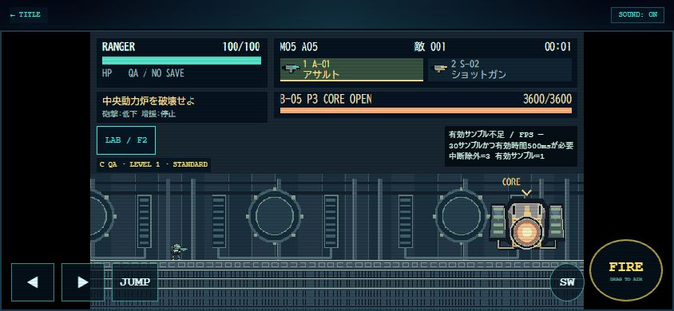

# 0.5.0 MOBILE FORTRESS — 確認レポート

確認日：2026-10-30。[M05仕様・全変更ファイル・初期調整](../../docs/MISSION_05.md)。無敵QA／局所検証／人手通常攻略は区別する。iPhone Safari実機ではない。

## ブラウザ実操作

ローカルHTTP・Chrome、TEST LABの既存UIで開始。撮影用のワープ／ゲーム内部API呼出しは使用していない。全AREAはチェックポイント開始であり、ブラウザの全編通し攻略ではない。正式4兵科の通しQAは後述のNode実更新で実施した。

| 画像 | 確認した内容 |
| --- | --- |
| [AREA01 / 844×390](area01-844x390.jpg) | 荒野、単独の巨大基地、接近目標。反復背景に基地が複数現れた初期不具合を修正後 |
| [AREA02 / 844×390](area02-844x390.jpg) | 装甲甲板と車体、外部砲塔の方向マーカー、砲塔破壊目標 |
| [AREA03 / 844×390](area03-844x390.jpg) | 機関のギア・ピストン、低天井、駆動装置の目標、新敵 |
| [AREA04 / 844×390](area04-844x390.jpg) | 制御室、装甲扉の目標。先行駆動停止状態の復元 |
| [AREA05 / 844×390](area05-844x390.jpg) | 動力炉区画、ボス入口への目標 |
| [B-05 FULL / 844×390](boss-full-844x390.jpg) | HP3600、左右装置稼働、コア保護、画面外方向 |
| [B-05 LEFT / 780×360](boss-left-780x360.jpg) | 左破壊済み、砲撃弱化、残る右装置の目標 |
| [B-05 RIGHT / 667×375](boss-right-667x375.jpg) | 右破壊済み、増援停止、左装置の砲撃弱化案内 |
| [B-05 OPEN / 390×844](boss-open-390x844.jpg) | 両装置破壊済み、コア露出、縦画面の操作領域 |
| [B-05 OPEN / 640描画 / 844×390](boss-open-640-844x390.jpg) | LAB限定640×360、同じワールド・HUD・コアのアンカー |
| [崩壊後LAB結果 / 844×390](lab-boss-result-844x390.jpg) | 崩壊プレビュー→CHECKPOINT_ONLY／BOSS_DEFEATED／NO SAVE。直接崩壊操作であり、実射攻略画像ではない |
| [通常URL一覧 / 844×390](normal-mission-select-844x390.jpg) | 新規セーブではM05 LOCKED、M06 COMING SOON。内部スクロールあり |

AREA画像と640／最終RIGHT画像はLAB初期STANDARD実験プリセット（画面兵科はRANGER）。FULL／LEFT／縦OPENでは正式RANGERを選択。性能の正式兵科検証は自動テストで4種類すべて実施。全20武器や全4兵科の人手試射をブラウザで確認した意味ではない。

指定4サイズで攻略表示が下段の操作ボタンを覆わず、LABの開始候補・折りたたみ・固定ヘッダー／フッターへアクセスできた。通常URLはTEST LAB非表示、公開canvas属性でUNIFIED_01／320×180を確認。M05の旧M04クリア解放はブラウザの保存データを改変せず、保存移行テストで検証した。最後の確認でconsole errorなし。

開発中は更新前のPNGがキャッシュされ、新しい単独基地と古い反復基地が混在した。M05ローダーの画像URLに版数を付け、再読込後に単独基地を確認した。既存素材のURLや読み込み処理は変更していない。

## 30秒性能計測：通常性能の評価には不採用

既存0.3.3計測を1回だけ使用。M05自由配置、E-13 50体、LAB初期STANDARD、無敵ON、A-01/S-02、UNIFIED 01、320×180、844×390。補充・射撃操作なし。通常STANDARD密度50の全編戦闘ではなく、LAB自由配置の上限100内に50体を生成した条件。

| 計測器上の項目 | 表示された値 |
| --- | --- |
| 状態 | 計測完了（有効）・中断なしの観測RAF計測完了 |
| 時間／フレーム／中断 | 30.008秒／254／0 |
| 観測RAF FPS／最低1秒 | 8.5／1.0 |
| P50／P95／P99 | 33.50／1000.75／1001.25ms |
| CPU更新／描画 | 1.40／1.32ms |
| 最大敵／弾／FX | 50／0／0 |

計測器は前景として254フレームを受理したが、約1秒周期が多くCPU時間との乖離が大きい。自動ブラウザの停止／スケジューリング影響と通常描画負荷を切り分けられないため、**正常な前景性能の比較に採用する試行は0件**。254という生の受理数を0と偽ってはいない。8.5fpsを実効ゲーム性能・iPhone性能・ボトルネックの結論として扱わない。100/200体はブラウザ未計測。無意味な再試行や新しい計測システムは追加していない。

通常のライブ表示でも1001msの停止区間が除外された。実機ではLABの計測で条件を選び、30秒開始後は回転・別タブ・LAB開閉をせず実操作する。中断理由がある結果は正常値へ合算しない。50/100/200体の実機前景計測を次フェーズで優先する。

## 関連テスト

    node --test tests/mobile-fortress.test.mjs tests/fortress-balance.test.mjs tests/sky-fortress.test.mjs tests/mission-lab.test.mjs tests/lab-ui.test.mjs tests/data.test.mjs tests/gameplay-polish.test.mjs tests/mobile-playtest.test.mjs
    py -3 -m unittest discover -s tests -p test_mobile_fortress_assets.py

Node259件、Pillow生成テスト1件成功。無関係な全件回帰は実施していない。

- M05旧記録解放・GAME OVER／再開始・M06選択禁止。
- 全5チェックポイントの安全位置と過去状態復元、再実行の弾／敵／設置／タイマー／カメラ初期化。
- 4兵科のワープなしA到達、全4兵科のA-01無敵C通し撃破、通常エンジン＋無敵補助のリザルト／保存まで。
- 全4兵科×初期2武器による道中必須装置・左右装置・コアの実射破壊。B-05の両破壊順序、シールド無敵、二重破壊／報酬防止。
- 全4兵科の無敵OFF単独砲撃回避、水平／昇降足場の支持・折返し・離脱・設置追従、側面貫通防止。
- E-13予兆・突進・攻撃予約、E-14回復量／CD／上限・損傷した必須部位／コア修復禁止・蘇生禁止、E-15予兆・3連射。
- 30/50/100体のM05密度上限、LAB200体、全4兵科×全20武器の発射・更新、FX／弾・設置寿命、WINGホバーEN維持。
- LAB保存バイト不変、通常保存の旧形式・武器解放・報酬1回、共有処理のM01〜M04基本進行。
- 24 PNGの再生成一致、寸法・透過・隔離、ロード失敗代替、純描画の状態不変。

### QA区分と結果

4兵科の地形A：72.28／42.95／103.60／64.32秒。初期アサルト無敵Cの通し：282／252／302／274秒（RANGER／SCOUT／GUARDIAN／WING）。通常エンジン＋無敵補助はRANGER 278秒で報酬保存。ボス指定CのA-01は74〜78秒、S-02は130〜142秒。

これらはシミュレーション時間。Bは単独攻撃の短い回避、Cは無敵、ボス指定は途中開始。**無敵なし自動全編攻略、無敵なし人手全編攻略Dは未確認**。崩壊プレビューの結果を実射撃破や正式クリアに含めない。

## 未確認・次の改善

iPhone Safari実機の同時操作・安全領域・音声・可変ツールバー、50/100/200体の正常な前景性能、無敵なし全編攻略、初期武器で左右の破壊順を選ぶ人手難度。新素材の低倍率可読性・昇降足場への乗り込みは実機で確認する。今回の不確かなFPSから既存武器や兵科を調整しない。

