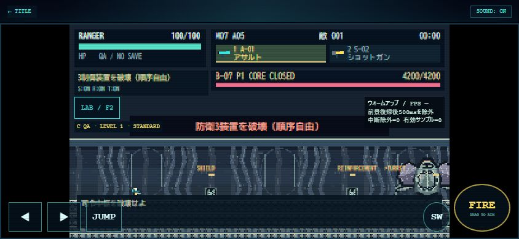

# M07 / 0.9.0 確認レポート

2026-10-31、ローカル実装。公開・push・デプロイなし。[ミッション仕様・変更ファイル](../../docs/MISSION_07.md)。

## 関連自動テスト

```text
node --test --test-reporter=spec --test-reporter-destination=reports/mothership/related-tests.txt tests/mothership.test.mjs tests/campaign.test.mjs tests/challenges.test.mjs tests/camera.test.mjs tests/invasion.test.mjs tests/living-colossus.test.mjs
py -3 -m unittest discover -s tests -p test_mothership_assets.py
```

Node **187件成功／0件失敗**、Pillow **1件成功**。[Node実行ログ](related-tests.txt)。M07固有、直接影響する司令部・保存・実績・カメラ・共通出現、および前ミッションM06の進行保護に限定。無関係な全件テストは実施しない。Pillow1件成功：24 PNG・151セル、2回生成一致、寸法・透過・近遠alpha・アンカー・出力先隔離。

主な確認：

- 旧M06クリアからM07解放、M08実行不可、司令部7分母・実績30件固定。
- 5エリア2回ずつ初期化、融合6秒再操作・閉鎖延期、3制御全6順序、B-07装置全8状態・Phase1〜3。
- 指揮解除・シールド30%単層・予算付き回復、転移先の距離／地形／直前再検証、大型敵の生成余白・壁衝突。
- 4兵科×初期2武器による3装置・コアの実射撃破壊、全20武器×4兵科の発射／更新経路。
- B-07の予兆矩形＝実判定、4兵科で0.25秒後に移動してPhase3の波を回避。
- 通常30/50/100・LAB200上限、設備破壊と敵数上限の独立、全消去後の孤立ゲート防止。
- 通常エンジンでクリア・報酬・兵科戦績・リザルト／スキップ、LABセーブのバイト一致。
- 旧199 PNGのGit blobハッシュ一致。M03〜M06固有ソース、兵科移動、実績マスタ、親Arcade indexはHEADから不変。M01〜M06開始／ボス生成のスモークも実施。

## QA区分と通し結果

下記はNodeのDOMスタブ上で実ゲームの移動・射撃・衝突・出現・ボス更新を実行。開始後に座標・敵HP・ゲート・EN・クールダウンを直接書き換えない入力コントローラを使用。ゲーム内秒数であり、人手攻略時間・実時間のFPSではない。

| 兵科 | A：地形＋必須装置、ボス入口まで | C：敵攻撃・出現あり、無敵で開始→B-07撃破 |
| --- | ---: | ---: |
| RANGER | 81.05秒 | 178秒 |
| SCOUT | 44.55秒 | 142秒 |
| GUARDIAN | 118.42秒 | 218秒 |
| WING | 70.22秒 | 162秒 |

Aでは敵攻撃を停止するが必須装置は実射撃で解除。Cでは初期A-01を使い、敵の出現・AI・攻撃とダメージ判定は動作するがLAB無敵。両方とも全5エリアを訪問し地形侵入診断なし。通常エンジン＋開始時無敵時間補助でも174秒で開始→リザルト・M07記録／報酬保存を確認。これはD（無敵なし通常プレイ）や人手の全編クリアではない。

## 最低限のブラウザ確認

Chromeの実ページを一時HTTPサーバーで起動しUIから操作。TEST LABでM07を選択して開始、B-07 Phase1／2を実行し、縦表示でAREA04を開始。正常読み込み・コンソールerrorなし。代表3枚を保存。

| CSS viewport | 確認内容 | 画像 |
| --- | --- | --- |
| 844×390 | M07 AREA01、M07ボス折りたたみ／開始、B-07 Phase1、装置とコアHP表示 | [B-07 Phase1](b07-844x390.jpg) |
| 780×360 | Phase2指定・コア露出、左右／ジャンプ／武器切替が画面内、横はみ出しなし | [コア露出](b07-open-780x360.jpg) |
| 390×844 | AREA04ネットワーク、縦操作、FIREの画面内配置、横はみ出しなし | [防衛網](network-390x844.jpg) |

通常URLでも確認：UNIFIED_01、320×180、TEST LAB非表示、司令部4タブ、0/7表示、M07 LOCKED、M08 COMING SOON・出撃disabled。旧クリア済みセーブからのOPEN復元は独立メモリの自動テストで確認し、ブラウザの通常進行へダミー解放記録を入れない。検証用タブ・viewport指定・HTTPサーバーは終了時に解除。



## 性能と未確認事項

- 今回は実機FPS評価を最終QAへ延期する方針。前景30秒の50/100/200比較は実施しないため、認定可能なFPS／CPU時間は未計測。短いHUD表示を性能保証に使用しない。測定不能な自動計測の反復なし。
- 200体の生成・更新・安全上限は自動テストで確認したが、iPhoneで200体60fpsを保証しない。
- iPhone Safari実機、実ノッチ／ホームバー、実タッチ、多様なブラウザアドレスバー、無敵なし人手全編攻略は未確認。
- 初期武器×兵科テストは攻撃成立性・部位破壊の無敵QA。被弾を避けながら人間が倒せることの認定ではない。
- Phase1開始時、最低倍率では遠い装置やボス外装の全幅が一度に収まらないことがある。操作対象は方向マーカーで補助。最終の視認性評価は残課題。
- M07で通常プレイするための移動・武器・保存・イベントを揃えた版であり、全組合せの攻略難度調整は完了扱いにしない。

次候補：M08の信号源回収シナリオ、全編人手攻略による難度測定、iPhone Safari最終QA、50/100/200体の正常前景30秒計測。武器や兵科の性能を測定なしに変更しない。
