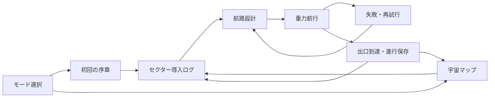

# HOMEWARD / 帰還航路 — v1.0.0 FOUNDATION仕様

## 範囲と世界観

遠方へ漂流した調査船「ヒナギ」が、星の引力を借り、地球の時刻信号を頼りに故郷を目指す。船・宙域・文章は本プロジェクト用のオリジナル。「遠くから故郷へ帰る旅」という題材だけを出発点とし、既存作品の人物・艦船・名称・台詞・画像・物語は使用しない。

遊ぶモードはCLASSIC（既存20ステージ）、FREE SPACE（既存自由配置）、HOMEWARD（物語と帰還進行）の3つ。軌道設計／重力操作、精密／スリングショットはそれぞれのモードで従来どおり利用する。HOMEWARDは初期3セクターを実装する。燃料・戦闘・乗員・アイテム・分岐航路は今回は実装しない。

## 全体構造とセクター間移動

宇宙マップはキャンペーン全体の航路図であり、物理ワールドとは別の座標系。縮尺は持たない。セクター内では3750×5000のワールドで重力航行し、出口ゲートへ到達するとクリアする。出口通過後は結果を保存し、プレイヤーが「次のセクターへ」を押して次のローカルワールドを読み込む。セクター間で速度・飛行時間・惑星配置は持ち越さない。



初期状態では01のみ解放。01クリアで02、02クリアで03を解放。通過済みセクターは再航行できる。03の次は未実装なので、結果ボタンは「宇宙マップへ」とする。地球帰還や物語全体の完結とは扱わない。

## データとセクター内容

`js/homeward-data.js` にキャンペーン定義とセクター定義を配置する。セクター定義は `id / number / name / theme / distance / map / next / enter / arrival / planets / goal` を持つ。`getHomewardSector(id)` が既存のステージ形式へ変換し、独立したスナップショットを返す。

|セクター|航行テーマ|惑星|帰還距離の短縮|
|---|---|---|---:|
|01 消えた星図|未知宙域から最初の航路標識へ|高密度・地球型・巨大ガス|1200航路単位|
|02 ふたつの潮|離れた引力を組み合わせる|高密度×2・巨大ガス|1800航路単位|
|03 青い残響|反発・吸収・熱領域の間を航行|反重力・ブラックホール・恒星|2400航路単位|

初期配置はv0.9.3で検証した長距離航路をHOMEWARD用に独立定義したもの。FREE SPACEの体験配置データを実行時に書き換えない。全セクターに再現可能な解答を持たせる。初期のANGLE −65°・THRUST 220のまま到達可能。惑星は3個を維持し、種類・サイズ・個数と出口は固定、位置は従来の配置制約内で編集可能。重力操作では発射後も惑星を移動できる。

## 宇宙マップ・進捗

マップは01→02→03→未知宙域→地球を表示する。黄色が現在地、緑が通過済み、暗い表示と鍵が未到達。下の操作一覧にも「現在地」「通過済み」「未到達」を表示し、色に依存しない。ロック中の航行ボタンは無効。地球と未来の宙域は表示だけで、航行ボタンは用意しない。

出発時の推定残距離は64000航路単位。これは物語上のキャンペーン航路距離で、各セクターのロケットが実際に飛行したワールド単位とは異なる。通過済みセクターの `distance` を一度だけ減算する。再航行・失敗・RESETで増減しない。01終了：62800・1.9%、02終了：61000・4.7%、03終了：58600・8.4%。今後のセクター追加時には総距離と航路の整合を管理する。

## ストーリーイベント

序章は初回のHOMEWARD選択時に表示。「帰還航路を始める」で既読を保存する。各セクターの導入ログを初回の入域時に表示し、「航行を始める」でイベントIDを既読にする。到着ログはCLEAR画面と宇宙マップに表示する。失敗は物語進行を変えず、その場で再試行可能。

イベントは宣言的な文章データ。進行保存はイベントIDだけを持ち、任意のスクリプトやネットワーク呼び出しを実行しない。ダイアログ中は既存の設定画面と同様に飛行を一時停止する。開閉だけでは惑星配置・角度・推力を初期化しない。

## セーブ仕様

専用localStorageキー：`orbit-maker.homeward.v1`。

```json
{
  "version": 1,
  "currentSector": "homeward-02",
  "cleared": ["homeward-01"],
  "openingSeen": true,
  "eventsSeen": ["homeward-01:enter", "homeward-01:arrival"],
  "active": true
}
```

`active` は最後にHOMEWARDを遊んでいたかを示す。CLASSICまたはFREE SPACEへ実際に移った時はfalse。再読み込み時、activeかつ序章既読なら保存した現在セクターの初期状態へ復元する。現在セクターが通過済みならマップを開き、次の航路を選べるようにする。飛行途中の座標・編集した配置・角度・推力のオートセーブは行わない。

保存タイミング：序章の開始、セクター選択、導入ログの既読、出口到達、モード離脱。失敗とRESETは通過記録を消さない。FREE SPACEの編集配置は同じセッション内のモード往復で復元し、再読み込みを越えては保存しないという既存仕様を維持する。

既存の進行・最高星キーには触れない。IndexedDBのバージョン・ストア・既存レコードを変更しない。HOMEWARD飛行は既存v1形式のギャラリー記録として、`playType: "homeward"`、セクターのID・タイトルを保存する。再生・お気に入り・PNG出力は既存経路を使う。

破損・未知バージョン・未知セクターを含むHOMEWARDセーブは上書きせず、一時プレイと案内する。容量不足・ストレージ拒否でもゲーム内進行は保持し、保存できないことを表示する。起動時の読み込みだけでは書き込まない。将来v2へ移行する場合は明示的な読み込みアダプターを作り、検証済みデータを新キーへコピーしてから切り替える。旧キーの自動削除はしない。

## 物理演算との統合

HOMEWARD用の別エンジンは作らない。`createSimulation / stepLiveFlight / PreviewController` を既存と同じ経路で利用し、1/120秒・Velocity Verlet・重力合算・連続衝突・熱／吸収判定を維持する。カメラ・ミニマップ・サウンド・演出も共通。新セクターだけ180秒の飛行上限と120秒の予測上限を指定する。予測上限以降は未予測と明示する。

新しい `playType === "homeward"` 分岐は、セクター開始・CLEAR・RESET・UI・復元の境界だけに置く。物理ステップ内に物語処理を入れない。CLASSICの星評価とHOMEWARDの通過進行は別々に更新する。

## 将来拡張

- 次のセクター：固定ID・ `next` ・配置・イベント・解答と検証をデータへ追加する。既存IDの再利用やクリア済みIDの並べ替えでセーブを壊さない。
- 分岐探索：将来 `next` を複数候補へ拡張し、単純な「前のセクター」解放をグラフの到達済み隣接ノードへ変更する。保存スキーマ移行とセットで扱う。
- 宇宙ギミック：セクターへ `objects: [{id,kind,transform,motion,collider,gravity,effect,render}]` を追加する。既存 `planets` は維持し、必要な物理要素だけアダプターで収集する。詳細は `SPACE_OBJECT_DESIGN.md`。
- 移動物体は固定ステップで更新し、予測と実飛行に同じ関数を使う。描画カリングで物理対象を削除しない。乱数はseedから決定的に生成する。
- ワームホール等の不連続移動や移動する新オブジェクトを記録する段階では、記録の明示的な次バージョンと旧v1読込を用意する。跳躍区間を直線補間して誤再生しない。
- 燃料・修理・探索選択肢は今回の進行保存に混ぜず、設計・検証してから追加する。

## 受け入れと次段階

全3セクターの到達・予測一致、順次解放・既読・再読み込み・保存失敗、CLASSIC／FREE SPACE／ギャラリーへの非干渉、320／375／390pxの表示を関連テストで確認する。実機SafariはPC画面サイズ再現とは区別する。

次段階では専用航路の追加とチュートリアルの深掘り、セクター04以降の物語、マップ上の分岐、iPhone実機受け入れを優先する。現時点でゲーム全体の正式完成や地球への帰還完了とは扱わない。
