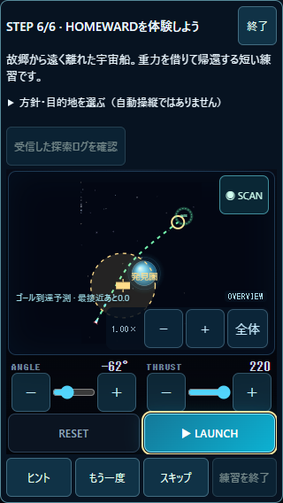
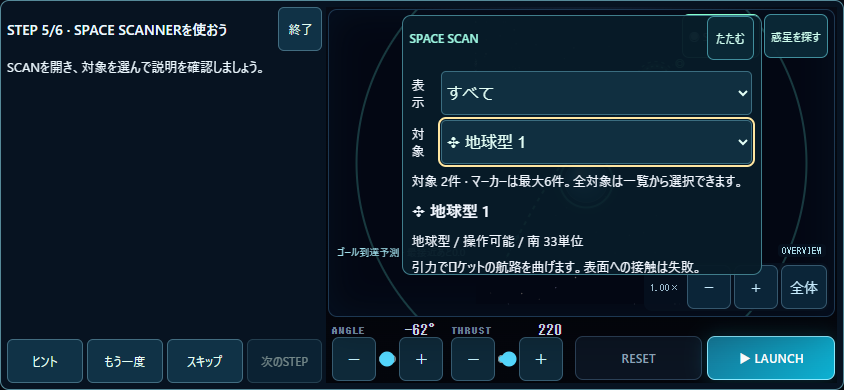

# v2.0.0-rc.3 — BEGINNER TUTORIAL / 検証レポート

2026-11-02、Windows / Node v25.9.0 / PC Chrome 156.0.8078.76。ローカル実装と自動検証の報告。iPhone実機の受入は未確認。正式完成の宣言はしない。Git push・公開・デプロイは行っていない。

## 1. Version

**2.0.0-rc.3**。rc.2のMISSION GUIDEと既存ゲームを利用した実操作チュートリアルを追加。

## 2. 主要変更ファイル

| ファイル | 変更 |
|---|---|
| `js/beginner-tutorial.js` | 独立進行・成功条件・次の操作・メモリ用ストレージ・セッション生成 |
| `js/beginner-data.js` | 本編と独立した練習データ、実旋回の測定、実予測の差分 |
| `js/beginner-practice.js` | 同じゲームの練習側アダプタ、固定ステップからの読取通知 |
| `js/beginner-ui.js` | 任意開始、6STEP、ヒント・再試行・スキップ・終了、状態復元 |
| `js/game.js` | 練習時のメモリ保存、実発射・実物理・実予測との接続、本編一時停止 |
| `index.html` / `styles.css` | 入口・案内・独立練習盤面・縦横画面・44px操作領域 |
| `package.json` / `README.md` | バージョン・起動・使い方・今回の試験出力先 |
| `tests/beginner-*.mjs` | 成功判定、実タッチ6STEP、画面・再開・異常系、保護・性能試験 |
| 既存QAハーネス / `tests/final-voyage-ui.mjs` | 新出力先、比較用の旧版配信、再現可能な仮想時計進行 |

物理・ステージ・HOMEWARD・保存の保護対象11ファイルはSHA-256一致。[検証証跡](validation.json)。既存の数式、既存のクリア条件、既存セーブ形式を変更していない。

## 3. チュートリアル構成

親画面に本編を保持し、同一オリジンの独立iframeで練習を行う。本編は停止し、終了するとiframeを破棄して元の画面へ戻す。操作結果は同一送信元・セッション・STEP世代を検査する。案内は短文と対象1つの強調。詳しい仕様は[SPEC.md](SPEC.md)。既存のHOMEWARD EXPERIENCEは別メニューとして残す。

## 4. STEP1〜6の結果

| STEP | 実行した確認 | PC結果 |
|---|---|---|
| 1 | 実LAUNCH。未操作では次へ不可 | PASS |
| 2 | 実際の±操作で両入力変更、実再発射。変更前の発射では成功しない | PASS |
| 3 | 予測を確認し発射。0.733333航行秒で実速度方向が5.0553°変化 | PASS |
| 4 | 実タッチで惑星を移動。予測ダイジェストが変化し、確認後に成功 | PASS |
| 5 | SCANだけでは未達。実検索選択で情報を表示すると成功 | PASS |
| 6 | 方針・行き先選択、実ステーション反応、ログ確認、実CLEAR | PASS |

[6STEP実タッチ結果](browser.json)。成功後も次へのタップを待つ。ゲームが勝手にSTEPを送ったり、演出だけで成功させたりしない。

STEP6は−62°/220で、帰還中継点(319,105)へ1.716667秒、観測地点(240,175)へ1.258333秒で実到達。両方とも0.175秒でステーションを検出。予測の終端状態は実飛行と完全一致し、1/100ステップずつ実行した最終結果も完全一致。[実航路](validation.json)。

## 5. 操作案内

初回は開始／あとでの任意案内。既存本編進行がある人は強制案内せず、メニューから開始する。LAUNCH→RESETと両入力→予測確認と発射→惑星ドラッグ→SCAN→方針・目的地・実航行の順に練習。惑星タップで既存の情報パネルが開いた場合は「たたむ」を案内する。

## 6. ヒント・スキップ

全STEPにヒント・もう一度・スキップ・終了を配置。もう一度は当該STEPだけ戻す。スキップは`skipped`で保存し、`success`・全6成功には含めない。全成功後は再実行可能。途中再開は保存されたSTEPの開始から。

## 7. 保存互換性

新規キー`orbit-maker.beginner.v1`だけを追加する。HOMEWARD v1・CLASSIC・CLUE・ギャラリー・お気に入り・保護記録は形式も内容も維持。練習のゲーム設定はメモリ内、IndexedDBへ接続しない。保存容量不足では通知して練習を継続する。LAN内HTTPで`randomUUID`が無い条件にも対応。

## 8. 本編データへの影響

実タッチ試験で、練習前後の既存localStorage全キー、新規キー以外の内容、IndexedDBの通常記録・お気に入り・保護記録、入力・倍率・カメラモード、元のメニューを比較して一致。練習iframeのネイティブlocalStorage書込みとIndexedDB接続を試験中禁止し、呼出し0件を確認した。[証跡](browser.json)。

5結末は既存ゲーム画面から実航行して到達、専用保護保存、CINEMATIC、再読込みを確認。ENDLESSから帰還、FREEへの移行もPASS。[全5結末](ui-results.json)。本編20ステージと既存シナリオは全自動テストでも回帰確認。

## 9. 自動テスト

全件最終結果は **483 PASS / FAIL 0 / SKIP 0**、35テストファイル。既存429件、rc.2の27件、今回追加27件を含む。`all-final.json` / `all-final.txt`へ全ログを保存する。

- [全件集計](all-final.json) / [全件ログ](all-final.txt)
- [6STEP・本編保護](browser.json)
- [5画面・再開・保存失敗・中断](lifecycle.json)
- [物理・予測・保護ファイル](validation.json)
- [5結末・CINEMATIC・旧記録](ui-results.json)

320×568、375×667、390×844、430×932、844×390で主要ボタン44px以上、全体スクロール超過0px、終了・次へが画面内。ヒント、スキップ、STEP2での再読み込み、再試行、パン／ピンチ／Pointer Cancel、終了後の本編発射を確認。保存失敗とrandomUUIDなしでも成功判定・終了が動作する。実機の指の感触・安全領域の実表示・Safariのバー変化は未確認。

検証途中で判明した修正：練習データの配置範囲不足を補い、既存の配置判定での移動テストを追加した。LAN HTTP用セッション生成を補った。6STEP試験の座標取得を正し、5結末試験の仮想時計を停止・明示進行することで100倍速中の試験待ち時間による結果変動を除いた。失敗した検証を無効化して合格にしていない。

## 10. 性能

rc.2のGit履歴から一時フォルダへ実ランタイムを複製し、rc.3と交互に3組比較。DEEP SPACEを実際に起動したことを必須検査する。375×667・DPR3、SCAN展開後にたたむ、2秒ウォームアップ＋8秒測定。[性能データ](performance.json)。

| 対象 | PC測定結果 |
|---|---|
| DEEP SPACE＋SCAN rc.2 | FPS中央値40.17、各回36.43〜43.17 |
| DEEP SPACE＋SCAN rc.3 | FPS中央値40.13、各回38.06〜42.03 |
| 比較 | 中央値比0.9991。今回の短時間試験では10%以内。改善とは断定しない |
| レンダラー処理時間比 | 両版とも約99%。既存の高負荷は残る |
| 練習盤面 | 8.02秒で59.98FPS、レンダラー処理時間比15.24% |
| 安定した案内 | 8秒間のDOM変更0件 |
| 練習開閉6回 | iframe残存0、GC後ヒープ2.71〜3.61MiB、DOMノード1706→1695、例外0 |

[練習画面と破棄処理](practice-performance.json)。6回目のヒープ上昇も記録しており、短い観測から長期リークなしとは断定しない。全数値はPC Chromeであり、iPhoneの性能・発熱ではない。

初回の測定は開始セーブにSector09クリアが無くDEEP SPACEではなかったため除外した。`performance-initial-not-deep.json`はその参考値であり、広域性能の証拠には使わない。FPSだけでCPU負荷・実機性能の改善を断定しない。

## 11. 残存課題

- iPhone実機の新チュートリアル受入、初めて遊ぶ人による説明の理解度は未確認。
- 再読み込みではSTEP開始から再開。練習飛行途中の完全再開には対応しない。
- 端末の保存拒否時は進行を継続できるが、再読み込み後の練習履歴保存は保証できない。
- SCANNERの既存広域描画負荷と実機の発熱は引き続き確認する。

## 12. iPhone実機確認

[短い確認表](IPHONE_CHECKLIST.md)に従い、6STEP、再開・再実行、終了後の本編、縦横回転・安全領域、パン／ピンチ、SCAN、発熱を確認する。全項目を未確認として用意した。ユーザーの実機判断を自動試験の成功で置き換えない。

## 13. 次バージョンへの引き継ぎ

今回の実機受入結果に応じた最小限の調整、初心者による操作観察、広域SCAN性能の継続評価。正式完成の判断はユーザーが行う。保存形式・既存難易度・物理は引き続き保護する。

## 画面キャプチャ

[惑星移動と実予測の変化](step4-375.png) / [SCAN対象情報](step5-375.png) / [STEP6実到達](step6-375.png)

[375px](tutorial-375x667.png) / [390px](tutorial-390x844.png) / [430px](tutorial-430x932.png)。すべてPC Chromeによるキャプチャ。
