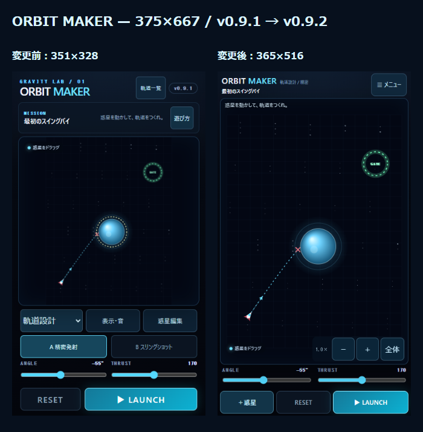

# v0.9.2 — BIG SPACE UI

実施日：2026-10-25。ローカル実装。公開・pushなし。PC Chromeのタッチ／画面サイズ再現であり、iPhone Safari実機は未確認。

変更ファイル：`index.html`、`styles.css`、`js/game.js`、`js/settings-ui.js`、`js/planets.js`、`package.json`、`README.md`、`tests/launch.test.mjs`。追加：`js/camera.js`、`tests/camera.test.mjs`、`tests/big-space-ui.mjs`、`SPACE_OBJECT_DESIGN.md`、本ディレクトリの検証レポート・測定JSON・画面キャプチャ・比較HTML。

## 画面比較

盤面外枠のCSSピクセルを `getBoundingClientRect` で測定。同一サイズ・新規ブラウザコンテキストで比較。

|画面|変更前 v0.9.1|変更後 v0.9.2|高さ増加|
|---|---:|---:|---:|
|320×568|296×242|310×417|175px（72%）|
|375×667|351×328|365×516|188px（57%）|
|390×844|366×505|380×693|188px（37%）|

通常画面は全3サイズでページ全体の縦横スクロールなし。発射調整、＋惑星、RESET、LAUNCHを下部に維持。スリング選択時はガイドと＋惑星・RESETを表示。モード／発射方式切替、ステージ選択、表示・音、ギャラリー、体験配置、ヘルプ、バージョンはメニューへ移動。

個別画像：`before-*.png`、`after-*.png`、`add-panel-*.png`（各3サイズ）。`menu-375x667.png`、`special-camera-375x667.png`。測定値は `before-measurements.json` / `after-measurements.json`。

## 惑星の操作

1. ＋惑星 → 種類・サイズ → 追加。配置可能な空き領域を既存制約で探し、成功時にパネルを閉じて新しい惑星を選択する。
2. 惑星をタップするとリングと対象名・削除ボタンを表示。ドラッグで移動。削除後は選択解除。追加パネルの選択変更で既存の惑星は変わらない。
3. 個数上限や固定ステージでは追加／削除を無効化し理由を表示。飛行後の追加・削除は禁止。重力操作モードだけ飛行中に移動できる。
4. 特殊惑星の体験配置はメニューから。攻略中は利用不可。

## カメラ

物理座標を維持し、描画全体とポインターの逆変換に同じCameraを使用する。倍率は「全体表示」に対して0.5〜3.0倍。＋／−は1.25倍刻み。2本指の距離で拡縮し、中点移動で視点移動する。視点の中心はステージ境界内に制限。全体表示はステージ境界・開始点・ゴール・惑星（危険領域含む）に12 CSS px以上の余白を取る。RESET／ステージ変更／体験配置で全体表示へ戻り、画面サイズ変更では現在の中心と倍率を維持する。

2本指開始で惑星ドラッグとスリングをキャンセルし、全指が離れるまで単指操作へ戻らない。Pointer Cancel・画面非表示・ウィンドウ失焦で安全に終了。UI起点のタッチはカメラ対象にしない。カメラによる位置・初速・半径・経過時間・予測条件の書き換えはない。

## 関連検証

- `node --test tests/camera.test.mjs tests/planets.test.mjs tests/launch.test.mjs tests/preview.test.mjs`：28件すべて合格。カメラ逆変換・倍率境界・2本指の中点・入力状態・7種類の追加・固定制約・既存複数惑星・両発射方式・予測と実飛行の全ステップ一致を検証。
- `node tests/big-space-ui.mjs`：3サイズの表示・パネル内スクロール構造・盤面不変、追加／選択／削除、ズーム後のマウス選択・タッチドラッグ、ピンチ中の誤発射防止、Pointer Cancel、RESET、重力操作での移動、予測描画点のワールド座標不変、音声経路へのテスト音送信、メニューからギャラリーへ遷移、Stage20固定条件、既存形式の進行・お気に入り保護を検証。
- 物理・発射ベクトル・ステージ・進行保存・ギャラリー保存・音声エンジンは無変更。全ステージの再調整や全件回帰は実施していない。
- 保存試験は破棄可能な独立ブラウザコンテキストだけを使用。実利用データの削除・初期化なし。
- 320pxで狭くなったメニュー内のモード選択を2段へ調整。初期ロケット位置に重なった操作ヒントを盤面下端へ移動。`git diff --check -- .` は問題なし。

## iPhone実機チェック（すべて未確認）

同じオリジンのローカル試験環境で開く。今回の変更は未公開なので、既存の公開URLを更新しても本版は表示されない。PCで `py -m http.server 8000 --bind 0.0.0.0` を対象フォルダで実行し、同じWi-FiのiPhoneから `http://PCのIPv4アドレス:8000/` を開く（Windowsで必要ならプライベートネットワークの通信を許可）。PC内localhostとは保存領域が別になる。既存公開サイトのデータは消さない。

|順|確認内容|OK／NG／未確認|
|---|---|---|
|1|縦画面で盤面・＋惑星・RESET・LAUNCHが見切れず、安全領域内に収まる|未確認|
|2|＋惑星で種類・サイズを選び追加。選択リング・対象名を確認して移動と削除|未確認|
|3|メニューで精密／スリング切替。どちらも発射でき、元へ戻すとキャンセル|未確認|
|4|惑星またはロケットへ1本指を置き、2本目を加えてピンチ・移動。誤発射しない|未確認|
|5|＋／−・全体表示。拡大後も指と惑星が一致し、予測線が追従する|未確認|
|6|重力操作で発射後に惑星を移動。カメラ移動後も操作でき、RESETで復元|未確認|
|7|Stage11〜20の固定条件が維持される。ステージ選択と体験配置が利用できる|未確認|
|8|表示・音、ギャラリー、ヘルプを開閉して発射条件が維持される|未確認|
|9|サウンドON・テスト音・中断復帰を聴感で確認。軽量モードと連続操作で遅延・発熱確認|未確認|
|10|再読み込み後も既存の星・お気に入りが残る。保存情報を削除しない|未確認|

NGの場合：端末／iOS／画面向き／モード／ステージ／倍率／再現手順／期待結果／実際の結果を記入する。

## 残存課題・引き継ぎ

iPhone Safari実機の複数指認識、動的アドレスバー、安全領域、音声聴感と発熱は未検証。マウスのカメラ操作は＋／−／全体で対応し、単指パンやマウスドラッグによるパンは追加していない。既存の縦横比を保つため全体表示では縦長画面に上下余白が出る。0.5〜3.0倍はPC検証に基づく暫定範囲。大きなworld・追加オブジェクトでは可視領域カリングを拡張する。詳細は [SPACE_OBJECT_DESIGN.md](../../SPACE_OBJECT_DESIGN.md)。
