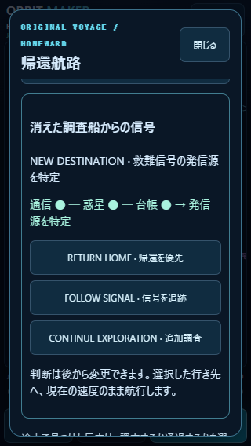
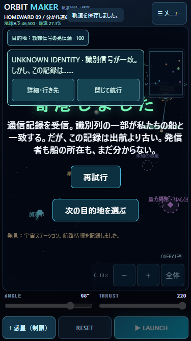
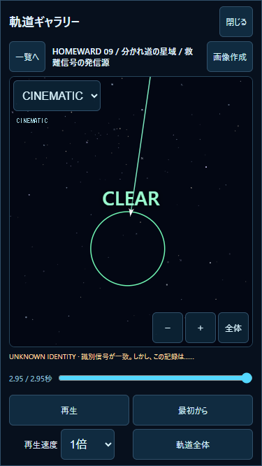

# v1.5.0 — ECHOES OF THE UNKNOWN

検証日：2026-10-30 JST。ローカル実装。Git push・公開・デプロイなし。
PC Node.js / Chromeの検証とiPhone実機を区別する。**iPhone実機の操作感・安全領域・発熱はUNVERIFIED。**

## 1. 変更した主要ファイル

|ファイル|変更|
|---|---|
|`js/echoes.js` 新規|手掛かり・通信・照合・3種類の航路判断。物理状態を書き換えない純粋な投影処理|
|`js/echoes-ui.js` 新規|短い関連図、可逆な判断ボタン、通信解析日誌、保護記録へのCINEMATICリンク|
|`js/homeward-progress.js`|任意の`echoes`保存、旧知識からの再計算、取得順非依存、初回イベント参照、判断履歴|
|`js/frontier.js`|新しい信号地点だけは3手掛かりの照合まで選択不可。既存5対象の距離条件は維持|
|`js/frontier-ui.js`|既存の非停止通知を通信にも利用。通信本文14px、44px以上のタップ領域|
|`js/homeward-ui.js`|星域図で解放後だけ新目的地を表示、解析日誌を既存日誌へ統合|
|`js/open-voyage.js`|無害な新目的地1点を追加。既存惑星・ギミック・ゴール・物理パラメータは維持|
|`js/voyage-courses.js`|新目的地の参考航路を追加|
|`js/game.js`|固定ステップ後の通信取得、既存目標変更経路の利用、航行終了・RESET時の初回通信記録保護|
|`js/gallery-ui.js`|保存された`storyEvents`を再生時刻に合わせて表示。旧記録の座標・再生方式は維持|
|`index.html` / `styles.css` / `package.json` / `README.md`|1.5.0、既存マップ内の小型ストーリーUI、説明|
|`tests/echoes.test.mjs` / `tests/echoes-ui.mjs` 新規|照合・航路・保存・互換性・実ブラウザの関連検証|

調査した既存構成はv1.4.0の発見、Sector09の3750×5000ワールド、HOMEWARD v1進行、寄港・安全な再発射、日誌、専用IndexedDB、CINEMATIC、1〜100倍のFlightClock。既存構成へ追加し、物理エンジンの全面変更はしていない。

## 2. ストーリー実装

「消えた調査船からの信号」。探査機に残された破損した通信が、惑星で観測した反応と、ステーションの帰着しなかった調査船「イサリ」の台帳につながる。3つの情報から別の発信源を推定する。到着時には自船と一部一致する古い識別列を受信するが、発信者・船の所在・一致の理由は確定しない。オリジナルの物語・名称で構成する。

航行画面に長文を常設しない。短い通信通知と、マップ内の「通信 ● ─ 惑星 ● ─ 台帳 ● → 発信源を特定」で関係を表す。複数通信が同じステップで発生した時は最新の要点を表示し、すべての取得情報・照合結果は解析日誌に残す。

通信の表示・閉じる操作は飛行を止めない。「詳細・行き先」は従来の宇宙マップを開き、メニュー表示中だけ従来どおり一時停止する。閉じると航行に戻る。到着時の通信通知を閉じると通常の寄港結果を確認できる。

## 3. 手掛かりと解放条件

|ID|取得条件|短い意味・効果|
|---|---|---|
|CLUE-01 破損した通信記録|D01漂流探査機をINVESTIGATEDにする（100単位以内）|識別不能な通信断片。単独では内容不明|
|CLUE-02 一致する信号パターン|D03実際の反重力惑星を調査（550単位以内）|CLUE-01と揃うと同一パターンと判明|
|CLUE-03 失われた航海記録|D04を選択して通常のステーション寄港|CLUE-01と揃うと消えた調査船との関連の可能性|
|CLUE-04 救難信号の発信源|01＋02＋03の照合|新しい目的地`echo-signal`を開示。正式名・マーカー・距離・選択が可能|
|CLUE-05 未解明の識別信号|解放済み`echo-signal`を選択し、実際に到達|自船と部分一致する識別列。真相は未確定、次章への伏線|

D02の従来の救難船救助と、今回照合して特定する別の信号地点は別物。D02の寄港・報酬・既存の5対象を置き換えない。D05の既存調査も追加探索先として維持する。

6通りすべての取得順で同じ解放結果になる。取得済みフラグと初回イベントIDの集合から再計算するため、再訪・再読込で報酬や同じイベントを重複発生させない。旧調査済みデータからも照合する。旧日時を現在の取得日時として捏造しない。

## 4. 航路分岐

|判断|目的地と挙動|
|---|---|
|RETURN HOME|既存の帰還ゲートを選択。手掛かり・報酬・調査済み状態は残る|
|FOLLOW SIGNAL|3手掛かり照合後だけ有効。新しい発信源を選択|
|CONTINUE EXPLORATION|検出済み・未調査の信号を優先。なければ判明済み地点の再探索を選択。既存マップから別の対象へ変更も可能|

未検出の地点を名前付きで強制開示する機能ではない。追加調査先がまだ分からない場合は、その判断ボタンを無効にし、通常の飛行で信号を探せる。いずれも後から切替可能で、帰還後の再探索を永久に禁止しない。連続した同一判断・同一目的地は履歴へ重複追加しない。

判断と目的地変更は既存の`changeDestination`を経由する。飛行中は位置・速度・経過時間を維持し、選択したゴールだけを変更する。操船や発射条件を自動修正しない。現在の航路からそのまま到達できるとは限らず、必要なら寄港・RESET後に条件を調整する。

## 5. 新しい目的地と実航行

救難信号の発信源：**(3300,2000)、到達半径100**。他の目的地・天体の中心と重複せず、新しい重力・衝突天体は追加しない。解放前はマップ・盤面・目的地一覧に表示しない。解放後だけ選択可能になる。未選択で通過しても航行は終了しない。

初期候補(2400,3900)は到達できたが、帰還ゲートへの直接航路が探索した角度・推力範囲で見つからず採用しなかった。現在の位置では追跡後の直接帰還も実際に検証できた。既存配置や成功判定を変更して解決していない。

以下は初期惑星配置・各寄港地の安全な標準出発位置・THRUST **220**を使う具体例。角度はANGLE入力値。推定ではなく、既存1/120秒エンジンによる到達結果。

|区間|ANGLE|到達時間|取得・選択|
|---|---:|---:|---|
|入口→探査機|−48°|8.500秒|D01検出後、マップで信号へ変更。CLUE-01|
|探査機→既存救難船|−174°|2.283秒|従来の救助・参考航路を利用可能|
|救難船→未知惑星|−19°|10.083秒|CLUE-02、同一信号パターン|
|未知惑星→ステーション|−77°|7.533秒|CLUE-03・04、調査船との関連・新目的地解放|
|ステーション→新しい発信源|98°|2.950秒|FOLLOW SIGNAL、CLUE-05、寄港チェックポイント|
|新しい発信源→異常物体の調査点|89°|5.917秒|CONTINUE EXPLORATION、既存D05調査を継続|
|異常物体の調査点→帰還ゲート|−98°|13.142秒|帰還、手掛かりを保持|

上記7区間は実行ステップ数、終端状態・座標、イベント時刻が1倍と100倍で完全一致。すべて予測の終端とも一致。再生は保存座標を使い、再積分はしない。

新しい発信源から直接帰還する別例：**−105° / 220、6.392秒**。発信源からステーションへ戻る別例：**−85° / 220、4.375秒**。惑星の寄港地から新しい発信源へは**−70° / 220、3.483秒**も検索時に実到達を確認した。

新規探索の隠れた行き先は最初から選べない。初回はゲートを選んだまま−48°で飛び、D01検出後に既存マップから変更する。最初の区間の検出・目標変更はv1.4.0で実航行検証済み、今回も関連検出テストを維持した。今回のNode全区間テストは以降の照合と到達を分離するため、既存5地点には内部APIで選択してから発射する。新しい発信源の解放条件は内部APIにも強制し、解放前には選べない。

区間別の終点座標・物理ステップ数・イベント：[route-results.json](route-results.json)。各飛行JSONも同じディレクトリに保存。テスト日時は倍率比較のため固定値を注入し、ブラウザの記録日時は実日時を使用。

## 6. 保存と互換性

既存キー`orbit-maker.homeward.v1`、トップレベル`version:1`を維持し、任意の追加情報だけを保存する。

```text
echoes: {
  version: 1,
  clues: { 'CLUE-01': {id, source?, at, flightId?}, ... },
  events: [{id, message, destination, at, elapsed}],
  choices: [{choice, destination, at}],
  records: { 'CLUE-05': 'protected-flight-id', ... }
}
```

追加項目がなければ未取得・未選択として扱う。ただし既存のD01/D03/D04調査済み情報がある場合は、読み込み時に手掛かりと関連を再計算して、調査し直しを要求しない。ロードだけでlocalStorageへ書き込まない。旧Sector01〜08だけのデータには不要な空のストーリー項目も追加しない。

既存進行・チェックポイント・発見・日誌・お気に入り・重要記録・CLASSICは保持する。DB名・バージョン・オブジェクトストアは変更しない。破損・将来形式のHOMEWARDは従来どおり上書きせず一時プレイにする。保存不能時は可能な限りメモリ内で継続し、通知する。旧保存や他キーを削除して容量を空けない。

解析日誌には取得内容、二つの照合結果、新目的地、判断履歴、保護記録参照を表示する。旧調査航行の参照があれば再利用し、すでに消えている座標記録を復元できるとは扱わない。

## 7. 重要航行記録

従来の専用DB`orbit-maker-homeward-archive`を継続使用する。新しい初回スロットは`story:homeward-09:<event-id>:first`。5手掛かりと2照合イベントで最大7スロット。新目的地の初回寄港も既存方式で保護する。

記録は航行終了・RESET時に保存し、保存成功後だけ参照IDを付ける。同じスロットの既存記録は`saveFirst`で保護し、自動整理・上書きしない。現在の最大構成はセクター9＋寄港7＋発見段階10＋通信7＝33スロット。各記録は既存の最大4096点を維持する。同一航行が複数の初回スロットに入る場合があり、全航行を無制限に専用保存する仕様ではない。

飛行記録には任意の`storyEvents`を追加し、CINEMATIC再生中に保存時刻に合わせて通信を表示する。旧v1記録は追加フィールドなしでも従来どおり動く。保存座標・速度・物理結果は変更しない。

## 8. 関連テスト

全件回帰は実施せず、関連Nodeテスト **31件成功**。

|対象|件数|結果|
|---|---:|---|
|`node --test tests/echoes.test.mjs`|7|取得・重複防止・全6取得順・旧v1.4・可逆な判断・実航行・予測・1/100倍・保存復元・容量不足・旧代表4航路 PASS|
|`tests/flight-replay.test.mjs`＋`tests/gallery.test.mjs`|12|旧記録・新規記録・再生位置・速度・CINEMATIC・非破壊性・DB不能の影響範囲 PASS|
|`tests/frontier.test.mjs`を`高速の\|未発見名称\|旧v1.3の\|保存容量不足\|遅延した`で限定|5|既存5対象の検出・調査・旧データ・記録参照・保存失敗 PASS|
|`tests/homeward.test.mjs`＋`tests/first-voyage.test.mjs`を`旧v1\|チュートリアル\|セクターの順次\|旧キー\|破損\|保存容量\|不正な現在`で限定|7|旧01〜08側の保存復元・チュートリアル・他キー・一時プレイ PASS|

旧保存の完全一致テストで、初期実装が読み込み後に不要な空項目を足すことを検出した。追加情報のある探索データに限って再計算する修正を行い、該当7件を再実行して成功した。テストの期待値を緩めて通過させていない。

既存Sector09代表4航路は保存済みの時間・終端座標と完全一致。`physics.js`、`encounters.js`、`launch.js`、CLASSICステージ、音声、通常ギャラリーDB処理に変更なし。既存の固定刻み・繰越処理・1〜100倍・惑星移動・カメラ処理を維持する。

**PC Chrome**：`node tests/echoes-ui.mjs`。ユーザーとは別の使い捨てコンテキスト・テスト用保存領域で実行。

- 320×568、375×667、390×844で通信と判断ボタンが画面内。本文14px、44px以上の操作。盤面はそれぞれ310×417、365×516、380×693を維持。パネル内スクロールのみで、ページ全体の余分なスクロールなし。
- 旧v1.4の調査情報から照合→3判断の切替→飛行中に帰還/追跡を切替→100倍で新目的地へ寄港→CLUE-05通知・チェックポイント保存。
- 375幅で再読込後も手掛かり・寄港地を復元。通常ギャラリーへ25件を追加して自動整理後も、日誌からCLUE-05の専用記録をCINEMATICでCLEARまで再生し、通信を表示。旧重要記録・お気に入りは保持。
- 新規探索では新目的地・詳細座標を表示せず、FOLLOW SIGNALは無効。ブラウザ例外なし。

結果：[ui-results.json](ui-results.json)、[ブラウザ保存例](browser-save.json)。容量不足は例外注入・疑似ストレージで確認し、実ディスクを埋めていない。PCのPASSをiPhone実機の合格には置き換えない。

## 9. 画面





## 10. iPhone実機確認表（未実施）

公開していないため、今回のローカル作業ツリーを配信する環境で開く。既存のサイトデータを消して試験しない。Sector09未解放の場合は通常の進行で到達する。

|順|操作と期待結果|記入|
|---|---|---|
|1|目的地を開く。未取得時に新信号の名前・座標が出ない。帰還は選べる|OK / NG / 未確認|
|2|探査機・未知惑星・ステーションを調査。短い通信と関連図が変化し、通知を閉じても飛行継続|OK / NG / 未確認|
|3|3手掛かり後にFOLLOW SIGNAL。新しい地点が選べる。RETURN HOME・追加調査へ変更も可能|OK / NG / 未確認|
|4|ステーションから98°/220で発射し、1倍または100倍で寄港。識別情報の通信を読む。閉じて寄港結果を確認|OK / NG / 未確認|
|5|再読み込み。寄港地・手掛かり・判断を保持。−105°/220で帰還、または89°/220で追加調査|OK / NG / 未確認|
|6|日誌のCLUE-05記録をCINEMATIC再生。旧お気に入り・旧重要航行も確認|OK / NG / 未確認|
|7|通知とマップの文字・見切れ・安全領域、パン/ピンチ/FOLLOW/CINEMATICへの干渉を確認|OK / NG / 未確認|
|8|100倍速と連続航行の操作感・処理落ち・発熱を確認|OK / NG / 未確認|

NG記入欄：端末/iOS、画面向き、寄港地・選択先、発射角度/推力/倍率、再現操作、期待結果、実際の結果。

## 11. 残課題

- iPhone Safariの実操作・実安全領域・CINEMATIC視認性・100倍時の発熱は未確認。
- 飛行途中の重要座標記録保存はv1.4.0から継続する残課題。取得状態は保存するが、航行が終わる前に閉じた場合、その飛行の保護記録はない。
- 保存容量・ブラウザのサイトデータ消去を超える復元、記録の外部バックアップは対象外。保存失敗した記録の自動再試行は未実装。
- CLUE-05は伏線。調査船の所在・識別信号の真相・次宙域での物語は次Version。推力や物理的成功を報酬として自動補正しない。
