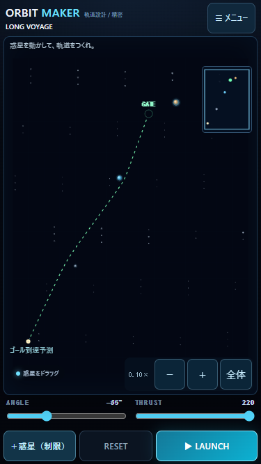
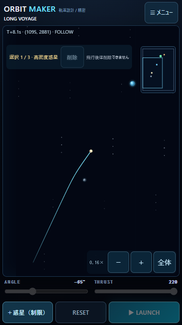

# v0.9.3 — EXPANDED SPACE

2026-10-25。ローカル実装・検証。公開・pushなし。以下のブラウザ検証はWindows PC上のChromeであり、iPhone Safari実機は未確認。

## 変更ファイル

`index.html`、`styles.css`、`js/game.js`、`js/camera.js`、`js/physics.js`、`js/preview.js`、`js/flight-record.js`、`package.json`、`README.md`、`SPACE_OBJECT_DESIGN.md`、`tests/camera.test.mjs`。

追加：`js/worlds.js`、`tests/expanded-space.test.mjs`、`tests/expanded-space-ui.mjs`、本ディレクトリのレポート・検証JSON・飛行記録・PNGキャプチャ。

## ワールドと制限の比較

|フリープレイ|物理ワールド（幅×高さ）|従来比（辺／面積）|飛行上限|予測上限|全体表示倍率|
|---|---|---|---|---|---|
|STANDARD|375×500|1／1|12秒|12秒|1.00×|
|LARGE|1125×1500|3／9|45秒|45秒|約0.33×|
|HUGE|3750×5000|10／100|180秒|120秒|0.10×|

従来の主な制限は375×500のワールド、飛行12秒、予測1441ステップ、記録1443フレームだった。速度120〜220は約4000単位の航行が可能なため変更していない。重力定数・ソフトニング・1/120秒のVelocity Verlet・全惑星の重力合算・連続衝突判定・境界の36単位の猶予も維持。時間制限だけを新ワールドのシミュレーション状態に指定可能とした。既存ステージには新しい制限を付けない。

座標はワールド単位。画面を縮小して失敗境界を動かす方式ではない。旧領域内の(100,400)から右へ220で2秒飛ばすと、LARGE/HUGEでは(540,400)で飛行継続する。新境界を越える場合は従来と同じ猶予を経て画面外失敗になる。

## HUGE体験配置と到達検証

メニュー → HUGE体験航行 → 配置を選ぶ。発射条件は全例ANGLE −65°、THRUST 220、出発点(250,4500)。初期配置のままLAUNCHで到達する。両発射方式・両ゲームモードで利用でき、惑星移動は必須ではない。

|体験配置|惑星|到達座標（丸め）|到達時間|実航行距離|累積旋回角|結果|
|---|---|---|---:|---:|---:|---|
|LONG VOYAGE|高密度・地球型・巨大ガス|(2143,935)|17.750秒|4059.80|27.62°|CLEAR|
|MULTI SWING-BY|高密度×2・巨大ガス|(3005,1654)|17.733秒|4090.02|52.10°|CLEAR|
|DEEP SPACE|反重力・ブラックホール・恒星|(1773,823)|17.750秒|3984.25|13.42°|CLEAR|

航行距離は固定ステップごとの位置差を合計した値。開始点が旧領域外にあることだけを広域航行の根拠にしていない。約4000単位の距離・座標変化を検証している。全例で惑星を除去した同じ発射条件はゴールへ到達せず、新ワールドの外へ逸脱する。引力・反発が経路に寄与する。

詳細：[航行検証.json](航行検証.json)。解答配置・初速・全保存サンプルは `voyage-flight.json`、`swing-flight.json`、`deep-flight.json`。ブラウザで実際にLAUNCHした記録は [browser-flight.json](browser-flight.json)。ブラウザ記録もHUGE、17.75秒、出発(250,4500)から(2143.17,935.27)へ到達している。



## カメラ・編集・ミニマップ

- 0.10〜3.00倍。倍率は従来375×500の表示スケールを基準とする。＋／−は1.25倍刻み、2本指の距離でズーム、中点で視点移動。
- FIXEDは現在の視点を維持。FOLLOWは飛行中のロケットへ追従。OVERVIEW／全体は現在の物理ワールド全体へ合わせる。RESETとワールド変更は全体表示へ戻す。
- FOLLOW中の＋／−は追従を維持。2本指操作はFIXEDへ切り替え、惑星／スリング操作をキャンセルする。メニューのカメラ選択から追従へ戻せる。カメラ設定は飛行中も利用可能。
- 最小タッチ半径22 CSS px。0.1倍でも小さい惑星を選択できる。ワールドへの逆変換で移動し、惑星の物理半径・質量を変更しない。
- 広域フリープレイでは発射前にゲートをドラッグできる。ワールド境界・惑星危険領域・発射地点の保護を維持。既存Stage01〜20ではゲート移動と広さ変更を禁止。
- 右上の72×96 CSS pxのミニマップにロケット・惑星・ゴール・表示範囲を表示。メニューからON/OFF可能。



## 予測・描画・記録の負荷対策

予測と実飛行は同じ物理ステップを使用する。LARGEは45秒、HUGEは120秒まで。計算は1フレーム160ステップ以内・約2msの時間予算で分割し、HUGEでも最大14401ステップ。点の保存間引きは計算ステップを省略しない。最大約3603予測点、描画は約1000点以内。予測終了時に飛行が継続可能なら「予測120秒まで（この先は未予測）」と表示し、失敗確定と扱わない。実飛行の上限180秒とは区別する。

航跡は3600点を超えると間引く。背景グリッドは可視範囲のみ・縮小時は間隔を広げ、画面外の惑星描画を省略する。物理演算では画面外の惑星も常に計算する。星は固定76個。ミニマップは固定Canvasを再利用する。

記録は既存v1形式の `[時刻, rocketX, rocketY, planet1X, planet1Y, ...]` を維持する。STANDARDは従来どおり全ステップ。HUGEは基本20Hzと旋回時の追加サンプル、終了時と直前ステップを必ず保存する。最大4096フレームで再間引き。3惑星・4096行の数値部分は約288KiBで、配列やJSON等の追加メモリは別途必要。実機メモリ・発熱の測定値ではない。

3配置は357／364／357行。固定ステップ位置と再生補間位置の最大差は、LONG VOYAGE 0.033、MULTI SWING-BY 0.138、DEEP SPACE 0.008ワールド単位。終端は完全一致。長時間では全物理ステップの完全記録ではないことを明示する。IndexedDBのスキーマ・自動20件・お気に入り30件の上限、ステージ進行のlocalStorage形式は変更していない。

## 関連テスト

関連8ファイル計71件を対象に検証。物理・予測・記録の共通処理変更に影響する範囲であり、プロジェクト全件回帰は実施していない。記録精度の追加検証で見つかった到達直前の間引き誤差を修正し、該当の広域・ギャラリー16件を再実行して全件合格。

```text
node --test tests/expanded-space.test.mjs tests/physics.test.mjs tests/camera.test.mjs tests/preview.test.mjs tests/launch.test.mjs tests/gallery.test.mjs tests/special-planets.test.mjs tests/live-gravity.test.mjs
node tests/expanded-space-ui.mjs
```

- 全3HUGE配置：到達、惑星の寄与、予測終端と間引き保存した全予測点の一致、スリングと重力操作の互換性、再生精度。
- STANDARD互換、旧境界外の飛行、新境界逸脱、HUGEの180秒上限、120秒での予測打ち切りと保存点上限。
- 0.1倍・逆変換・FOLLOW・物理状態の不変性、遠隔通常惑星／ブラックホール／恒星の高速連続判定。
- Stage01〜20：v0.9.2の物理ソース（`ba20c0564fd07b60a955a00119b7ba61ecb60233`）と各基準軌道を全ステップ比較し、全て一致・CLEAR。ステージデータ・攻略条件は無変更。
- PC Chrome：320×568、375×667、390×844でHUGE 0.1倍とスクロールなし。375pxで小型惑星選択、ゲート移動と予測再計算、FOLLOW中の倍率変更、ピンチで追従解除、実LAUNCHと記録、RESET、ミニマップOFF、ギャラリー再生、お気に入りと進行の再読み込み後の維持、Stage20の広さ変更禁止を確認。ページ例外なし。

PCの時間再現機能でブラウザ時刻を進めた航行試験を含む。物理刻みは変えていない。実時間のiPhone性能測定ではない。結果は [ui-results.json](ui-results.json)。実利用の保存領域には触れず、使い捨てブラウザコンテキストを使用した。

## iPhone実機確認手順（全項目未確認）

未公開のため、既存公開URLには本版は反映されない。対象フォルダで `py -m http.server 8000 --bind 0.0.0.0` を実行し、同じWi-FiのiPhone Safariで `http://PCのIPv4アドレス:8000/` を開く。必要ならWindowsのプライベートネットワーク通信を許可する。公開サイトとはオリジンが違うため記録は別管理。既存サイトの履歴や保存情報を削除しない。

|順|操作と期待結果|OK／NG／未確認|
|---|---|---|
|1|縦画面でメニュー→広さ→LARGE／HUGE。全体表示で0.33／0.10倍になり全体が見える|未確認|
|2|HUGE体験航行→LONG VOYAGE。初期のままLAUNCH、約18秒待ってCLEAR|未確認|
|3|RESET後にカメラFOLLOWを選択。発射中の追従と＋／−、2本指操作での解除|未確認|
|4|0.1倍で小さな惑星を選択・移動。ゲートも移動でき、予測線が更新される|未確認|
|5|MULTI SWING-BY／DEEP SPACEも初期配置でLAUNCHして到達。危険領域は従来どおり失敗|未確認|
|6|ミニマップON/OFF、重力操作、スリング発射、RESETが使える|未確認|
|7|ギャラリーで長距離航行を再生し、お気に入りを保存。再読み込み後も残る|未確認|
|8|STANDARDと既存ステージの星・進行が維持され、音声ON/OFFも利用できる|未確認|
|9|連続航行・ズーム・予測で操作遅延、発熱、Safariの再読み込みが起きない|未確認|

NG記録欄：端末／iOS／ワールド・配置／モード／発射方式／倍率／再現手順／期待結果／実際の結果。

## 残存課題

iPhone実機の複数指操作、安全領域・動的アドレスバー、音声、長時間のメモリ・発熱は未確認。HUGEの予測は120秒までで、以降60秒は計算対象外。広域飛行の記録は補間再生であり、間引き後の全ステップ一致は保証しない。新しい自由配置はリロードを越えて保存しない（ギャラリーの飛行記録は保存される）。最大惑星数は3個、追加の宇宙ギミックは未実装。公開・pushは未実施。
