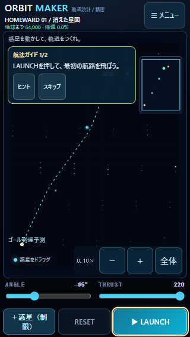
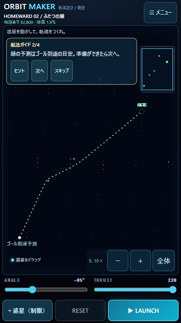

# v1.0.1 — HOMEWARD FIRST VOYAGE

2026-10-25。ローカル実装・検証。公開・pushなし。PC Chromeでの画面サイズ再現であり、iPhone Safari実機は未確認。

## 変更ファイル

`js/homeward-data.js`、`js/homeward-progress.js`、`js/homeward-ui.js`、`js/game.js`、`index.html`、`styles.css`、`package.json`、`README.md`、`HOMEWARD_SPEC.md`、`tests/homeward.test.mjs`。

追加：`js/homeward-tutorial.js`、`tests/first-voyage.test.mjs`、`tests/first-voyage-ui.mjs`、本ディレクトリの検証JSON・飛行記録・画面PNG・本報告。

## セクター別の調整と攻略

|セクター|初期設定と結果|攻略例・結果|難易度の意図|
|---|---|---|---|
|01 消えた星図|−65°／220：CLEAR 17.750秒|そのままLAUNCH|従来の配置・初速・出口を維持。発射と引力による曲がりを観察|
|02 ふたつの潮|−65°／200：逸脱 22.517秒|角度はそのまま、THRUST 220：CLEAR 17.733秒|推力と予測の関係を学ぶ。218でも到達|
|03 青い残響|−60°／200：衝突 7.375秒|ANGLE −65°／THRUST 220：CLEAR 17.650秒|反発・吸収・熱を読み、角度と推力を組み合わせる。216・218でも到達|

02は推力だけを変える分かりやすい解答を用意し、初期の単純発射は失敗する。03では反重力惑星(1000,3200)を維持し、ブラックホールを(1250,2300)、恒星を(1500,2000)、出口を(2731,1245)・半径80に調整。精密角度の範囲を−75〜−50°に絞り、狭い画面でも1°の調整を行いやすくした。FREE SPACEやCLASSICのスライダー範囲は変更していない。

全例の出発点は(250,4500)、物理ワールドは3750×5000。解答の実航行距離は01：4059.80、02：4090.02、03：4197.90ワールド単位。初期失敗と解答成功は物理演算・実際のゲーム画面の両方で確認した。

### 惑星の寄与と危険領域

02の解答から高密度惑星を1個ずつ除くと、いずれも非クリアになる。03では反重力・ブラックホール・恒星のそれぞれを除いた3ケースが全て非クリア。置いてあるだけの特殊惑星にはしていない。

03の解答は、ロケット半径を含めて吸収域から最小35.39、熱領域から最小54.84ワールド単位の余裕で通過する。吸収／熱領域を横切らせる別テストでは、それぞれabsorbed／overheatedの失敗を検出。特殊惑星の重力・危険領域仕様は変更していない。

詳細は [balance-verification.json](balance-verification.json)、[sector-verification.json](sector-verification.json)。各解答の記録は `homeward-01-flight.json`〜`homeward-03-flight.json`。実際の画面での失敗・成功記録は [browser-homeward-flights.json](browser-homeward-flights.json)。

## 航法ガイドと探索演出

別のゲーム画面は作らず、通常盤面の小さな案内と強調枠・リングで教える。ガイドが画面の高さを押し下げることはない。

- 01：発射→航跡を観察。
- 02：THRUST操作→予測を確認して「次へ」→発射→観察。
- 03：紫の反重力惑星をタップ→ANGLE→THRUST→予測→発射→観察。
- 対象のボタン／スライダーを枠、惑星／ロケットをリングで強調。解答を自動適用せず、実操作で進む。惑星選択のリングは維持し、ガイド中は削除できない惑星の選択ツールバーを一時的に隠して操作領域を確保する。
- いつでもスキップできる。スキップ／完了後は通常操作へ戻り、再読み込み・RESETでガイドを強制し直さない。未完ガイドの再試行は最初の操作段階に戻る。
- ヒントは任意表示。スキップ後や旧クリア済みデータでも、宇宙マップの攻略ヒントから解答例を読める。
- 予測OFF時はONへの操作先を案内し、勝手に設定を変えない。スリング選択時の発射はロケットの操作を案内し、数値調整段階では精密発射への切替またはスキップを案内する。
- 発射直後の3秒間は短い出航ログを表示。到達時はセクターごとに異なる発見ログを表示し、残距離も更新する。01：星図の回収、02：青い惑星の方位、03：故郷の時刻信号へと物語を進める。





## 既存セーブ保護

キーとversionは `orbit-maker.homeward.v1` のまま。任意フィールド `tutorial` を追加し、セクターごとのstatus（active／completed／skipped）、段階、未完ガイドのANGLE／THRUSTを保存する。既存cleared・currentSector・eventsSeenを維持する。旧セーブの02・03通過済みを取り消さず、通過済みはガイド完了として扱う。新規ガイドを強制しない。旧データの読み込みだけでは書き込まない。

再読み込み後も未完の段階・精密発射設定を復元する。飛行途中の座標・編集した惑星位置・スリングの引き量は保存しない。観察中に再読み込みした場合は発射段階から再開。完了・スキップは維持する。

CLASSICの星・モード別進行、FREE SPACE、IndexedDBと記録v1形式は変更していない。旧お気に入りを保護し、新03の記録をギャラリーでCLEARまで再生できることを確認した。物理・予測・通常／特殊惑星・既存Stage01〜20・FREE SPACEデータ・音声・ギャラリーストアのソースは無変更を差分で確認した。

## 関連テスト結果

```text
node --test tests/homeward.test.mjs tests/first-voyage.test.mjs tests/launch.test.mjs
node tests/first-voyage-ui.mjs
```

単体・入力テスト22件合格。以下の変更箇所とその影響だけを確認した。既存Stage01〜20の全到達検証や全件回帰は再実行していない。

|項目|結果|
|---|---|
|01〜03の解答|全て到達。両方式・重力操作の共通解も到達|
|02・03の初期非クリア|物理計算と実ゲーム画面で確認|
|予測一致|全保存予測点と終端状態が実飛行に一致。入力ステージは不変|
|ガイド|順序、実入力、予測確認、再試行、スキップ、完了、保存復元が合格|
|旧HOMEWARD|02・03クリア済みの進行・既読・残距離維持。ガイドを強制しない|
|保存失敗|破損・将来形式の上書き防止、保存拒否・容量不足の一時プレイを維持|
|PC Chrome実操作|01→02→03、初期失敗→調整→成功、途中の再読み込みを確認|
|既存機能|CLASSIC Stage01 CLEAR・★★★と20ステージ一覧、FREE SPACE編集状態への復帰、旧お気に入り、新記録再生を確認|
|画面|320×568／375×667／390×844で主要操作とガイド表示。ページ全体のスクロール・例外なし|

測定値・実操作結果は [ui-results.json](ui-results.json)。ブラウザの時刻再現で飛行を進めた試験を含む。物理刻みは変更していない。試験は独立した使い捨てコンテキストの保存データだけを使い、利用者のデータを初期化していない。

## iPhone実機確認手順（未確認）

本版は未公開。対象フォルダで `py -m http.server 8000 --bind 0.0.0.0` を実行し、同じWi-FiのiPhone Safariから `http://PCのIPv4アドレス:8000/` を開く。公開サイトとは保存領域が別になる。既存サイトの保存情報は削除しない。

|順|確認操作・期待結果|OK／NG／未確認|
|---|---|---|
|1|HOMEWARD→01でガイドと発射ボタンを確認。そのまま発射して曲がる航跡とCLEARを見る|未確認|
|2|02のTHRUSTを220へ。「次へ」→発射でCLEAR。未調整なら非クリア|未確認|
|3|03で紫の星をタップし、ANGLE −65°・THRUST 220へ。予測と危険領域を確認して発射|未確認|
|4|ガイドの途中で再読み込みし、段階とANGLE／THRUSTが残る|未確認|
|5|スキップ後に再読み込みしてもガイドが戻らず、マップのヒントは読める|未確認|
|6|既存クリア済みの02・03と星・お気に入りが残る。CLASSIC／FREE SPACEも使える|未確認|
|7|画面の安全領域、ガイドの指操作、サウンド、連続プレイ時の遅延・発熱を確認|未確認|

NG記録：端末／iOS／セクター／モード／発射方式／段階／再現手順／期待結果／実際の結果。

## 残存課題

iPhone実機の操作感・音声・発熱は未確認。02は初期角度を保ち推力を増やす解答が最も分かりやすく、角度を変えると難しくなる。03も予測と任意のヒントで学ぶ構成で、操作の自動補正は行わない。チュートリアル状態を保存しても飛行途中の再開には対応しない。04以降のセクター、分岐探索、新ギミックは未実装。公開・pushは未実施。
