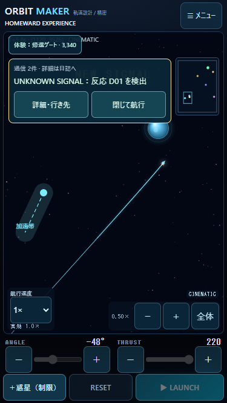
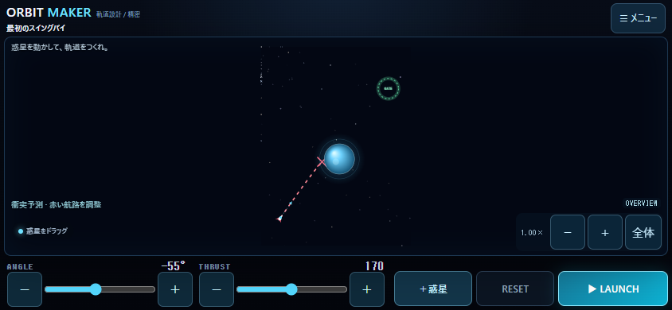
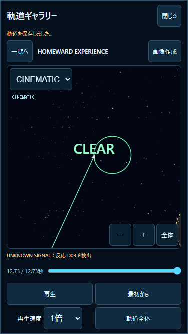

# v1.7.0 — HOMEWARD EXPERIENCE

検証日：2026-10-31 JST。ローカル実装。Git push・公開・デプロイなし。
**PCの自動検証とiPhone実機を区別する。実機の操作感・安全領域・発熱・処理落ちはUNVERIFIED。**

## 1. 方針・確認した既存実装

既存の画面・ANGLE/THRUST・スリングショット・予測・FOLLOW/CINEMATIC・1〜100倍・通知・日誌・ギャラリー・HOMEWARD進行を確認した。既存機能の表示と操作を改善し、物理エンジンと成功条件を変更しない。

通常HOMEWARDのストーリーやセクターを増やす版ではない。新規プレイヤー向けの体験だけを、既存Sector09と同じ検証済みのワールド/力から構成する。通常進行とは別の使い捨てセッションにする。

## 2. 主要変更ファイル

|ファイル|内容|
|---|---|
|`js/homeward-experience.js` 新規|独立した体験航路・検出・寄港。通常HOMEWARDのストレージへアクセスしない|
|`js/voyage-presentation.js` 新規|予測の表示用特徴、色・マーカー、単一の短い発見リング|
|`js/game.js`|微調整、入力直後の予測更新、航跡/炎、通知演出、体験開始・目的地変更・記録・元の画面への復帰|
|`js/frontier-ui.js`|通信件数と色を付け、複数イベントを1枚の通知に集約|
|`js/cinematic-camera.js`|近距離の発見対象を短時間だけ構図に含める表示用cue|
|`js/flight-replay.js`|保存済みイベント時刻に合わせて同じ発見cueを再現。物理再計算なし|
|`js/homeward-ui.js`|最近の発見地点を既存SVGマップで強調|
|`js/space-experience.js` / `js/space-audio.js`|発見・解析・航路解放の色と短い合成音。従来の音声解除・音量・同時発音制限を継続|
|`index.html` / `styles.css`|44pxの微調整、数値の視認性、体験パネル、横画面の操作1段化|
|`package.json` / `README.md`|1.7.0・操作説明|
|`tests/homeward-experience.test.mjs` / `tests/homeward-experience-ui.mjs` 新規|実航路・表示・カメラ・保存保護・4画面サイズ|
|`tests/space-experience.test.mjs`|新しい3種類の音も既存の音声出力経路・ノード解放の検証に追加|

## 3. 発射操作

- ANGLE・THRUSTの左右に−/＋を置き、1単位ずつ調整可能。スライダーも維持し、THRUSTのstepは2から1にした。
- ボタン/スライダーの高さは44px。角度・推力の値を14px・太字にする。飛行中は微調整ボタンも無効化し、誤操作を防ぐ。
- 入力イベントで古い予測をclearし、同じ既存PreviewControllerで新しい予測を開始。次の描画フレームから最新条件を表示する。長い予測の全計算は従来の分割予算で進めるため、入力時にUIを長時間停止させない。
- 精密発射/スリングショットの共通速度ベクトル、角度/速度の許可範囲、ライブ重力の操作は維持する。操作説明を常時盤面へ追加しない。

## 4. 予測航路

|表現|意味|
|---|---|
|水色の点線|通常の予測|
|緑の点線|既存の物理判定で目的地へ到達|
|赤い点線・赤い×|衝突予測。短い状態表示も追加|
|紫の小さな弧|表示用サンプルの進行角の累積変化が約26°を超える部分。最大3か所|
|金の小さな輪|目的地近くを通る位置。到達成功とは別の目安|

予測データを読むだけで、再積分・力・成功判定を変更しない。画面倍率に応じて線幅を約1.6〜2pxに保ち、ズームアウトでも見えるようにする。描画線は約650区間＋終点に制限し、マーカーは旋回3個・接近1個まで。時間上限で予測を終えた時の既存の「この先は未予測」表示は維持する。

小さな重力の曲がりをすべて「大旋回」とは表示しない。体験の直行経路は最大約8.8°、探査機への寄り道は約14.3°の速度方向変化を実測している。紫の弧の検証は大きく曲がる形状を別途使い、体験経路の成功を表示用しきい値に合わせて偽装していない。

## 5. 航行・発見・達成感

発射時の噴射炎・短い粒子、重力接近時の航跡増光、スイングバイ、CLOSE CALL、到達リング/成功音は従来機能を活用する。今回、速度が260を超えた時の炎を水色へ、目的地の近くの航跡を緑へ変える。数値や速度自体は変更しない。

発見/解析/航路解放を以下で区別する。

|種類|色・短い表示|音|
|---|---|---|
|信号・天体発見|金色、NEW SIGNAL、対象位置に短い輪|660→880Hz・0.12秒|
|調査/通信解析|薄紫、DATA RECEIVED|440→740Hz・0.18秒|
|新航路/座標解放|緑、ROUTE UNLOCKED|660→1046Hz・0.24秒|

同時に出す通知パネルは1枚だけ。新しい要点と件数を表示し、詳細は通常HOMEWARDの日誌へ残す。ワールド上の発見リングも最新の1か所・2.4秒だけ。マップをすぐ開いた場合は最近の発見地点を輪で強調する。未検出の名称・行き先をまとめて開示しない。

既存の粒子上限64/軽量12・リング6、音声4音上限・連打抑制を継続。軽量では新しい発見リングの拡散も抑える。初期ミュート・設定保存・ユーザー操作後のAudioContext開始/復帰を維持し、イベントから勝手にAudioContextを開始しない。

## 6. HOMEWARD EXPERIENCE

メニューの「HOMEWARD EXPERIENCE · 約3分の体験航路」から開始。セクター解放は不要。通常の初回チュートリアルは進めず、体験終了後に通常HOMEWARDの初回説明を受けられる。

ワールド3750×5000、既存Sector09の惑星3個・彗星・異常物体・目的地を再利用。初期条件は−55°/200で、単純発射ではクリアしない。プレイヤーが予測を見て調整して発射する。惑星ドラッグ、ライブ重力、スリングショット、速度変更、通常カメラも利用可能。

|経路|入力・操作|実航行時間|
|---|---|---:|
|直行|ANGLE −59° / THRUST 220で発射。信号を検出しても帰還を続ける|20.325秒|
|任意の寄り道|−48° / 220で発射。約5.633秒でD01検出後、通知の詳細から信号を選択|探査機まで8.500秒|
|寄港後の帰還|体験パネルで帰還ゲートを選択。−59° / 220を設定して再発射|12.733秒|

寄り道の合計飛行時間は21.233秒。惑星の重力で曲がり、未知信号を発見し、寄り道を選び、実際に到達する。ワープ・自動成功・速度ベクトルの自動修正なし。同じ初速の1倍/100倍で物理ステップ数と全終端が完全一致し、予測の終端とも一致。スリングショットも実際に算出した速度で飛ばし、両方式の初速差1e−8未満・到達時間一致・終端座標差1e−6未満を確認した。方式間の浮動小数点誤差を倍率差の検証とは分けている。

終了後は体験パネルの「体験ログ」と「今回の航行をCINEMATIC再生」で振り返れる。「通常のHOMEWARDへ」または元の画面へ戻る操作を用意する。

約3分は操作・鑑賞を含む体験の設計目安。実飛行は上記の時間で検証したが、初心者が実際に操作して3分以内に終えるユーザーテストは未実施。発射条件を知った端末操作を3分以内の学習効果として扱わない。

終端座標・重力による方向変化・発見時刻：[route-results.json](route-results.json)。直行・寄り道の記録JSONもこのフォルダに保存する。

## 7. CINEMATIC

既存の発射・惑星接近/スイングバイ・ゴール接近・到達構図を維持する。発見時はロケットと近距離の信号対象を最大1.6秒だけ同時に収める。遠方の星図由来の開示を追うために極端なズームアウトをしない。

優先順位は従来の到達/ゴール/惑星構図を優先し、その下に発見構図を加える。既存の位置/ズーム補間と倍率上限を継続し、物理ステップごとのカメラ更新は追加しない。手動パン・ピンチでは従来どおりFIXEDになり、CINEMATICへ明示的に戻せる。

再生では保存済みのfrontierEvents/storyEventsと目的地座標から同じ表示用cueを作る。シークやモード切替では古いcueを再初期化する。物理演算の再実行や保存済み座標の変更はしない。

## 8. 保存・互換性

体験モデルは通常HOMEWARDのHomewardProgressを使わず、localStorageや専用アーカイブにアクセスしない。体験の選択・検出・寄港・ログは今回のセッション内だけで、終了/再読込で体験進行を再開する機能は追加していない。

通常HOMEWARDのSector01〜09、CLUE-01〜09、探索状態、判断履歴、チェックポイント、日誌の保存形式は変更しない。体験前の配置とANGLE/THRUSTへ戻せる。通常のチュートリアル完了/スキップも書き込まない。

体験飛行は通常ギャラリーに任意の`experience:true`と発見イベントを付けて保存する。通常の自動20件・お気に入り保護のルールを継続し、HOMEWARD重要記録の専用DBへは体験を保存しない。新しいDB・スキーマ変更・セーブ削除はない。保存不能でも飛行できる既存の処理を継続する。

## 9. 関連テスト

全件回帰は実施していない。関連Node **52件PASS**。

|対象|件数|主な確認|
|---|---:|---|
|`tests/homeward-experience.test.mjs` 新規|6|直行・寄り道の実到達/発見、初期非クリア、1/100倍、両発射方式、予測一致、再生、入力不変、表示制限、手動優先、旧基準終端|
|`tests/preview.test.mjs`|12|既存予測・実飛行一致、ON/OFF、条件変更、キャンセル/RESETの影響範囲|
|`tests/camera.test.mjs`|3|座標逆変換・ピンチ・配置制約|
|`tests/flight-replay.test.mjs`|6|旧/新記録・CINEMATIC・シーク/手動・速度・データ非破壊|
|`tests/space-experience.test.mjs`|8|通常/軽量、物理非干渉、CLOSE CALL、3種の追加音を含む音声経路・上限・解放|
|`tests/mobile-audio.test.mjs`|11|音声解除/復帰・ミュート・中断・開始失敗・同時発音・診断の維持|
|`tests/cinematic.test.mjs`の関連6件|6|発射/高速/到達、惑星保持、ゴールヒステリシス、倍率/境界、表示fps、既存3モード・手動復帰|

CINEMATICの関連6件は`発射・|接近から|ゴール接近|STANDARD|位置・|既存3`で限定実行。過去の検証記録を再生成する無関係なケースは実行しない。

Sector09の代表4航路、Sector01〜08の8基準航路は保存済みの到達時間・終端座標と完全一致。`physics.js`、`preview.js`、`launch.js`、`encounters.js`、ステージデータ、HomewardProgress、通常/専用DB処理には差分なし。

**PC Chrome**：`node tests/homeward-experience-ui.mjs`。独立したテスト用コンテキストで実行。

|画面サイズ|盤面の実測|結果|
|---|---|---|
|320×568|310×402|PASS|
|375×667|365×501|PASS|
|390×844|380×678|PASS|
|844×390|834×276|PASS|

縦画面では44pxの入力領域を確保した分、v1.6.0の盤面より高さ15px減少。横画面では500pxの最小高さによる見切れを解消し、操作を横1段にした。画面全体の余分なスクロールなし。設定/体験パネルは内部スクロール。

ブラウザで確認した範囲：

- ±1操作と現在値、角度/推力変更後の到達予測、飛行中の微調整無効化。
- 体験開始→発射→通知1枚→任意の目標変更→到達→再発射→CINEMATIC再生。
- 390幅でCDPの2点タッチを送り、ピンチがCINEMATICを解除してFIXEDとなり、飛行は継続すること。実際の指の操作感を検証した意味ではない。
- HOMEWARD v1の保存文字列が体験前後と再読み込み後で完全一致。CLASSICの別キーを保持。
- 既存お気に入りと専用重要記録の内容が体験前後で完全一致。
- 新規セーブなしでも体験を開始でき、その後に通常HOMEWARDの未読オープニングへ進める。体験だけでチュートリアル進行を保存しない。
- 全サイズでブラウザ例外なし。

実測：[ui-results.json](ui-results.json)。PC Chromeでの模擬表示・自動操作であり、iPhoneの実音声・安全領域・熱/電力の測定ではない。

## 10. 画面キャプチャ

その他の3縦サイズの通常画面・4サイズの到達画面も同じフォルダに保存した。

## 11. iPhone実機確認表（未実施）

今回のローカル作業ツリーを配信する環境で開く。公開していないため、公開サイトが1.7.0に更新されたとは扱わない。既存のサイトデータを消して試験しない。

|順|操作・期待結果|記入|
|---|---|---|
|1|メニュー→HOMEWARD EXPERIENCE。通常の進行と関係なく開始できる|OK / NG / 未確認|
|2|ANGLE/THRUSTを±1・スライダーで調整。数値・予測が追従し、誤タップや文字選択がない|OK / NG / 未確認|
|3|−59°/220で直行、または−48°/220で発射し信号へ寄り道。通知が1枚で、閉じても航行|OK / NG / 未確認|
|4|パン/ピンチ、FOLLOW/CINEMATIC、1倍/100倍を試す。手動カメラが優先される|OK / NG / 未確認|
|5|到達後に体験ログ・CINEMATICを確認し、通常HOMEWARDへ進む|OK / NG / 未確認|
|6|通常進行・CLUE・チェックポイント・日誌・旧お気に入り/重要航行が残る|OK / NG / 未確認|
|7|縦/横でボタン・メニュー・安全領域が見切れず、音声ON時の新しい合成音が聞こえる|OK / NG / 未確認|
|8|軽量、100倍、連続航行の応答・発熱・処理落ちを確認|OK / NG / 未確認|

NG記録：端末/iOS、画面向き、遊ぶモード、角度/推力/倍率、再現操作、期待結果、実際の結果。

## 12. 残課題

- v1.4.0〜1.7.0のiPhone実機操作・音声・実安全領域・発熱は未確認。PC成功で合格にしない。
- 初心者による約3分の学習体験、色/音の分かりやすさはユーザーテストが必要。
- 体験ログ・進行はセッション内のみ。通常ギャラリーの記録は残るが、体験の途中再開や専用の永久保存は今回追加しない。
- 通知の全情報は通常HOMEWARDの日誌/記録で再確認する。自動操船や、検出した遠方地点への自動移動はない。
- 飛行途中の重要記録保護、保存失敗時の自動再試行・外部バックアップなど、前Versionの残課題は継続。
