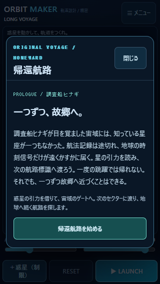
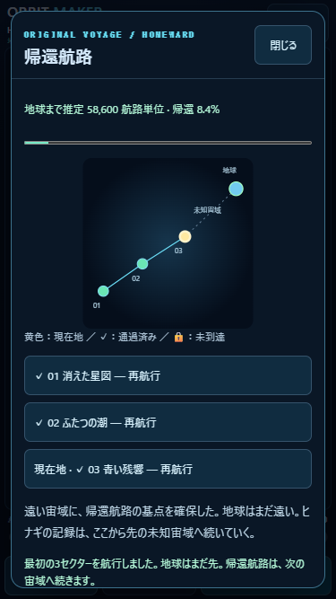

# v1.0.0 — HOMEWARD FOUNDATION 検証報告

実施日：2026-10-25。ローカル実装。公開・pushなし。PC Chromeでの画面サイズ・タッチ・時刻再現による確認と、iPhone Safari実機の確認を区別する。実機は未確認。

## 実装と仕様書

全体仕様は [HOMEWARD_SPEC.md](../../HOMEWARD_SPEC.md)。CLASSIC／FREE SPACEを維持し、メニューへHOMEWARDを追加。調査船ヒナギが地球の時刻信号を追うオリジナルの序章と航法記録を用意した。既存作品の登場人物・艦船・固有名詞・画像・台詞・物語は使用していない。

追加画面：モード選択、初回の序章、セクター導入ログ、現在地・ロック・通過済みを示す宇宙マップ、帰還進捗、到達ログと次セクターボタン。飛行中は既存の盤面・カメラ・予測・ミニマップ・発射UIを共用する。マップと物語画面はオーバーレイで、盤面の高さを変えない。内容が長い場合はパネル内部だけスクロールする。

変更：`index.html`、`styles.css`、`js/game.js`、`package.json`、`README.md`。

追加：`js/homeward-data.js`、`js/homeward-progress.js`、`js/homeward-ui.js`、`HOMEWARD_SPEC.md`、`tests/homeward.test.mjs`、`tests/homeward-ui.mjs`、本ディレクトリの検証JSON・画面PNG・飛行記録・本報告書。

## セクター到達検証

全て3750×5000のワールド。出発(250,4500)、ANGLE −65°、THRUST 220。惑星の種類・サイズ・個数と出口は固定、配置位置は既存の配置制約内で編集できる。初期版の配置は、既存の検証済み広域航路を独立したセクターデータとして利用した。ストーリー専用の新規難易度調整は次段階とする。

|セクター|内容|到達時間|終端座標（丸め）|実航行距離|判定|
|---|---|---:|---|---:|---|
|01 消えた星図|高密度・地球型・巨大ガスによる最初の航路|17.750秒|(2143,935)|4059.80|CLEAR|
|02 ふたつの潮|高密度惑星2個と巨大ガスの引力を組み合わせる|17.733秒|(3005,1654)|4090.02|CLEAR|
|03 青い残響|反重力・ブラックホール・恒星の境界を航行|17.750秒|(1773,823)|3984.25|CLEAR|

各セクターで予測の終端状態と実飛行の終端状態が完全一致。保存した全予測点も対応する実飛行ステップの座標と完全一致。重力操作モードは惑星を動かさない共通解で到達し、スリングショットから同じ初速へ変換した場合も到達した。飛行中に惑星を動かせば初期予測と異なる軌道になる点は既存仕様どおり。

詳細：[sector-verification.json](sector-verification.json)。`homeward-01-flight.json`〜`homeward-03-flight.json` に解答配置・初速・時系列データを記録。実際のゲーム画面で01→02→03を発射してクリアした記録は [browser-homeward-flights.json](browser-homeward-flights.json)。

## 進行・保存・互換性

HOMEWARD専用キー `orbit-maker.homeward.v1` に、バージョン・現在セクター・通過済みID・序章とイベントの既読・HOMEWARDを選択中かを保存する。01到達で02、02到達で03を解放。通過済みは再挑戦でき、再クリアで距離を二重加算しない。失敗・RESETで通過記録は消えない。

物語の推定残距離は64000→62800→61000→58600航路単位。3セクター終了は8.4%で、地球帰還や全編完結と扱わない。この航路単位はキャンペーン全体の推定距離で、実航行のワールド単位とは別。

再読み込み後は保存したセクターの初期状態を復元する。クリア済み地点で再読み込みした場合はマップを開き、次を選べる。飛行途中・編集座標は保存しない。FREE SPACEへの往復では同じセッション内の編集状態を復元する。FREE SPACEをリロード後の初期配置へ戻す既存仕様は維持し、HOMEWARD保存によって新しく永続化しない。

HOMEWARDの破損・未知バージョンの保存内容を上書きせず、一時プレイと案内する。容量不足や保存拒否でも一時進行は継続可能。読み込みだけでは書き込まない。

CLASSICの進行・星、音声設定のキーを変更していない。既存の物理エンジン、Stage01〜20のデータ、広域ワールド設定、予測、記録／IndexedDB／音声モジュールは無変更であることを差分で確認。HOMEWARDの記録は既存v1配列形式、追加メタデータは既存の `playType` に `homeward` を指定するだけ。自動保存20件・お気に入り30件と既存の自動整理規則を維持し、移行・一括初期化は行わない。

## 関連テスト結果

```text
node --test tests/homeward.test.mjs tests/launch.test.mjs
node tests/homeward-ui.mjs
```

単体・入力テスト14件合格。新規セクター／進行の8件と、呼び出し元変更に関連する既存発射・入力の6件に限定した。物理や既存ステージデータを変更していないため、Stage01〜20の全到達検証やプロジェクト全件回帰は再実行していない。

|確認範囲|結果・根拠|
|---|---|
|セクター01〜03|全3件の到達、データ整合、予測一致、両方式／両モード、記録終端一致が合格|
|進行保存|順次解放・ロック・重複加算防止・既読・離脱・復元が合格|
|保存失敗|破損・未来形式の非上書き、利用不可・容量不足時の一時進行が合格|
|ブラウザでの連続攻略|01→02→03を実際のLAUNCHでCLEARし、03後にマップへ戻る|
|再読み込み|01クリア後の保存からマップを復元、02が解放、序章を繰り返さない|
|CLASSIC|20ステージの一覧を維持。Stage01をCLEAR・★★★、旧最高星とモード別進行を維持|
|FREE SPACE|HOMEWARDへの往復で編集したANGLE −64°／THRUST 210とHUGE配置を復元|
|ギャラリー|旧v1のお気に入りを維持。HOMEWARD3件の記録保存、03の再生でCLEARを確認|
|ダイアログ開閉・RESET|マップ開閉で角度を保持。RESETでセクター初期状態へ戻り、通過済み進捗は保持|
|ページ例外|全対象サイズでなし|

PCブラウザの時刻を進める機能を使って飛行を検証した。物理刻みは変更していない。iPhoneの実時間性能や音声の聴感を合格としたものではない。試験は独立した使い捨てコンテキストのデータを使い、利用者の保存領域を操作していない。

## 画面サイズ

|PC再現サイズ|盤面サイズ|序章・マップ|ページ全体スクロール|
|---|---|---|---|
|320×568|310×417|安全領域用のパネル枠内、主要操作可能|なし|
|375×667|365×516|同上、全3セクターの遷移確認|なし|
|390×844|380×693|同上|なし|

測定はCSSピクセル。ノッチ・ホームインジケーター・Safariの動的アドレスバーは実機で未確認。結果：[ui-results.json](ui-results.json)。





## iPhone実機確認手順（未確認）

本版は未公開。対象フォルダで `py -m http.server 8000 --bind 0.0.0.0` を実行し、同じWi-FiのiPhone Safariから `http://PCのIPv4アドレス:8000/` を開く。必要ならWindowsのプライベートネットワーク通信を許可する。公開サイトとは保存領域が別になる。既存サイトの保存情報は削除しない。

|順|操作・期待結果|OK／NG／未確認|
|---|---|---|
|1|メニュー→HOMEWARD。序章が読めて、閉じる／始めるが見切れない|未確認|
|2|序章→導入ログ→航行。初期設定のままLAUNCHし、約18秒で01をCLEAR|未確認|
|3|次のセクターへ進み02→03を航行。失敗時はRESET／再試行で戻れる|未確認|
|4|宇宙マップに現在地・鍵・通過済み・残距離が表示され、内部だけスクロールする|未確認|
|5|クリア後に再読み込み。現在地・解放・既読・帰還進捗が残る|未確認|
|6|惑星ドラッグ、両発射方式、重力操作、ピンチ、追従、予測、サウンドを確認|未確認|
|7|CLASSIC／FREE SPACEへ戻り、星・編集操作が使える。既存お気に入りと新記録を再生|未確認|
|8|03後は8.4%で、地球帰還完了にはならない。閉じる・次操作が押せる|未確認|

NG記録：端末／iOS／セクター／モード／発射方式／倍率／再現手順／期待結果／実際の結果。

## 残存課題・次Version

初期3セクターは既存広域航路を土台にした基礎版。専用のチュートリアル航路と難易度調整、04以降の物語、分岐マップ、探索イベントを次に検討する。帰還距離は物語上の固定設定で、全航路はまだ実装していない。新しい宇宙ギミック、燃料・乗員・戦闘は未実装。セーブはチェックポイント方式で、飛行途中の再開には対応しない。iPhone実機での表示・指操作・音声・発熱は未確認。公開・pushは未実施。
