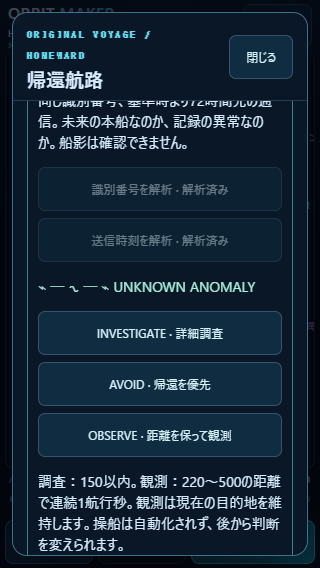
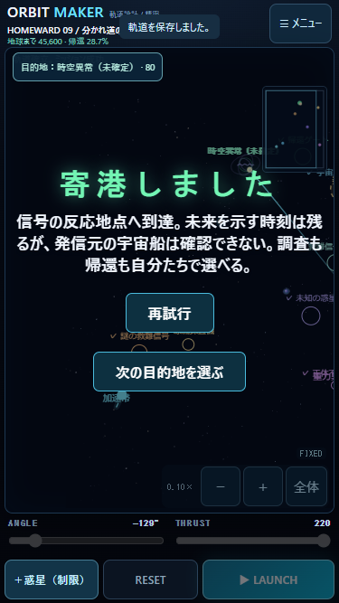
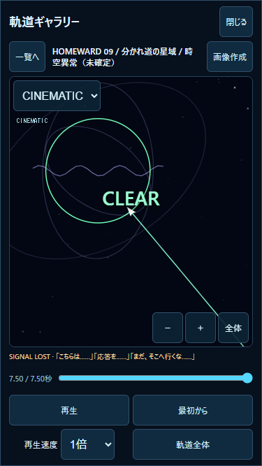

# v1.6.0 — THE IMPOSSIBLE SIGNAL

検証日：2026-10-31 JST。ローカル実装。Git push・公開・デプロイなし。
**PCの自動検証とiPhone実機を区別する。実機の操作感・実安全領域・発熱・処理落ちはUNVERIFIED。**

## 1. 主要変更ファイルと既存調査

v1.5.0の`echoes.js`、`echoes-ui.js`、Sector09、HOMEWARD v1、CLUE-01〜05、3航路判断、日誌、専用IndexedDB、ギャラリー/CINEMATIC、予測、固定ステップ/FlightClockを確認して追加した。

|ファイル|内容|
|---|---|
|`js/impossible-signal.js` 新規|4手掛かりの定義、解析、固定ステップ後の距離/連続観測、判断結果、軽量Canvas演出|
|`js/impossible-ui.js` 新規|2解析ボタン、3行動、波形、判断履歴・結果、保護航行へのリンク|
|`js/echoes.js` / `js/echoes-ui.js`|既存の手掛かり一覧・通信解析日誌へ06〜09と関連・取得条件・日時を追加|
|`js/homeward-progress.js`|解析・行動・結果の保存、旧データの安全な復元、固定ステップ上の観測、RESET/失敗結果|
|`js/frontier.js`|CLUE-08取得後の目的地解放、調査前のUNKNOWN ANOMALY表記|
|`js/homeward-ui.js`|既存宇宙マップに新地点・状態・操作を統合|
|`js/open-voyage.js` / `js/voyage-courses.js`|目的地1点と検証済み参考航路。力・移動ギミックは追加しない|
|`js/game.js`|解析/行動から既存の目標変更へ接続、通信・描画・記録メタデータ、保存失敗通知|
|`js/gallery-ui.js`|保存された解放時刻以降だけ異常リングを描画。旧記録には描画しない|
|`index.html` / `package.json` / `README.md`|1.6.0表示と説明|
|`tests/impossible-signal.test.mjs` / `tests/impossible-ui.mjs` 新規|関連検証と実航行・Chrome画面キャプチャ|

物理エンジン、惑星・ギミックの既存力、発射ベクトル、ステージデータ、音声、通常ギャラリーDBの処理には差分なし。既存の1/120秒・時間倍率・繰越処理を再利用する。

## 2. 追加したストーリー

CLUE-05を得た船が、回収した通信を解析する。部分一致だった番号を完全に照合すると、本船の識別番号 **HN-0417** と一致する。続く解析では通信内部の送信時刻が航行基準時より **72時間先** を指す。古い回収記録に未来の送信時刻が含まれるという矛盾を残す。

時間差は`TRANSMISSION_OFFSET_HOURS=72`の固定設定。現実の今日・端末日付から未来の日時を計算しない。Date.nowは取得/選択の履歴メタデータだけに使う。

照合で新しい反応地点を特定する。接近時には識別信号が強くなるが、船影は確認できない。詳細調査または外側からの観測で、追加通信を受け取る。

> 「こちらは……」「応答を……」「まだ、そこへ行くな……」

その後、通信は途絶える。未来の自船が存在するとは確定せず、記録の破損、時計の異常、未知の発信者という解釈も残す。警告か救難要請かも未解明。

短い非停止通知、マップ内の信号波形と判断パネル、後から開く日誌を使う。複数の通信が同じ固定ステップで発生した場合は最新の要点を通知し、全イベントを日誌に保持する。「詳細・行き先」で既存マップを開いた間だけ従来どおり一時停止し、閉じると再開。イベント発生による自動停止は追加していない。

## 3. CLUE-06〜09

|ID / 名称|条件|関連・解放情報|
|---|---|---|
|06 本船と一致する識別番号|CLUE-05取得後「識別番号を解析」を押す|05関連。本船と同一の番号、送信時刻解析を解放|
|07 未来の送信日時|06取得後「送信時刻を解析」を押す|05・06関連。固定+72時間、座標の照合|
|08 時空異常の座標情報|06と07を照合|06・07関連。新しい目的地をUNKNOWN ANOMALYとして解放|
|09 異常領域からの追加通信|INVESTIGATEを選び実際に150以内へ接近、またはOBSERVEを選び220〜500の帯域内で連続1航行秒を観測|05〜08関連。追加通信・調査結果・続編の謎|

定義にはID、名称、短い説明、取得条件、関連ID、解放情報を持たせる。取得日時と参照はセーブの手掛かりエントリへ保存。日誌から再確認できる。解析済みのボタンは無効化し、再訪でも同じ手掛かり/初回イベントを重複付与しない。

送信時刻解析を先に押しても、06がなければ実行不可。保存済みの06・07や解析フラグから08を再計算できるため、保存項目の順序に依存しない。旧CLUE-01〜05は変更・削除しない。旧データに今回の解析項目がなければ未解析として始める。

## 4. 新地点と物理的な判定

目的地ID：`temporal-anomaly`。座標 **(2200,800)**、通常の到達円 **半径80**。既存のガス惑星(1900,1500)、ゲート(2900,700)、ステーション(3400,1100)と重複しない。新しい重力源・危険領域・移動物体は作らない。

CLUE-08以前はマップ/盤面/行き先一覧に表示せず、内部の目的地選択APIでも選択を拒否する。解放後はUNKNOWN ANOMALY。09取得後だけ「時空異常（未確定）」と表示し、原因は断定しない。

距離条件は物理ワールド単位でロケット中心との距離。各1/120秒の前後位置の区間と円の交差を使う。

- 600以内：初回の接近通信。選択を強制せず、航行を止めない。
- 150以内：INVESTIGATEの詳細調査。
- 220〜500：OBSERVEの連続観測帯域。帯域外・内側に出ると連続時間をリセットする。区間内の滞在割合×実際の物理時間で加算する。

前後の位置が範囲外でも、その間を横切る高速ステップを検出する。内側を挟んだ二つの短い観測区間を合算して「連続1秒」とは扱わない。カメラ倍率、描画頻度、実時間から距離・観測秒数を計算しない。

## 5. 三種類の行動と履歴

|行動|実際の変更|結果|
|---|---|---|
|INVESTIGATE|新地点を目標に指定|実際に150以内へ来た場合だけ詳細調査・09取得|
|AVOID|既存帰還ゲートを目標に指定|実際のゲート到達で帰還。選択後に内側へ入っていた場合は「接近後に帰還」と区別|
|OBSERVE|現在の目標を維持|外側帯域で連続1航行秒を満たした場合だけ観測・09取得|

いずれも船体位置・速度・角度・推力を修正しない。OBSERVEは距離を保つ自動操船ではない。観測後も慣性航行は続き、内側に進むこともある。必要なら目標変更、寄港後の発射条件変更、RESETを使う。

選択は後から変更できる。変更前に未完了だった判断には`superseded`結果を残す。同一判断の連打は未完了エントリを増やさない。RESET・衝突・逸脱・時間切れ・条件未達での寄港も履歴に残す。

最後の行動を再読み込み後も表示する。新しい航行では同じ行動の新しい試行を`continued:true`で開始でき、前の結果を消さない。観測途中の連続秒数は新発射時にリセットし、別の航行や閉じていた時間を合算しない。帰還後も手掛かりと再探索の自由を保持する。

## 6. 実際の攻略例・終端記録

初期惑星配置・各寄港地の標準の安全な出発点、THRUST **220**を使う。未来信号の解析を済ませてから目的地を選び、下記ANGLEを入力して発射する。手動で移動した惑星では予測を見て再調整する。

|航路|ANGLE|到達時間|結果|
|---|---:|---:|---|
|救難信号地点→時空異常|−129°|7.500秒|INVESTIGATEで09取得・寄港。接近通信は5.183秒、詳細調査は7.183秒|
|時空異常→帰還ゲート|−20°|2.975秒|帰還。取得した情報を保持|
|宇宙ステーション→時空異常|−159°|5.450秒|INVESTIGATEで09取得・寄港|
|救難信号地点→直接帰還|−105°|6.392秒|AVOIDで帰還。600の接近範囲にも入らず、09は未取得|
|宇宙ステーション→時空異常（観測別解）|−159°|5.450秒|同じ物理航路でOBSERVEの外側1秒条件を達成後、慣性で寄港|

新地点から帰還する区間は、救難側からの調査・ステーションからの調査・観測それぞれに続けて検証した。全経路の物理ステップ数・終端状態/座標・イベント時刻が1倍と100倍で一致し、予測の終端とも一致。成功判定の強制、ワープ、終端位置の代入は使っていない。

終点座標・イベント・判断結果：[route-results.json](route-results.json)。飛行記録は`signal-investigate.json`、`station-investigate.json`、`station-observe.json`、`direct-avoid.json`。Node日時は比較のため固定値を注入し、ブラウザ日時は実際の取得時刻を使う。

## 7. 演出・再生

ワールド座標上の青紫の薄いリング3本と25点の小さな波形だけをCanvas描画する。軽量モードではリング1本に削減。画像素材、外部通信、粒子配列、物理的な時空効果は追加しない。描画用の時間から揺らぎを作り、物理計算へ渡さない。

新記録には任意の`impossibleDisplay.visibleFrom`を保存。再生でも保存された解放時刻以降だけリングを描画する。既存の`storyEvents`を使って接近・追加通信・最後の通信を時刻に合わせて表示する。再生時に物理を再計算しない。旧記録に追加情報がなくても従来どおり再生する。

## 8. 保存・互換性・保護

キー`orbit-maker.homeward.v1`、トップレベル`version:1`、`echoes.version:1`、IndexedDB名・バージョン・ストア構造を維持する。

```text
echoes.clues['CLUE-06'..'CLUE-09'] = {id, at, related, unlocks, flightId?}
echoes.impossible = {
  analysis: {identity?, timestamp?},
  approached, investigated, tracking,
  choices: [{id, choice, destination, at, result,
             completedAt?, elapsed?, enteredInner?, continued?}]
}
echoes.events / echoes.records = 既存方式に初回イベント・参照を追加
```

コンストラクタは読み込みだけでは保存しない。既存のCLUE-01〜05、発見情報、旧セクター、CLASSIC、チェックポイント、日誌、お気に入り・重要記録を削除しない。解析していない旧データに未来信号を自動取得させない。06/07がすでにある場合は08を再計算し、復元時の未知日時はnullとして扱う。

通信解析を寄港中に行った場合は、元のCLUE-05の保護航行を関連資料として参照できる。飛行中の新通信は終了/RESET時に従来の専用DBへ`story:homeward-09:<event-id>:first`で保護する。既存スロットを上書き・自動削除しない。今回の初回通信/結果は最大9種類、新寄港1種類で、従来33スロットと合わせ最大43。すべての再試行を新スロットへ無制限に保存する方式ではない。

記録には任意の`impossibleChoices`も保存し、取得時の判断履歴と物理航行を関連付ける。`CLUE-09`や通信イベントの専用参照からCINEMATIC再生可能。4096描画点の上限を維持する。

保存失敗は通知し、可能な限りメモリ内で進行を継続する。既存情報の削除で空きを作らない。保存成功前に参照を保存済みと扱わない。保存不能の試験は疑似ストレージへの例外注入であり、実ディスクを埋めていない。

## 9. 関連テスト結果

全件回帰は実施していない。関連Nodeテスト **35件PASS**。

- `node --test tests/impossible-signal.test.mjs`：10件。解析前提・順序・再計算・重複防止・可逆判断・4実航路/観測別解・予測・1/100倍・高速横断・帯域内連続秒数・RESET・旧保存・容量不足・基準航路。
- `tests/flight-replay.test.mjs`と`tests/gallery.test.mjs`：12件。旧/新記録・CINEMATIC・再生位置・速度・中断・保存不能・非破壊性の関連範囲。
- `tests/echoes.test.mjs`を`手掛かりは|旧v1.4|三つの判断|新寄港地|容量不足|v1.3代表`で限定：6件。既存の手掛かり全6取得順、可逆な航路判断、旧知識と記録、再探索、容量不足、Sector09代表4航路。
- `tests/homeward.test.mjs`と`tests/first-voyage.test.mjs`を`旧v1|チュートリアル|セクターの順次|旧キー|破損|保存容量|不正な現在`で限定：7件。従来の進行・チュートリアル・他キー保護・一時プレイ・復元。

Sector09の従来代表4航路、Sector01〜08の8本の基準航路は、既存JSONにある到達時間・終端座標と完全一致。過去のレポート・基準飛行記録を再生成して期待値を変える方法は使っていない。

**PC Chrome模擬画面**：`node tests/impossible-ui.mjs`。独立した使い捨てプロファイルで実行し、ユーザーの実データに接続しない。

|サイズ|盤面|マップパネル|判定|
|---|---|---|---|
|320×568|310×417|296×544|PASS|
|375×667|365×516|351×643|PASS|
|390×844|380×693|366×820|PASS|

各サイズで未解析地点を隠す→2解析→新地点解放→3判断を切替→実飛行→09取得・寄港。44px以上のボタン、内部スクロール、パネル開閉で盤面寸法維持、ページ全体の余分なスクロールなし、ブラウザ例外なし。飛行中のマウスによる手動パン後も航行継続を確認した。タッチ・ピンチの実機操作感を模擬マウスから合格扱いしない。

375幅では、通常ギャラリーに25件追加して新航行が自動整理された後も、再読み込みした日誌からCLUE-09の専用航行をCINEMATICでCLEARまで再生し、最後のSIGNAL LOST通信を表示。旧お気に入りは保持。結果：[ui-results.json](ui-results.json)、[ブラウザの保存例](browser-save.json)。

## 10. キャプチャ





## 11. iPhone実機確認表（未実施）

今回のローカル作業ツリーを配信する環境で開く。公開・デプロイしていないため公開サイトが1.6.0になったとは扱わない。既存のサイトデータを消して試験しない。CLUE-05未取得ならv1.5.0の攻略例で取得する。

|順|操作・期待結果|記入|
|---|---|---|
|1|Sector09の目的地を開き、識別番号→送信時刻を解析。06〜08とUNKNOWN ANOMALYが現れる|OK / NG / 未確認|
|2|調査・回避・観測を切替。目的地の違いと観測条件を読み、後から変更できる|OK / NG / 未確認|
|3|信号地点から−129°/220で発射。接近通知を閉じても航行し、パン/ピンチ/FOLLOW/CINEMATICを使える|OK / NG / 未確認|
|4|調査条件で09と最後の通信を受信。文字・見切れ・安全領域と、通知を閉じた後の寄港操作を確認|OK / NG / 未確認|
|5|再読み込みで寄港地・手掛かり・最後の判断と結果が残る。−20°/220で帰還|OK / NG / 未確認|
|6|ステーションから−159°/220でOBSERVEを試す。外側連続1秒の結果を日誌で確認|OK / NG / 未確認|
|7|CLUE-09の保護航行をCINEMATIC再生。旧ギャラリー・お気に入りも残る|OK / NG / 未確認|
|8|100倍の操作応答・連続航行・発熱・処理落ちを確認|OK / NG / 未確認|

NG記録欄：端末/iOS、画面向き、寄港地点・目的地、解析/判断、角度/推力/倍率、再現操作、期待結果、実際の結果。

## 12. 残課題

- v1.4.0〜1.6.0のiPhone実機確認は保留。PC模擬のPASSとは区別する。
- 飛行途中の重要座標記録保存は継続課題。手掛かりは保存するが、航行終了前にタブを閉じた飛行の座標記録は保護できない。
- 保存失敗後の自動再試行・外部バックアップ・サイトデータ消去からの復元は未実装。過去に消えた記録を復元できるとは扱わない。
- OBSERVEは自動の安全距離保持ではない。観測後も船は航行する。判断履歴は保持するため、極端に長いプレイでの日誌肥大化の整理方針は後続課題。
- 未来の船、信号の発信者、警告の意味は未確定。時空による物理効果や次宙域の物語は今回追加していない。
