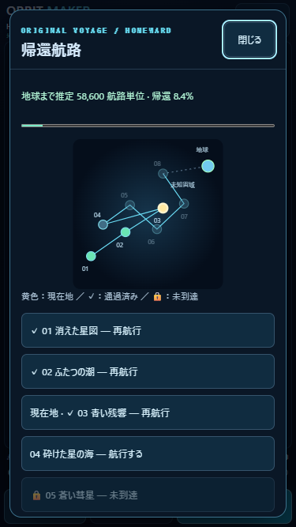
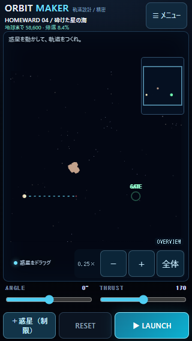
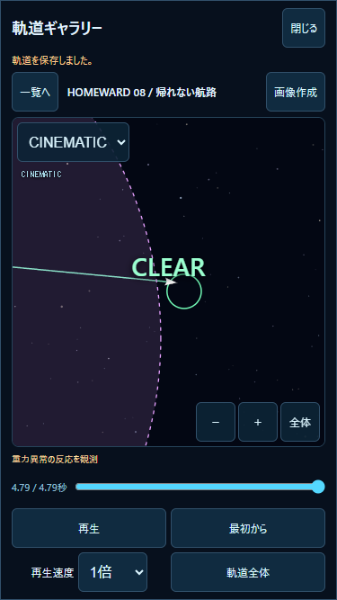

# v1.2.0 — LOST SECTORS 検証レポート

実施日：2026-10-27。ローカル実装。公開・push・Pages設定変更なし。
PC Node.js / Chromeで自動検証。**iPhone Safari実機の操作感・発熱・安全領域はUNVERIFIED**。

## 変更ファイル

- `js/lost-sectors.js`（新規）：04〜08の物語、配置、初期条件、解答、ヒント、分岐。
- `js/homeward-mission.js`（新規）：既存の尾判定・物体座標・異常重力を読み取り、遭遇条件を集計。シミュレーションを書き換えない。
- `js/homeward-data.js`：03→04接続、04〜08の1500×1500ワールドと固定配置・発射制約を組み立てる。01〜03の物理データは維持。
- `js/homeward-progress.js`：旧v1互換の日誌、選択・履歴、寄り道の推定残距離、情報取得を必要とする解放判定、非同期保存参照。
- `js/homeward-tutorial.js`：通常盤面上の新5セクター用短いガイド。スキップ・入力復元。
- `js/homeward-ui.js`：8セクターの解放表示、追跡／回避、日誌とCINEMATIC再生リンク。
- `js/game.js`：各固定ステップでの遭遇観測、発見表示、遭遇条件未達時の失敗、選択なしの出航防止、記録への参照。
- `js/gallery-ui.js`：IDで保存済み航行を開いてCINEMATIC再生。保存成功を呼出元へ返す。
- `js/cinematic-camera.js` / `js/flight-replay.js`：現在時刻の遭遇物体も構図候補に含める。記録の座標・物理演算は変更しない。
- `index.html` / `styles.css`：宇宙マップ04〜08、選択ボタン、パネル内の日誌、Version表示。
- `package.json` / `README.md`：1.2.0表記・操作案内。
- `tests/lost-sectors.test.mjs` / `tests/lost-sectors-ui.mjs`（新規）：今回の検証。
- `tests/homeward.test.mjs` / `tests/first-voyage.test.mjs`：旧3セクター用の検証対象・旧セーブfixtureを01〜03へ明示的に限定。新セクターは専用テストで検証。
- 本ディレクトリ：実測JSON、5本の飛行記録、模擬セーブ、画面キャプチャ、本書。

## 新セクターと具体的な攻略

全セクターの発射地点は **(120,1100)**、新ワールドは **1500×1500**。既存01〜03の3750×5000は変更しない。
各遭遇対象は固定配置。追加・削除・ドラッグによる迂回はできない。プレイヤーはANGLE・THRUSTまたはスリングショットを調整する。物体の移動時刻は発射時のT=0を基準とし、発射前に実時間で待っても配置は変わらない。

|Sector|初期角度 / 推力|初期失敗|成功例 ANGLE / THRUST|到着時刻|攻略の意味|
|---|---|---|---|---|---|
|04 砕けた星の海|0° / 170|隕石衝突・2.683秒|0° / 220|4.275秒|隕石群が交差する前に抜ける。0° / 120で通過を待つ別解も可|
|05 蒼い彗星|−5° / 170|時間切れ・5秒|0° / 200|4.300秒|彗星本体の少し上を通り、尾の加速を受ける|
|06 沈黙する灯台|0° / 170|エリア逸脱・8.333秒|−13° / 170|5.650秒|灯台の100単位の受信圏で中継鍵を取得してからゲートへ|
|07 誰かがいる|0° / 170|UFO衝突・2.492秒|追跡：−2° / 200|4.683秒|周回中のUFOの上側を先行して観測|
|07 別解|同上|同上|回避：2° / 170|5.508秒|UFOが離れた側を通り、接触を回避|
|08 帰れない航路|1° / 170|エリア逸脱・8.350秒|0° / 200|4.792秒|未知の物体の異常重力で下へ曲がり脱出|

終点座標、固定ステップ数、遭遇実績：[sector-results.json](sector-results.json)。各 `homeward-0N-flight.json` は既存v1形式の再現用飛行記録。
正解を一点には限定しない。04の推力120/219、05の170/220、06の角度−12/−14、07の−3°・200と3°・170、08の推力190/210でも到達・遭遇条件を確認した。

## ギミックを利用する必要性

- **04**：移動する隕石群の初期位置(560,850)、速度80、下向き、5個。初期航路は衝突。群れを除去した対照実験では同じ初期航路が到達し、障害物が攻略に寄与することを確認。
- **05**：彗星(370,1121)、速度40、加速強度100。解答で尾の中を約0.854秒通る。制限5秒で、通常推力の最大移動は220×5=1100。ゲートの近端まで1145必要なため、尾を利用しない航路は全許可角度・推力でも間に合わない。尾を利用した実績もクリア時に要求する。
- **06**：灯台(600,990)の受信イベントが必須。物体を除いた対照実験では物理的にゴールへ到達しても、情報がないため07を解放しない。
- **07**：周回UFO(600,1100)、速度80。接触せず140単位以内で観測する実績と、追跡／回避の選択が必要。UFOを除いた対照実験では初期航路が到達する。出航前の遠距離捕捉イベントで方針を選び、実航行でもUFOへの接近・回避を検証する。
- **08**：物体(570,1220)、反応半径500、強度120。許可角度−1°〜1°。異常重力を除くと直進経路からゲート中心までの最小距離は約42.9で半径22より大きく、推力によらず届かない。解答では異常重力の加速度積分が約23.30となり、実際の航路変更を確認。積分値1超を条件とする。

## 分岐・物語・帰還距離

地球までの基準距離64000を維持。従来3セクター通過時は従来どおり残58600・帰還8.4375%。04〜08の短い出航、遭遇、発見、到着ログは、失われた標識→彗星の流れ→灯台の中継鍵→同行者の可能性→地球を測る新しい基準点、という順に接続する。船名ヒナギと既存の時刻信号を継続し、物語はオリジナル。

07の「追跡」は推定残距離に600を加える。「回避」は追加なし。選択は再挑戦時も保持し、同じ選択を押しても重複加算しない。選択を変えた場合は現在の航路計画の寄り道分が置き換わり、選択履歴は残る。全8セクター通過後も帰還完了ではなく、次の宙域へ続く。

## 航海日誌・保存仕様

`orbit-maker.homeward.v1` / `version:1` を維持。`cleared`、`currentSector`、`eventsSeen`、`tutorial`等の既存データを継承し、以下を任意フィールドとして追加。

```text
choices[sectorId] = "pursue" | "avoid"
journal[sectorId] = {
  departure, encounter, encounters: [encounterId], discovery, arrival,
  choice, choiceLog, choiceHistory: [{choice, text, at}],
  lastResult, elapsed, flightToken, flightId, clearFlightId
}
```

遭遇・発見は実飛行中に観測し、初回変化時に保存する。失敗も直近航行として記録する。日誌はセクターごとの要約と、保存済みの直近航行・到着航行への参照を持つ。全試行の座標は従来のギャラリーで管理する。

IndexedDB保存が成功した場合だけ参照を付ける。遅れて完了した保存が、別の新しい航行の日誌を上書きしないことも検証。保存不能でも進行とゲームは継続し、通知する。旧保存の読み込みだけでは書き換えない。未知の拡張フィールドは保持し、破損・将来バージョンは元データを上書きしない。

IndexedDBのDB名、バージョン、v1記録形式、20件の自動保管・30件のお気に入りは変更しない。日誌から記録を削除しない。ギャラリー側で整理・削除された参照は通知して安全に終了する。重要な航行はお気に入り登録が必要。

## 関連テスト

全件回帰は実施していない。以下の**34件**を範囲限定で検証し、すべて成功。

- `node --test tests/lost-sectors.test.mjs`：14件。5航路の初期失敗・調整成功、予測の終端状態完全一致、1/100倍の状態・遭遇実績完全一致、両ゲームモード、スリングショット、実績なしの解放防止、複数解、分岐、保存・復元、旧01〜03の基準終点・時間、非同期参照、遭遇対象のカメラ構図。
- `node --test tests/cinematic.test.mjs tests/flight-replay.test.mjs`：既存7+6件。今回カメラと再生アダプターを変更した影響範囲。旧記録の非破壊性・手動操作・速度・一時停止・境界など。
- `node --test --test-name-pattern='旧v1|チュートリアル|セクターの順次|旧キー|破損|保存容量|不正な現在' tests/homeward.test.mjs tests/first-voyage.test.mjs`：7件。保存・ガイドの影響範囲のみ。
- `node tests/lost-sectors-ui.mjs`：PC Chromeで下表。375幅では全5件を実際のUIから初期発射失敗→RESET→入力調整→成功し、04は重力操作＋スリングショットも使用。07の選択なし出航防止、選択変更と再読み込み、08到着後の日誌からCINEMATIC再生を確認。旧お気に入りとCLASSICの保存値を維持。ブラウザ例外0。
- `node --check js/game.js` / `js/homeward-ui.js`、`git diff --check`：問題なし。

物理刻みは既存1/120秒。新しい重力・移動・衝突計算は追加していない。既存 `physics.js`、`encounters.js`、`launch.js`、CLASSICのステージ定義、`gallery-store.js`、`space-audio.js` に差分なし。01〜03は保存済み飛行記録との到達時間・終点の完全一致を検証。

|PC Chrome模擬サイズ|盤面|HOMEWARDパネル|ページ全体のスクロール|結果|
|---|---|---|---|---|
|320×568|310×417|296×544|なし|PASS：マップ、ロック、説明、スキップ、主要操作|
|375×667|365×516|351×643|なし|PASS：全5セクターの失敗→成功、分岐、再読込、日誌再生|
|390×844|380×693|366×820|なし|PASS：マップ、ロック、説明、スキップ、主要操作|

結果：[ui-results.json](ui-results.json)、[模擬セーブ](browser-save.json)。テストは独立したブラウザコンテキストを利用し、ユーザーの保存データには接続していない。





## iPhone実機確認手順（未実施）

既存の進行を消さずに試す。公開は行っていないため、今回のローカル版をiPhoneから利用できる既存のローカル配信環境で開く。現在の公開URLに今回の変更があるとは扱わない。

|順序|操作・期待結果|記入|
|---|---|---|
|1|Safariで縦画面。メニュー→HOMEWARD。03までの記録が残り、04が解放、先のセクターはロック。マップのパネル内だけスクロールできる|OK / NG / 未確認|
|2|04へ。まず初期発射で隕石失敗。RESET、精密発射0°/220で到着。スキップ・ヒント・スリング操作も確認|OK / NG / 未確認|
|3|05を0°/200で発射。蒼い尾に入り5秒以内に到着。予測線と飛行の位置関係を確認|OK / NG / 未確認|
|4|06を−13°/170。灯台の発見文を確認してから到着し、07が解放|OK / NG / 未確認|
|5|07で追跡か回避を選択。追跡で残距離+600、再読み込み後も選択が残る。上表のいずれかの航路でUFOを回避して到着|OK / NG / 未確認|
|6|08を0°/200。紫の場で航路が曲がって出口へ。FOLLOW / OVERVIEW / CINEMATIC、1倍と100倍の操作感を確認|OK / NG / 未確認|
|7|宇宙マップ→航海日誌。出航・発見・選択履歴・到着を確認。到着航行のCINEMATIC再生、一時停止、手動カメラ、お気に入り登録|OK / NG / 未確認|
|8|再読み込み。01〜08の進行、CLASSICの星、旧ギャラリーのお気に入りが残る。FREE SPACEへ切り替えて従来操作と音声を確認|OK / NG / 未確認|

NGの記録：端末／iOS／画面向き、セクター、モード、ANGLE・THRUST、再現操作、期待結果、実際の結果を記入。端末の実機確認結果をPC模擬結果と混ぜない。

## 残存課題・次Version

- iPhone Safari実機の指操作、ノッチ・ブラウザバーの安全領域、音声復帰、100倍時の体感と発熱は未確認。
- 日誌の航行参照はギャラリーの自動整理対象。お気に入りを自動登録する仕様は追加していない。
- 追跡／回避は出航前の方針選択。選択で強制航路を作らず、両方の航路調整を許容する。物語分岐と推定寄り道距離に反映。飛行中の通信イベント・資源管理は今後の拡張。
- 予測線の緑は物理的なゴール到達。情報取得等の航路条件は別途判定することをガイドで説明。今回物理エンジンへストーリー条件を混在させていない。
- 実航行時間は短い局所宙域の課題。物語上の帰還距離はワールドの物理サイズと独立。09以降の本格的な分岐宙域は未実装。
