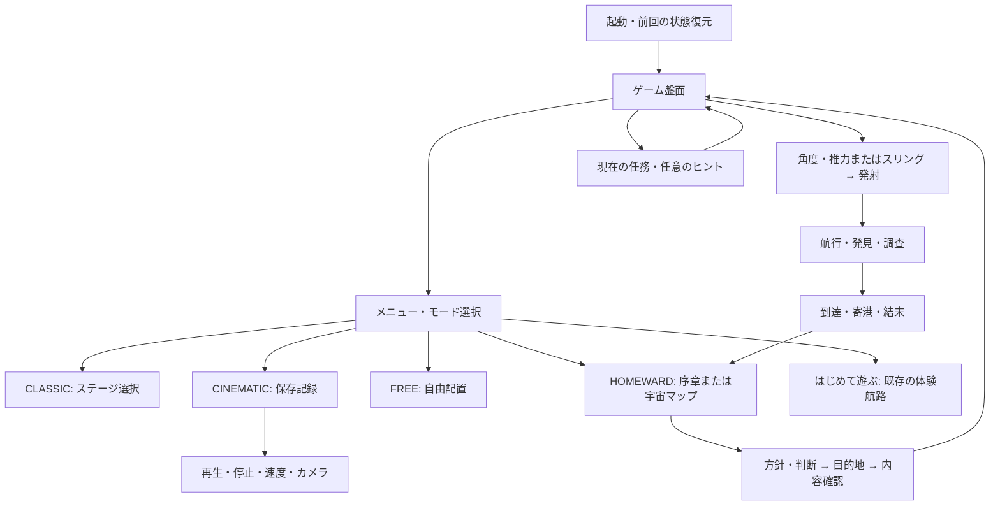

# v2.0.0-rc.2 — MISSION GUIDE & BEGINNER UX

## Plan / 現状分析

既存の起動は直接ゲーム盤面。独立したタイトル画面はなく、メニューがモード選択の役割を持つ。HOMEWARDの目的地・判断・解析・日誌が同一マップ画面に並び、英語の方針と物語上の判断が混在する。選択済みでも「閉じると航行へ戻る」ことが分かりにくい。

|画面|目的|プレイヤーの操作|操作後・次への移動|
|---|---|---|---|
|ゲーム盤面|航路を設計し実航行|角度・推力、惑星、発射|飛行→到達／失敗。現在の任務ボタンで必要時だけ説明|
|モード選択（メニュー）|遊び方を選ぶ|説明付き5導線を選択|既存の各画面・体験航路へ。飛行中は既存の無効条件を維持|
|HOMEWARD序章・出航ログ|物語・宙域の条件を確認|開始・続行、必要な判断|通常の航行画面へ|
|HOMEWARD宇宙マップ|宙域・進行を確認|解放済みセクターを選ぶ|既存条件で入域・出航|
|航路・目的地|目標を選び意味を確認|方針／判断→既存の目的地→距離・説明を確認|「この場所へ向かう・航行画面へ」。発射は自分で行う|
|探索・解析|取得情報を整理|対象へ実航行、取得済み通信の解析|発見・CLUE・分岐を既存ロジックで更新。日誌で再確認|
|日誌|情報・判断・記録の再確認|該当する記録の再生|既存CINEMATICへ|
|SCAN|既知情報と操作可否の確認|検索・表示・復元|カメラのみ移動。通常盤面へ戻る|
|CINEMATIC|保存座標の鑑賞|再生・停止・速度・カメラ|閉じるとゲームへ。物理の再実行はしない|

## Tasks → Build

- 読み取り専用の案内モデルとUIを分離する。スキャナーと同じ情報開示境界を使う。
- ヘッダーにコンパクトな現在任務。詳細は既存形式のダイアログ。原則1対象のみ強調。
- DEEPの3方針だけ日本語を補助。Sector09の帰還／信号追跡／探索、FINALの5判断を別の意味へ置換しない。
- 既存ボタンを再配置し、元の選択ハンドラ・条件・保存方式を再利用する。
- 案内は最大5Hzで読み取り、表示内容が変化した時のみ文章を更新。物理ステップには入れない。

## Test → Docs

既存429件と追加状態試験、4画面サイズ、タッチ・SCAN併用、段階的選択、全5結末を確認する。rc.1のローカル配信用コピーと同条件のSCAN性能比較を行う。iPhoneの操作感・安全領域・発熱は未確認のまま記録する。公開・push・デプロイは行わない。
