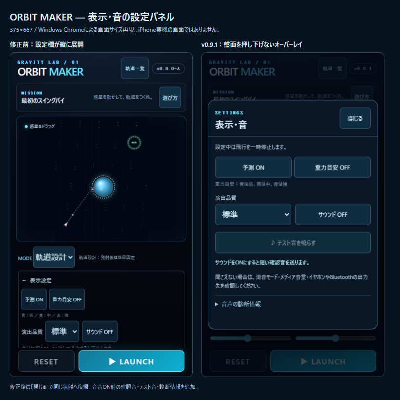

# v0.9.1 — MOBILE UI & AUDIO FIX

2026-10-24実装。iPhone実機で報告された縦長設定UIと無音問題に対する修正です。**PCの関連テストは成功しましたが、修正後のiPhone Safariでの画面・聴感はUNVERIFIEDです。** 公開・pushは行っていません。

## 1. 修正ファイル

| ファイル | 内容 |
| --- | --- |
| `index.html` | 「表示・音」「惑星編集」の独立dialog、テスト音、診断欄、版表示 |
| `styles.css` | 通常画面の操作行を整理、安全領域内のオーバーレイ・内部スクロール |
| `js/settings-ui.js`（新規） | パネル開閉・フォーカスを扱う入力層。盤面や入力値を初期化しない |
| `js/game.js` | パネル表示中の飛行一時停止、音声の明示開始・状態表示・復帰の接続 |
| `js/space-audio.js` | 非同期開始・再開・期限付き復旧・同じ経路の確認音・診断・解放 |
| `package.json` / `README.md` | v0.9.1、操作・関連確認の案内 |
| `tests/mobile-audio.test.mjs`（新規） | 非同期resume、拒否・中断・closed・タイムアウト、消音、波形経路等 |
| `tests/mobile-ui-audio-ui.mjs`（新規） | 変更したUI・音声に限定した3サイズと実ブラウザ確認 |
| `tests/space-experience.test.mjs` | 音声開始テストを非同期unlock完了待ちへ変更 |
| `reports/mobile-ui-audio/` | 本レポート、変更前後画像、比較HTML／PNG、JSON・単体ログ |

物理・惑星設定・Stage01〜20・launch.js・重力操作エンジン・星評価・進行保存・記録／IndexedDB・PNG／共有の処理は変更していません。保存キー・形式は同じです。他プロジェクトや、前作業の受入準備文書の変更も維持しています。

## 2. UI変更と画面比較

- 通常画面は「モード／表示・音／惑星編集」「発射方式」「ANGLE／THRUST」「RESET／LAUNCH」に整理。設定を開いてもグリッドの高さを変えません。
- 設定はnative dialogで重ね、背景への入力を抑止。安全領域の上下に12px以上の余白を取り、閉じるボタンをスクロール領域の外へ配置しました。内容が増えた場合はパネル内部だけがスクロールします。
- 設定中は飛行と予測の更新を一時停止。閉じると同じ盤面・角度・推力・モード・惑星設定で再開します。時間の追い付きによる飛行ジャンプを起こさないよう、既存のフレーム時刻更新は続けます。物理ステップの計算自体は変更していません。
- 惑星編集の説明は短い特徴文を残し、固定条件などは「編集ルール・ステージ条件」へ移しました。種類・サイズ・個数の制約を緩めていません。飛行中の編集制限も維持しています。

| PC再現サイズ | 修正前：通常盤面高 | 修正前：表示設定／惑星編集時 | 修正後：通常／表示・音／惑星編集 | 主操作 |
| --- | ---: | --- | --- | --- |
| 375×667 | 269px | 260 / 260px | 328 / 328 / 328px | スクロールなしで到達 |
| 390×844 | 446px | 266 / 260px | 505 / 505 / 505px | スクロールなしで到達 |
| 320×568 | 260px | 260 / 260px | 242 / 242 / 242px | 以前は隠れていたANGLE／THRUSTも同時表示 |

320px幅では通常盤面が従来より18px低くなりますが、全主要操作を同時に使えるようにしています。設定を開閉しても盤面・発射ボタンの矩形は完全一致し、3サイズともページ全体の縦横はみ出しはありませんでした。これはChromeの画面サイズ再現であり、iPhoneのノッチ・ホームインジケータ・アドレスバーの実挙動は未確認です。



修正後の画面：

- [375×667 表示・音](after-display-375x667.png) / [惑星編集](after-planet-375x667.png) / [通常](after-normal-375x667.png)
- [390×844 表示・音](after-display-390x844.png) / [惑星編集](after-planet-390x844.png) / [通常](after-normal-390x844.png)
- [320×568 表示・音](after-display-320x568.png) / [惑星編集](after-planet-320x568.png) / [通常](after-normal-320x568.png)
- [音声ON・診断情報](audio-diagnostics-375.png)

`before-*.png` は変更前に取得しました。`before.json`／`after.json` は盤面・発射ボタン・ページ寸法です。比較HTMLは既存のキャプチャを並べた資料で、ゲーム画面を加工したものではありません。

## 3. サウンド無音の原因調査

実機の機種・iOS・AudioContext状態・出力先を採取できていないため、**「まったく音が出ない」の実機原因は未確定**です。ソースから次を確認し、切り分け可能な形で修正しました。

| 調査対象 | 調査結果 | 対応 |
| --- | --- | --- |
| ONボタンとUI音の順番 | 従来はcaptureのUI音処理がON切替前に実行され、OFFなら音が出ない。ON処理自体にも確認音がなかった | ONタップのハンドラー内で開始／resumeし、準備完了後に短い確認音 |
| 非同期resume | 従来はresumeの完了を待たず、`play()`はrunning以外を捨てた。開始直後の確認音・発射音が失われ得た | 明示的な確認音だけは完了を待つ。飛行音は大量にキュー保存しない |
| interrupted／開始拒否／未完了 | 従来は失敗の状態表示が乏しく、closedや復帰不能の再生成経路もなかった | statechange・期限・エラー・時計を観測し、次の明示操作で復旧 |
| Safariの音声セッション | Web Audioだけの自動セッションはambientとして扱われ得る。実機の消音・出力経路の影響は候補だが未確定 | APIがあればON時にplaybackを指定、OFF時に以前の種類へ戻す。非対応・例外なら通常Web Audioを継続 |
| OS・端末側 | 消音・メディア音量・Bluetooth／イヤホン・OS中断はアプリから聞こえたか確認できない | 簡潔な案内と診断情報。実際の聴感確認を別途要求 |

AudioSessionの自動選択・playback／ambientの区分は [W3C Audio Session仕様](https://www.w3.org/TR/audio-session/) を参照。APIは対応を検出して使い、消音スイッチを必ず回避できるとは主張しません。WebKitにも [interruptedから戻らない報告](https://bugs.webkit.org/show_bug.cgi?id=273511) や [resumeが未完了になる報告](https://bugs.webkit.org/show_bug.cgi?id=281566) がありますが、この実機報告と同一原因だと断定するものではありません。

## 4. AudioContextの修正

1. 初期OFFを維持。保存済みONでもロード時にはAudioContextを作らず、ユーザー操作で生成・resumeします。
2. ON／テスト音のタップ内で同期的にresumeを呼び、その完了はPromiseで扱います。同時に来た再開要求をまとめます。フレーム更新・物理ループからawaitしません。
3. 明示テストは実ゲームと同じ `play()` → Oscillator → Gain → master（従来と同じ0.055）→ destinationを使用。440→660Hz・0.28秒の確認音です。再タップ時は前の確認音を止め、重ねずに再試行できます。
4. 任意の初期化補助として、同じグラフでゼロ値の1サンプルだけを開始します。無音の連続ループ・外部音声・メディア要素・録音権限は導入しません。
5. resume未完了は1.5秒で通知し、次の操作で新しいContextへ切り替えます。closed、開始拒否、時計停止も同じく「次の明示操作」で再生成。自動再生成を繰り返しません。
6. 時計は出力要求の160ms後に確認し、進んでいなければ500ms待って再確認します。起動直後の短い遅延だけで停止と判定しません。
7. 中断・非表示・OFFでは音声ノードを停止／切断。再開後に古い確認音が遅れて鳴らないよう、世代を使って待機中の要求を無効化します。復帰時は勝手に鳴らさず次の操作を待ちます。
8. 同時4音まで、同種音の間隔制限、短い寿命を維持。ノード終了時・消音時にGainも解放します。

診断にはContext状態、再開待ち・試行回数、テスト音の状態、出力要求数、時計の進行、AudioSession種類、直近エラーを表示します。「出力経路へ送信済み」は実際に聞こえたことを意味しません。

## 5. 関連テスト結果

```
node --test tests/mobile-audio.test.mjs tests/space-experience.test.mjs tests/launch.test.mjs
node tests/mobile-ui-audio-ui.mjs
node --check js/space-audio.js
node --check js/settings-ui.js
node --check js/game.js
```

- 単体・入力25件成功、失敗0。非同期resume、重複開始、短い再タップ、タイムアウト、拒否後再生成、interrupted、closed、OFF／背景移動による待機キャンセル、時計停止、任意API非対応、ノード解放、両発射・RESET、演出／予測の物理非干渉を確認。ログは `unit-result.txt`。
- Chromeで3サイズの設定パネル位置・閉じる・内部スクロールを確認。開閉前後の盤面と発射ボタンが一致し、通常画面の主要操作すべての中心点でヒットを確認しました。
- 入力値・MODEを保ったまま惑星追加／削除／種類／サイズ変更。飛行中に開いた設定でCanvasを220ms比較して不変、閉じると再び飛行することを確認。
- Stage20の種類・サイズ・個数の固定、体験配置禁止、発射ボタンの有効性を確認。全20ステージの再計算は実行していません。
- 実際のChrome AudioContextをsuspend→タップでresume。開始拒否はテスト境界で注入し、次タップのContext再生成・確認音送信を確認。ON保存・再読込直後のContext未生成・OFFでノード切断を確認。
- PCの実OfflineAudioContextへ同じテスト音を合成し、22050サンプル／44100Hzの波形RMSが約0.00440（非ゼロ）であることを確認。これはDSPと出力経路の検証で、PCの聴感やiPhoneスピーカー出力を検証したものではありません。
- ブラウザ例外0。`interaction-audio.json` の `iphoneAudible` はUNVERIFIED。
- 保護対象の物理、ステージ、惑星データ、発射変換、重力操作、進行、IndexedDB、ギャラリー記録、PNG／共有のソースに差分なし。通常のユーザープロファイルは開かず、ブラウザ検証は破棄可能な独立contextのみで行いました。

## 6. iPhone実機での再確認手順

**v0.9.1は未公開です。公開済みURLで今回の修正版を試せるとは報告しません。** 同じWi-Fiでローカル配信するか、明示承認後に配信されたv0.9.1を使用します。

Windowsで次を実行し、PCの有効なLANアダプターのIPv4アドレスを確認します。

```powershell
cd C:\_wk\github\browser-game\034_惑星重力ゲーム
py -3 -m http.server 8034
```

Safariで `http://PCのIPv4アドレス:8034/` を開き、**v0.9.1** の表示を確認してください。既存データのある保存領域では飛行を繰り返さず、試験用プロファイルや専用端末を使います。履歴・サイトデータを消す必要はありません。

| 順 | 操作 | 期待結果 | 実機結果 |
| --- | --- | --- | --- |
| 1 | 通常画面を見る。アドレスバーを出し入れ | 主操作が届き、ページ全体の不要スクロール・見切れがない | 未確認 |
| 2 | 「表示・音」「惑星編集」を開閉。説明も展開 | 盤面・発射位置がずれず、パネル内だけスクロールし、閉じるが隠れない | 未確認 |
| 3 | 角度・推力・MODEを変更して開閉、惑星編集、両方式で発射 | 設定値・盤面を保持し、編集制限・発射が働く | 未確認 |
| 4 | 飛行中に設定を開いて閉じる | 設定中だけ停止し、同じ状態から再開。RESETも使える | 未確認 |
| 5 | 「表示・音」でサウンドON | 短い確認音が聞こえる。聞こえなければ消音・音量・出力先を確認 | 未確認 |
| 6 | 「テスト音を鳴らす」を押し、音声診断情報を開く | 音が聞こえる。Context running・時計進行・sentを確認。聞こえない場合はNGとして機種／iOS・診断を記録 | 未確認 |
| 7 | 音声OFF→ON、別タブ・画面ロックから復帰後にテスト音 | OFFで停止。復帰直後の勝手な音がなく、タップで再開できる | 未確認 |
| 8 | 同じURLを再読込 | 音・品質設定を保持し、操作前には勝手に音を出さない | 未確認 |

NGの記録欄：機種／iOS、起動URL、手順、期待した音／画面、実際の結果、診断情報、再現頻度、消音・音量・出力先を記入してください。画面キャプチャがあれば添付します。

## 7. 残存課題

修正後iPhoneの安全領域・Safariバー、実スピーカー／イヤホンでの音、OS中断からの回復、AudioSession対応状況は未確認です。running・時計進行・非ゼロ波形でも物理的な可聴性は保証できません。実機の診断結果から残る原因を切り分けます。

音声APIを使えない場合もゲームは継続できます。最小iOSの保証範囲は引き続き未確定です。実機で問題が残る場合は、本レポートのチェック表と診断情報をもとに関連箇所だけ再修正してください。公開・pushはユーザーの明示承認まで実行しません。
