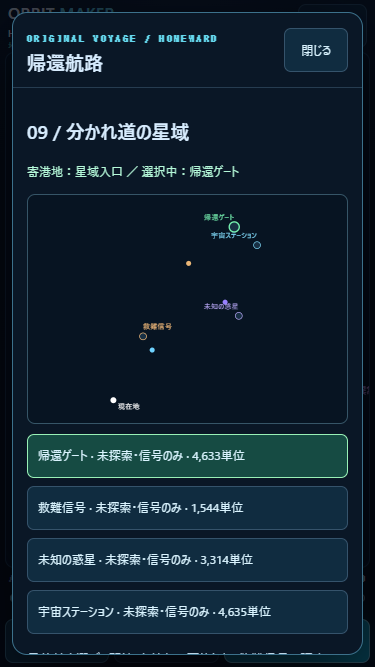
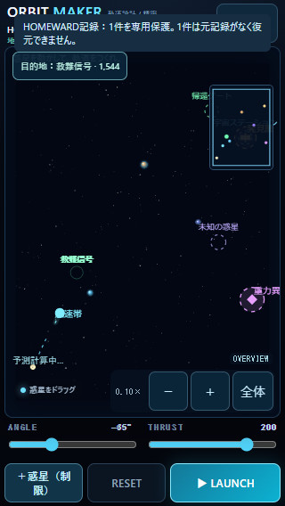
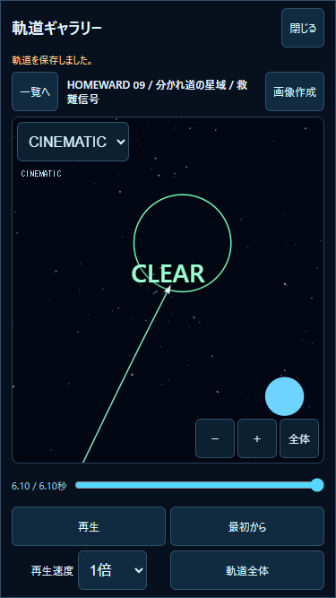

# v1.3.0 — OPEN VOYAGE

検証日：2026-10-27。ローカル実装。公開・Git push・Pages設定変更なし。
PC Node.js / Chromeで確認。**iPhone Safari実機の操作、表示、安全領域、発熱はUNVERIFIED**。

## 1. 変更ファイル

|ファイル|変更|
|---|---|
|`js/open-voyage.js`（新規）|Sector09、4目的地、3750×5000ワールド、寄港、報酬、安全な再発射、保存値の正規化|
|`js/voyage-courses.js`（新規）|実物理で確認した16区間の参考航路|
|`js/homeward-archive.js`（新規）|HOMEWARD専用IndexedDB、初回スロットの非上書き保存、旧参照のコピー移行|
|`js/homeward-data.js`|08→09接続、09データの組立。01〜08の物理設定は変更しない|
|`js/homeward-progress.js`|寄港チェックポイント、目的地、探索履歴、情報・報酬、保護記録参照。既存v1形式を継承|
|`js/homeward-ui.js`|星域図、4目的地の選択・距離・探索状態、参考航路、報酬、保護記録の再生リンク|
|`js/homeward-tutorial.js`|09の短いガイド。通常盤面上で実施しスキップ可能|
|`js/game.js`|飛行中の目標変更、寄港・再発射、記録保護と保存失敗通知、旧記録移行、目的地描画|
|`js/gallery-ui.js`|専用記録を優先して再生。新記録の目的地マーカー描画。旧v1は維持|
|`index.html` / `styles.css`|小型「目的地」ボタン、独立スクロールの星域図・目的地リスト、09ノード、保存通知|
|`package.json` / `README.md`|Version・操作案内・レポートへのリンク|
|`tests/open-voyage.test.mjs`（新規）|4ルート・16区間・予測/倍速・保存・報酬・互換性の検証|
|`tests/open-voyage-ui.mjs`（新規）|実際のChrome IndexedDBを使った操作・保存保護・再生・容量エラー検証|
|`tests/open-voyage-design.mjs`（新規）|参考航路の探索を再現する開発用スクリプト。ゲームからは起動しない|
|`tests/lost-sectors.test.mjs`|旧04〜08の対象範囲を明示。09には専用の検証を用意|
|`reports/open-voyage/`|本書、航路結果、記録JSON、模擬セーブ、画面キャプチャ|

## 2. Sector09の構成・目的地と座標

HUGE：**3750×5000**。入口の発射地点：**(250,4500)**。各位置は物理ワールド座標。

|目的地ID|名前|中心(x,y)|到達半径|到達時の処理|
|---|---|---|---:|---|
|gate|帰還ゲート|(2900,700)|100|Sector09クリア、次宙域への通行情報|
|rescue|救難信号|(900,3100)|95|漂流船の救助、参考航路の表示を解放|
|planet|未知の惑星|(3000,2650)|110|反発重力の調査、帰還距離900短縮の航法技術|
|station|宇宙ステーション|(3400,1100)|100|寄港履歴、次宙域の進入方位情報|

未知の惑星の調査点は反重力惑星本体の外側に配置する。惑星本体は(2700,2350)。地球型(1100,3400)、巨大ガス(1900,1500)も配置。惑星3個は種類・個数固定だが、発射前のドラッグと重力操作モードの移動は可能。目標・発射地点等の配置制約は既存処理を使う。

ギミックは彗星(650,3700)、方向−65°・速度12、加速する尾、ステーション(3400,1100)、未知の物体(3500,3500)。彗星の位置は保存済み総航行時間から進め、寄港ごとに初期位置へ戻さない。ステーションと異常重力は固定。既存の危険領域・衝突処理を維持する。

各地点は最初は「未探索・信号のみ」。信号位置は星図に載るが、詳細情報・報酬は未発見。選択した目的地を強調し、ロケットからの直線距離を表示する。目的地が少ないため、全4地点を最初から選択できる。

## 3. 攻略例と実航行検証

すべて**実際に既存物理エンジンを1/120秒ずつ実行**し、通常の連続ゴール判定による到達を確認した。位置や終了状態を強制する処理は使用していない。

|ルート|航路・ANGLE / THRUST（各区間）|総飛行時間|実移動距離|
|---|---|---:|---:|
|A 直接帰還|入口→帰還 −59°/220|20.325秒|4556.1|
|B 救難|入口→救難 −65°/220、救難→帰還 −52°/220|20.825秒|4602.8|
|C 惑星調査|入口→惑星 −32°/220、惑星→帰還 −93°/220|23.700秒|5234.1|
|D 複数寄り道|入口→救難 −65°/220、救難→惑星 −19°/220、惑星→ステーション −77°/220、ステーション→帰還 −132°/220|26.675秒|5899.5|

距離は固定ステップのロケット移動量の合計。寄港から発射位置への港内移動は含まない。
Dの区間時間は6.100、10.083、7.533、2.958秒。入口からワールドの反対側へ航行し、従来375×500の範囲を大きく超える。

各区間の終点座標、ステップ数、安全な次発射地点は [route-results.json](route-results.json)。各 `A/B/C/D-...-flight.json` は実シミュレーションから取得した既存v1互換の記録。

入口→惑星の参考航路では進行方向が2°以上変わる。惑星の重力を除いた対照実験では同じ発射条件で目的地に到達せず、重力による接近を確認した。Aのスリングショットも到達し、精密発射との終点差は1e-7ワールド単位未満。

他の寄港地間も含め全16区間を検証。`voyage-courses.js`は初期惑星配置・標準発射地点での参考値であり、自動操縦や唯一解ではない。惑星を動かした場合や移動物体の位相が異なる場合は、予測を見て調整する。

## 4. 複数回航行・目標変更

1. 「目的地」またはHOMEWARDの宇宙マップで行き先を選ぶ。
2. ANGLE・THRUSTまたはスリングで発射し、選択中の1地点を物理ゴールにする。
3. 非選択地点へ接近しても終了しない。飛行中もマップを開き目標を変更でき、ロケットの位置・速度・経過時間は変えず、ゴールのみ変更する。
4. 物理的に到達したら飛行を確定して寄港。非ゲートは「寄港しました」、帰還ゲートは「CLEAR」。報酬とチェックポイントを保存する。
5. 「次の目的地を選ぶ」から次の航行へ。通常は港の中心の南160を発射位置とし、惑星が移動して塞いでいた場合は、安全な周囲の候補を探索する。港内の離着陸は抽象化し、次の飛行は安全な位置から新規シミュレーションとして始める。

再読み込み・RESETでは最後に確定した寄港地点から再開。失敗でチェックポイントは失われず、飛行途中の位置は保存しない。同じ寄港地を選んだまま即再発射する操作はマップへ案内する。飛行を一度離れて戻る航路や、過去に探索した別地点への再訪は可能。報酬は再訪で重複しない。

全カメラモード、倍率0.1〜3、1本指パン、ピンチ、惑星選択・移動、航行倍率1〜100を維持。目的地選択中も従来同様に飛行を一時停止し、閉じると再開する。メイン画面の盤面寸法は維持し、小型ボタンだけを追加。

## 5. 寄り道報酬・日誌

- 救難：`route-charts`。星域図に航路線を表示し、現在の港から選択地点への参考ANGLE・THRUSTを表示する。
- 惑星：`navigation-tech`。帰還の推定残距離を900短縮し、進捗へ反映する。
- ステーション：`station-intel`。次の宙域向け情報を保存し、日誌に表示する。次セクターのゲーム処理は今回実装しない。
- ゲート：`next-region`。Sector09クリアを記録。寄り道の成果の有無でゲートをロックしない。

報酬・発見・探索履歴は重複を除いた配列で保持。旧07の追跡による寄り道600も維持。旧01〜08の進行と距離は09の報酬を得るまで従来どおり。

## 6. 航海日誌の記録保護

通常ギャラリーとは別のIndexedDB **`orbit-maker-homeward-archive` / version 1 / `flights`** を追加。

```text
{key: "sector:homeward-01:first", record: <従来のv1航行記録>, savedAt}
{key: "dock:homeward-09:rescue:first", record: <従来のv1航行記録>, savedAt}
```

各セクターの初回クリアと09各地点の初回寄港を保存する。キーの存在確認と初回挿入は同じreadwriteトランザクションで行い、既存スロットを上書きしない。自動整理や自動削除処理は持たず、通常ギャラリーの削除・お気に入り解除からもアクセスしない。現在は最大9セクター＋4寄港の13スロット。飛行点は従来の最大4096点に収める。容量不足では既存記録を削除せず通知する。

Chromeの検証では、旧1件＋09の4寄港＋09初回クリアの6スロットを保管し、JSON直列化サイズは**100679 bytes**。これはデータの直列化サイズであり、実際のIndexedDB占有量やiPhoneメモリ計測値ではない。

通常DB **`orbit-maker-gallery` / version 1**、20件の自動保管、30件のお気に入りは変更しない。通常ギャラリーへ25件を追加して新航行が自動整理された後も、専用6スロットは完全に同じ内容で残り、日誌から救難へのCINEMATIC再生が成功した。

旧日誌の`clearFlightId`が参照する残存航行をコピーし、`importantFlightId`を保存する。元記録・お気に入りは変更しない。旧参照が歴史上の最初の航行だったかは遡及して保証せず、残っている参照記録を保護する。削除済みの航行は復元せず、その件数を通知する。旧02の削除済み参照には架空の保護IDを追加しないことを検証した。

アプリ自身は重要記録を自動削除しない。サイトデータ消去やブラウザ側の保存領域消去からの復元は保証しない。重要記録の管理・エクスポートは今後の課題。

## 7. 保存互換性

HOMEWARDのキー `orbit-maker.homeward.v1`、`version:1`を維持。既存フィールドと未知の拡張フィールドを保持。以下を任意に追加する。

```text
voyage: {
  checkpoint, selected, visited, discoveries, rewards,
  completed, elapsed, planets, launchPosition,
  records: {rescue: <protectedFlightId>, planet: ..., station: ..., gate: ...}
}
journal[sectorId].importantFlightId
```

`elapsed`は確定済み航行の総時間で、彗星の時刻に使う。`planets`は寄港時点の配置。飛行中に失敗・再読み込みした場合は直前の寄港配置から再開する。選択中の目的地は選択時に保存する。重要記録の参照は専用DBへの保存成功後に付ける。

記録本体は既存v1座標を利用し、物理再計算なしで再生。09の新記録にだけ最終目的地、出発港、目的地マーカーの任意メタデータを加える。飛行中に目標を変更した記録では最終目標を再生に使う。ギャラリーのCLEARはその区間の到達を示し、Sector09のクリアは帰還ゲート到達時だけ記録する。

## 8. 関連テスト

全件回帰は実施していない。**関連Nodeテスト35件成功**。

|実行|件数・結果|
|---|---|
|`node --test tests/open-voyage.test.mjs`|12件PASS。A〜D、全16区間、予測一致、1/100倍一致、重力操作との一致、寄港・復元、非選択地点、目標変更、重複報酬、旧01〜08基準軌道、移行、重力対照、スリング|
|`node --test tests/flight-replay.test.mjs tests/gallery.test.mjs`|12件PASS。変更したギャラリーの影響範囲、旧記録・再生速度・一時停止・非破壊性|
|旧HOMEWARD/first-voyageを保存・ガイド関連の名前で限定実行|7件PASS。旧v1・順次解放・他キー保護・破損/将来形式・容量不足・復元|
|lost-sectorsを「追跡・回避／新ガイド／遅れて／ステーション未受信」で限定実行|4件PASS。既存分岐、解放制約、保存・ガイド、遅延した保存参照|

全航路は予測の終端状態と実飛行が完全一致。1倍/100倍の状態・固定ステップ数も完全一致。Stage01〜20、惑星・ギミック物理、音声、通常ギャラリーDBにソース差分なし。旧HOMEWARD01〜08は保存済み記録の終点・到達時間と完全一致。

**PC Chromeブラウザ検証**：`node tests/open-voyage-ui.mjs`。

|模擬サイズ|盤面|パネル|確認|
|---|---|---|---|
|320×568|310×417|296×544|目的地選択、主要操作、惑星x1100→1300のドラッグ、空白パン→FIXED、全体表示、RESET|
|375×667|365×516|351×643|Dの4区間、飛行中の目標切替、寄港復元、FOLLOW/CINEMATIC、重要DB・再生・自動整理・容量エラー|
|390×844|380×693|366×820|星域図、目的地選択、距離・強調、パネル、主要操作|

全サイズでページ全体の不要な縦横スクロールなし、パネルは画面内、例外0。パネルを開閉しても盤面寸法は同じ。テストは独立したブラウザコンテキストで実施し、ユーザーの実データへ接続していない。

実際のChrome IndexedDBで移行・再読み込み・初回スロット再挿入・自動整理からの保護を確認。容量エラーは専用保存APIに`QuotaExceededError`を注入し、画面通知・ゲーム継続・既存専用データの不変性を確認した。OSの実際のディスクを埋める試験は行っていない。

結果：[route-results.json](route-results.json)、[ui-results.json](ui-results.json)、[模擬セーブ](browser-save.json)。

## 9. 画面キャプチャ





## 10. iPhone実機確認手順（未実施）

公開はしていないため、今回の作業ツリーを配信する既存のローカル環境からSafariで開く。現行公開サイトへ反映されたとは扱わない。進行やサイトデータを消さずに試す。

|順序|操作・期待結果|記入|
|---|---|---|
|1|HOMEWARDで01〜08の進行が残り、08クリア後に09を開ける。375幅・狭い縦画面で見切れを確認|OK / NG / 未確認|
|2|「目的地」をタップ。星域図の現在地・4地点・未探索・距離・選択強調が見える。パネル内のみスクロールし、閉じると盤面が戻る|OK / NG / 未確認|
|3|直接帰還Aを表の条件で試す。FOLLOW/CINEMATIC/OVERVIEW、ピンチ・1本指パン、1〜100倍の操作感を確認|OK / NG / 未確認|
|4|救難信号へ−65°/220で到達。寄港後、再読み込みして港が残る。別の目的地を選んで再発射|OK / NG / 未確認|
|5|Dの順に救難→惑星→ステーション→帰還。参考航路解放、残距離900短縮、航行情報が日誌へ残る。再訪しても重複しない|OK / NG / 未確認|
|6|飛行中に目的地を切替。船の位置・速度が飛ばず、選んでいない地点への接近だけでは終了しない|OK / NG / 未確認|
|7|日誌の専用保護された寄港記録をCINEMATIC再生。再生・一時停止・速度変更・手動カメラを確認|OK / NG / 未確認|
|8|通常ギャラリーの古い記録が整理されても専用リンクが再生できる。確認のために既存の大切な記録を削除しない|OK / NG / 未確認|
|9|数回の航行でタップ応答、発熱、音声、バックグラウンド復帰を確認。CLASSICの星・旧お気に入りが残る|OK / NG / 未確認|

NG記録：端末、iOS、セクター、寄港地、目的地、ゲームモード、発射条件、速度倍率、再現操作、期待結果、実際の結果。

## 11. 次Versionへの課題

- iPhone Safari実機の操作・表示・発熱・保存領域の挙動は未確認。PC模擬結果を実機PASSとは扱わない。
- Sector10以降は未実装。ゲートでは次宙域への情報と09クリアを保存し、09の再探索は継続できる。
- 重要記録は各セクター・各寄港地の初回分を保護する。毎回の全航行は従来ギャラリーの保管上限に従う。エクスポート・明示的な専用記録管理UIは今後の課題。
- 飛行途中の状態は保存しない。再開は最後の寄港点から。失敗した航行中の惑星編集もチェックポイントへ戻す。
- 移動物体の位相とプレイヤーが編集した惑星配置により参考航路は変わり得る。予測による再調整を前提とする。
