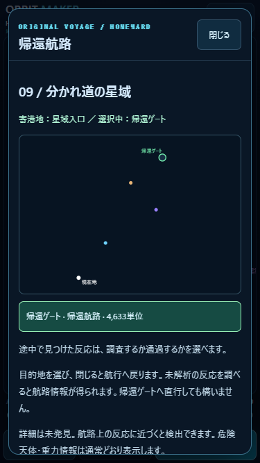
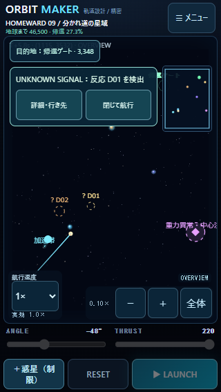
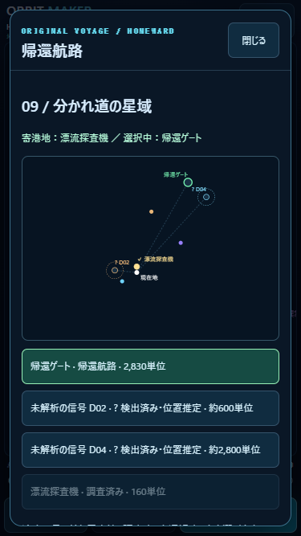
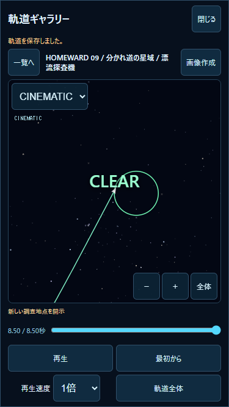

# v1.4.0 — UNKNOWN FRONTIER

完了検証日：2026-10-30（JST）。ローカル実装。公開・Git push・Pages設定変更なし。
**PC Node.js / Chromeによる自動検証と、iPhone実機確認を区別する。実機の操作感・安全領域・発熱はUNVERIFIED。**

## 変更した主要ファイル

|ファイル|内容|
|---|---|
|`js/frontier.js` 新規|5対象の設定、状態、旧データ引継ぎ、固定ステップ上の区間検出・調査、重複しない情報報酬|
|`js/frontier-ui.js` 新規|短い非停止通知、詳細・行き先、閉じて航行|
|`js/homeward-progress.js`|発見状態・日時・情報・参照の保存、ランタイム追跡、旧v1.3の知識を保持、画面操作時の目的地制限|
|`js/homeward-ui.js`|未発見地点を伏せた星域図、推定位置、正式名、調査条件、参考航路、対象別日誌・CINEMATICリンク|
|`js/game.js`|実飛行の各1/120秒ステップで観測、表示名の制御、発見・調査記録の専用保存、保存失敗通知|
|`js/open-voyage.js`|Sector09の短い探索案内、探査機の無害な地点、既存異常物体の中心を避けた調査点|
|`js/voyage-courses.js`|新しい調査点・寄港地間の検証済み参考航路|
|`js/gallery-ui.js`|保存された発見イベントを時刻に合わせて再生表示。旧記録は従来どおり|
|`index.html` / `styles.css`|通知、44px以上の操作、調査条件、日本語表示、バージョン|
|`package.json` / `README.md`|1.4.0・操作説明|
|`tests/frontier.test.mjs` / `tests/frontier-ui.mjs` 新規|今回の対象・実航路・互換性・ブラウザ保存を限定検証|
|本ディレクトリ|本仕様・レポート、実測JSON、飛行記録、模擬セーブ、画面キャプチャ|

`physics.js`、`encounters.js`、`launch.js`、CLASSICステージ、音声、通常ギャラリーDB、CINEMATICの物理処理は変更していない。過去の検証用航行記録はテスト後も元の内容を維持した。

## 発見・調査の体験

新しい探索では帰還ゲートだけを行き先として表示。UNKNOWNの5対象は名称・詳細・選択ボタンを表示しない。危険な天体、反発・重力、彗星の尾、実際の予測線は隠さない。

航行中に検出すると`DETECTED`になり、短いUNKNOWN SIGNAL通知と「? D01」等の信号マーカーが現れる。宇宙マップでは未解析の名称、推定位置の点線円、100単位に丸めた概算距離を表示する。その信号を目的地に指定して寄り道することも、通知を閉じて元の航路を続けることもできる。

調査条件を満たすと`INVESTIGATED`となり、正式名称・正確な距離・取得情報を開示。探査機の星図から遠方の別信号を知り、そこを次の目的地に選ぶ、といった航路の変化が生じる。自動停止・自動目的地変更・速度補正は行わない。

通知はゲームを停止しない。「詳細・行き先」で既存の宇宙マップを開くと、メニューの従来仕様に従い一時停止する。行き先を押して閉じると再開。閉じる操作は船体・カメラ状態を変更しない。

## 5対象の配置・条件・報酬

ワールドは従来の **3750×5000**。距離は物理ワールド単位。ロケット中心と対象中心の実距離で判定する。

|ID|対象・実位置|検出|調査|効果|
|---|---|---:|---|---|
|D01|漂流探査機 (1500,3000)|700以内|100以内への接近|`probe-routes`：参考航路を表示、D04の信号位置を開示|
|D02|謎の救難信号 (900,3100)|700以内|170以内への接近|`rescue-option`：発信位置・正体を特定し、任意の救助先として表示|
|D03|未知の惑星。反重力惑星の初期位置 (2700,2350)|1000以内|実際の惑星位置から550以内を通過|`gravity-notes`：反発重力・予測の補足説明|
|D04|宇宙ステーション (3400,1100)|700以内|160以内、かつ目的地に指定して通常の寄港判定|`station-guidance`：次の航行の参考情報・航行方位|
|D05|既存の異常物体 (3500,3500)|1000以内|380以内に連続0.5航行秒|`anomaly-clue`：未検出ならD01の信号を開示、追跡情報を日誌へ|

D02・D03・D04は既存対象を再利用する。D05も既存の固定された異常物体を使い、新しい危険物体を重複配置しない。追跡は範囲内での連続観測を意味し、新規の物体移動やUFOを追加したわけではない。D01だけが新しい無害な対象で、力・衝突領域は追加しない。

目的地の到達円は既存設定を維持。D03の調査用目的地は(3000,2650)、D05は危険な中心を避けた(3300,3500)・到達半径50。探査機の到達半径は70。D03の判定は固定の調査マーカーではなく、プレイヤーが移動した場合も**実際の反重力惑星**へ追従する。

救難の寄港による既存の参考航路報酬、惑星の寄港による帰還距離900短縮、寄港チェックポイント、既存の報酬は維持する。新しい重力情報の調査判定はこれらと分離し、推力・加速度・ゴール条件を自動補正しない。

情報から開示された地点は`source: chart`としてDETECTEDにする。これはセンサーが遠方まで接近したという意味ではない。正体は調査するまで伏せ、記録でも情報由来の開示と区別する。

## 判定方式・物理非干渉

実飛行の固定ステップを実行した直後に、前後のロケット位置と対象位置を渡す純粋な観測関数を呼ぶ。区間と円の交差を解析的に求め、前後の点が範囲外でも途中で横切った場合を拾う。D05の観測時間も区間内にいた割合×シミュレーション時間で集計し、範囲を離れると連続時間をリセットする。

観測関数は物理スナップショットを書き換えない。カメラ倍率・描画回数・実時間では判定しない。状態遷移時だけlocalStorageに書き、毎物理ステップの保存は行わない。報酬は集合として重複を除き、同じ対象の同じ状態へ戻さない。

参考航路は入力例であり、自動設定ではない。発射条件を入力し、検出した行き先を明示的に選ぶ。変更時も船の位置・速度・経過時間は維持する。予測は最終的に選択したゴールと同じ既存物理を使い、実飛行の終端状態と一致する。

## サンプル実航路

すべて実際に1/120秒ずつ積分し、通常の到達判定で成功した。終了状態・座標を強制していない。各航路について1倍／100倍の状態・ステップ数・発見状態・検出時刻の一致を確認。

|例|入力と選択|実飛行時間|結果|
|---|---|---:|---|
|A 直接帰還|入口→ゲート：−59° / 220|20.325秒|受動的な信号検出のみ。調査完了0件のまま帰還可能|
|B 探査機|入口から−48° / 220。D01検出後に探査機へ変更（約5.633秒）。寄港後→ゲート −59° / 220|8.500＋12.733＝21.233秒|D01調査、D04の信号を開示、航路情報取得後に帰還|
|C 救難|入口から−65° / 220。D02検出後に信号へ変更（約3.800秒）。救難→ゲート −52° / 220|6.100＋14.725＝20.825秒|信号の位置・正体を特定、救助寄港後に帰還|
|D 惑星・寄港地|入口から−32° / 220、D03検出後に変更。惑星→ステーション −77° / 220、D04検出後に変更。ステーション→ゲート −132° / 220|14.500＋7.533＋2.958＝24.992秒|D03調査、D04寄港・航行支援、帰還|
|E 複数発見・航路変更|入口から−48° / 220。D02・D01の2信号を検出してからD01へ変更。開示されたD04へ −46° / 220。最後にゲート −132° / 220|8.500＋12.708＋2.958＝24.167秒|探査機で開示された地点を、実際に次の寄港先として選択|

新しい探索では最初に隠れた目的地を選べない。B〜Eの初回はゲートを選んだ状態で上記の方向へ発射し、途中で検出した信号へ目標を変更する。初めから未知地点の名称を知っていたり、船の進行方向を途中で自動修正したりする試験ではない。

追加のD05実航行：ステーションから93° / 220で異常反応の調査点へ10.017秒、0.5秒追跡を達成。未検出のD01が情報から開示される。その後、探査機へ−160° / 220で8.358秒、ゲートへ−59° / 220で12.733秒。既存v1.3のステーション寄港済みセーブを起点とし、新しい発見を確認した。

各遷移の航行時刻、目標変更時刻、終点座標は [route-results.json](route-results.json)。D05は [tracking-results.json](tracking-results.json)。各JSON航行記録は実物理から取得したもの。自動テストの日時は倍率比較のため固定値を注入し、ブラウザの保存例は実際の日時を使用する。

## 保存仕様・旧データ互換性

HOMEWARDの保存キー `orbit-maker.homeward.v1`、トップレベル`version:1`を維持。既存の進行・寄港・日誌・未知の拡張フィールドへ干渉せず、任意フィールド`frontier`を追加する。

```text
frontier: {
  version: 1,
  targets: {
    D01: {
      id, state, source,
      firstDetectedAt, detectedElapsed,
      investigatedAt, investigatedElapsed,
      information, tracking,
      detectedFlightId, investigatedFlightId,
      legacy?
    }, ... D05
  },
  rewards: [情報ID]
}
```

日時は初回だけ付ける。再訪で更新しない。追跡途中の連続時間は新しい発射時にリセットし、調査完了状態は維持する。発見は飛行が失敗・RESETで終わっても失われない。船のチェックポイントは従来どおり寄港時だけ更新する。

旧v1.3セーブには以下を適用する。読み込みだけでは元のlocalStorageを書き換えない。

- 訪問済みの既存地点はINVESTIGATED、選択中だった未訪問地点はDETECTEDとして航路を継続可能にする。
- 既存の専用寄港記録IDを引き継ぐ。存在しない記録を復元したとは扱わない。
- 旧日時は不明のまま`legacy:true`とし、UIにも旧記録・日時不明と表示する。旧選択地点を今回調査した場合は新しい調査日時だけを記録し、過去の初回検出日時は捏造しない。
- Sector01〜08、CLASSICの星、音声、旧お気に入り、通常ギャラリーDBと専用DBの名前・バージョンは維持する。

## 重要記録・再生・保存失敗

既存の `orbit-maker-homeward-archive` / version 1に、以下の初回スロットを追加する。DB構造の変更や旧記録削除はしない。

```text
discovery:homeward-09:D01:DETECTED
discovery:homeward-09:D01:INVESTIGATED
... D05
```

発見または調査した航行を、成功／失敗にかかわらず終了・RESET時に保管する。既存の`saveFirst`で同じスロットを上書きせず、保存成功後だけ対象へ参照IDを付ける。通常ギャラリーの20件制限・削除から独立し、日誌の対象別ボタンからCINEMATIC再生できる。

既存の最大4096描画点を維持。現在の初回セクター9＋寄港地点6＋発見段階10で最大25スロット。毎回の全航行を専用保存する仕様ではなく、通常ギャラリーの件数制限も変更しない。記録には任意の`frontierEvents`を追加し、再生時刻に応じて通知内容を表示する。旧v1記録には追加フィールドがなくても再生可能。

localStorageや専用DBの保存に失敗した場合、画面へ通知し、可能な限りメモリ内で航行・調査を続ける。保存失敗分を再読み込み後も復元できるとは表示しない。既存データを削除して容量を空ける処理は追加していない。

## 関連テスト

全件回帰は実施していない。関連Nodeテスト **43件成功**。

- `node --test tests/frontier.test.mjs`：12件。A〜E、D05実追跡、状態遷移、高速区間横断、報酬重複防止、名前と選択制限、旧v1.3、容量不足時継続、遅延した参照保持、旧代表4航路。
- `node --test tests/open-voyage.test.mjs`：12件。既存の直接／救難／惑星／複数寄り道航路、寄港・復元・重複防止、旧01〜08の基準終点・時間、重力・スリング互換性。従来16区間と追加9区間は、既存・新規の航路テストを合わせて到達検証。
- `node --test tests/flight-replay.test.mjs tests/gallery.test.mjs`：12件。旧記録・新記録・再生・一時停止・非破壊性など、変更した再生表示の影響範囲。
- HOMEWARD/first-voyageを`旧v1|チュートリアル|セクターの順次|旧キー|破損|保存容量|不正な現在`で限定実行：7件。旧保存・ガイド・他キー保護・破損/将来形式・保存不能・復元。

`node --check`、`git diff --check`も確認。物理・衝突・発射ベクトル・CLASSICステージ・音声・通常保存DBに差分なし。v1.3の代表4航路の終点・到達時間は保存済み基準と完全一致し、旧HOMEWARD01〜08も維持。

**ブラウザ**：`node tests/frontier-ui.mjs`。独立したテスト用Chromeプロファイルを使い、ユーザーの実データには接続しない。

|PC Chrome模擬サイズ|盤面|通知の幅×高さ|結果|
|---|---|---|---|
|320×568|310×417|214×85.6|PASS。名前を隠した星域図、検出通知、44px以上の操作、閉じても飛行継続|
|375×667|365×516|269×85.6|PASS。検出→目標変更→調査→信号開示→再読込→帰還、保護記録・旧v1再生|
|390×844|380×693|284×85.6|PASS。localStorage/専用DBの容量エラーを注入し、通知・メモリ内継続・元データ不変を確認|

全サイズでパネル内に収まり、ページ全体の余分なスクロール・ブラウザ例外なし。通知やパネルを開閉しても盤面寸法は維持。検出済みの盤面ラベルは短い「? D01」等にして隣接ラベルの重なりを抑えた。

通常ギャラリーへ25件を追加し、調査記録が自動整理された後も、専用8スロットの内容は変わらず、D01調査航行のCINEMATIC再生に成功。旧お気に入りは内容を保持し、旧v1航行もCLEARまで再生できた。容量不足はAPIへの例外注入であり、実際のディスクを埋めた試験ではない。

結果：[ui-results.json](ui-results.json)、[ブラウザの模擬セーブ](browser-save.json)。

## 画面キャプチャ






## iPhone実機確認手順（未実施）

今回の作業ツリーを配信する既存ローカル環境で開く。公開・pushしていないため、公開サイトが今回の版になったとは扱わない。既存のサイトデータを消して試験しない。

|順序|操作・期待結果|記入|
|---|---|---|
|1|HOMEWARD09を開く。旧訪問済み地点は残り、新しい探索では帰還ゲートだけが分かる。危険天体・予測線・重力情報は見える|OK / NG / 未確認|
|2|新規探索で−48°/220を入力して発射。約5.6秒までに反応D02・D01を検出。通知が画面内に収まる|OK / NG / 未確認|
|3|通知を「閉じて航行」。船が飛行を続け、パン・ピンチ・FOLLOW/CINEMATICを操作できる|OK / NG / 未確認|
|4|D01の通知から「詳細・行き先」。未解析の信号を選んで閉じると、その目標へ飛行を継続。100以内で名称・情報を取得|OK / NG / 未確認|
|5|寄港後に再読み込み。探査機が判明したままで、D04の信号が選べる。帰還ゲートの参考航路も表示される|OK / NG / 未確認|
|6|表のC/D/Eを参考に別の寄り道を試す。各情報は再訪しても重複しない。D05は危険な中心を避けて観測する|OK / NG / 未確認|
|7|日誌の対象別「調査航行をCINEMATIC再生」。旧お気に入りと旧航行も保持される|OK / NG / 未確認|
|8|1倍と100倍で発見対象・調査結果が同じ。連続プレイの応答・発熱・Safari安全領域を確認|OK / NG / 未確認|

NG記録：端末・iOS、画面向き、寄港地・選択先、発射条件・倍率、再現操作、期待結果、実際の結果。

## 残課題

- iPhone実機の指操作・安全領域・発熱は未確認。PC模擬のPASSと区別する。
- 調査点へ向かう途中の目標変更は航路を自動修正しない。必要なら次の寄港・再試行で発射条件を調整する。移動した惑星では参考航路も再確認する。
- D05は固定物体の連続観測。動く未知物体を追う通信・物語イベント、対象の追加は後続Version。
- 記録は航行終了・RESET時に保護する。飛行中の座標保存、重要記録のエクスポート、ブラウザによるサイトデータ消去からの復元は今回の対象外。
