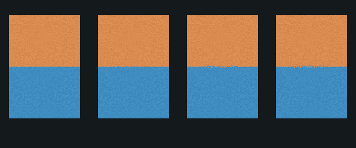
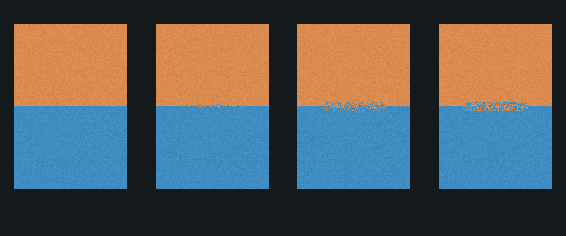
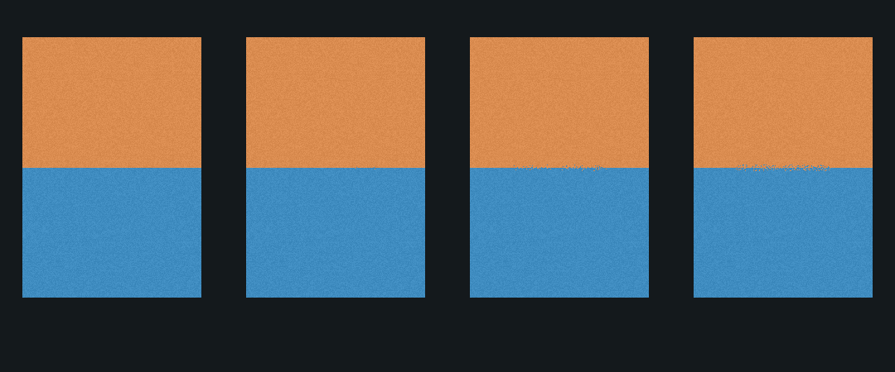
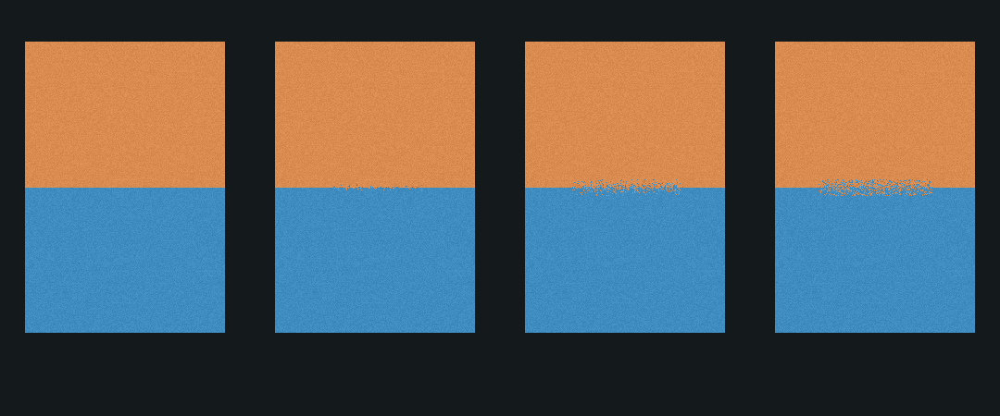

# SAND MOTION v0.6.4 — LIGHT & FLOW TRACE

2026-11-21（日本時間）。実装と利用可能な最終検証を完了しました。変更テキストはLF。commit・push・公開は行っていません。

## 物理側の原因：コードと再現で確認

| 調査項目 | v0.6.3で確認したこと | v0.6.4での改善 |
| --- | --- | --- |
| 強さの伝達 | UIの値はtraceSegmentへ渡されている。ただし主に候補の処理確率に作用し、移動回数上限はほぼ共通 | 確率だけでなく移動上限・リング長・繰り返し・周囲への伝播・処理予算を段階化 |
| 指の距離と砂の移動 | 軌跡は補間されるが、1入力で各粒が動ける回数が低速1／2セルに制限されている | 低速では標準グリッドで弱1／標準3／強5回、高精細は補正後2／6／10回まで。速い払いは少し増やす |
| 密集部 | 空きがなくても毎回BFSを先に実行。最後に小さな4粒循環だけが発生する | 短いレーンと隣接セルの空きを先に判定。空きがあれば短い連鎖、なければ向きを持った長方形リングによる混合へ進む |
| 高精細 | 探索・候補が増える一方、共通予算を使い切り、混合や強さの差が薄れやすい | 早期の密集判定と予算の段階化。整数グリッドの循環による移動量差も補正し、画面換算平均移動を各強さで標準品質との20%以内に調整 |
| ブラシ | 初期の半径3が、縮小表示されたCanvas上では小さい。強さを見つけにくい | 初期を中（半径5）へ。細3／中5／太8をグリッド倍率で補正。道具パネル先頭の大きなプリセットへ移動 |
| 座標 | pointerごとに現在のCanvas矩形からCSS座標をグリッドへ変換。高精細も同じ式 | 方式を維持し、CSS幅255／355pxと両内部解像度で変換をテスト |
| 再開時の準備 | 移動サブステップごとに近隣粒を何度も起こす | なぞり砂中は変更セルをdirty配列へ記録し、通常道具に戻す際にまとめて起こす。重力停止中の無駄な反復を削減 |

これはコードとNodeで再現した原因です。iPhone録画そのものや実機を直接解析した結果ではありません。

## 操作UI

なぞり砂を選び、メインの道具ボタンを再び押すと、パネル先頭で次をすぐ調整できます。

- **砂を動かす強さ：弱／標準／強**、初期は標準。
- **ブラシの太さ：細／中／太**、初期は中。
- 選択ボタンを強調し、メインにも「なぞり砂／標準・中」のように値を表示。
- 変更は砂を再生成せず次の操作へ即時反映。調整を続けてもよく、閉じてすぐ遊べる。
- 常設ボタンは増やさず、メインの2段操作とキャンバス優先を維持。パネル本文はスクロールでき、閉じるボタンは本文の外に置く。
- なぞり砂の道具パネルを開くと本文を先頭へ戻し、以前のスクロール位置で調整項目が隠れないようにする。

通常の砂のブラシは従来の設定に残しています。強さ・太さの選択だけで画像読込、リセット、粒子変換は呼びません。

## 同じ太さ・軌跡での強さ比較

不透明な色帯画像の中央を、太さ「中」、横幅40%分、800msの同じ軌跡で1回なぞった結果。移動粒子数は「最終位置が初期位置と異なるID数」、平均はその粒だけの直線距離です。途中で動いて元へ戻った粒の移動サブステップ数とは区別しています。

| 品質 | 強さ | 位置が変わった粒 | 平均距離（内部セル） | 平均距離（標準換算） | 作用半径（標準換算） |
| --- | --- | ---: | ---: | ---: | ---: |
| 180x300 | 弱 | 500 | 1.000 | 1.000 | 5 |
| 180x300 | 標準 | 762 | 1.603 | 1.603 | 6 |
| 180x300 | 強 | 845 | 2.123 | 2.123 | 7 |
| 270x450 | 弱 | 1,064 | 1.246 | 0.831 | 5 |
| 270x450 | 標準 | 1,801 | 1.980 | 1.320 | 6 |
| 270x450 | 強 | 2,063 | 2.707 | 1.805 | 7 |

すべての強さで弱→標準→強の順に移動粒子数・平均距離が増えます。高精細はセルが細かいため標準換算でも確認し、各強さの平均距離が標準品質との20%以内に収まるテストを追加しました。

同じ「中」の太さでアルゴリズムだけを比較すると、標準設定の移動粒子数は旧版372→新版762、 高精細は旧版973→新版1,801です。旧初期値の「細」と新版初期値の「中」を比べるだけの評価にはしていません。

速い入力でも、同じ軌跡で標準設定の平均移動距離がゆっくりした入力より大きくなることを確認しました。変更するのは入力中だけで、指を止める／離すと継続移動しません。

## 密集・空き・壁・保存結果

- 完全密集部では1セル1粒のまま、入力方向と左右の押し出しに沿う隣接リングで混合します。毎回無関係な遠方とランダム交換する方式ではありません。
- 空きがあれば範囲内の短い連鎖で押し分けます。空きのある色帯画像では連鎖が発生し、粒を移して新しい小さな溝を作ることを検証しました。
- 作用範囲はブラシ半径＋弱0／標準1／強2の標準換算。固定砂の位置・固定状態の変更も範囲内だけです。全設定で作用範囲外の固定砂を保持するテストに成功しています。
- 探索深さは標準4／5／6、高精細6／8／9、探索ノード上限は標準40／高精細60。補間は最大768点。候補・探索予算は弱60,000／標準120,000／強180,000までで軌跡全域へ配分します。
- 壁と画面境界、各粒の移動回数上限を検査してから隣接移動を確定。移動不能な粒の削除、重複、遠距離再配置はありません。

| 品質・画像 | 検証した段階 | 総粒子数＝占有数＝可視数 |
| --- | --- | ---: |
| 標準180×300・不透明密集画像 | 初期／1回／10回／30回、全強さ・全太さ | 30,240 |
| 高精細270×450・不透明密集画像 | 初期／1回／10回／30回、全強さ・全太さ | 68,040 |
| 標準・近くに空きがある画像 | 強で30回 | 24,192 |
| 高精細・近くに空きがある画像 | 強で30回 | 54,432 |

全ケースでIDとRGBA配列を保持し、画面外0、作用範囲外の移動0、作業バッファ再利用を確認。可視数はdraw呼出数ではなく、RGBAから独立して着色された画素を数えています。表示用の微小な明暗差は維持しますが、元画像の色配列や透明度は変更しません。

## 比較画像（Node参照描画）

各画像は左から **操作前／1回／10回／30回**。同じ色帯画像・軌跡・時間で、旧初期設定の「細・標準」と新初期設定の「中・標準」を比較しています。上記の同一太さ比較も別に記録しています。

### 標準・v0.6.3



### 標準・v0.6.4



### 高精細・v0.6.3



### 高精細・v0.6.4



同じ「中」の太さでの設定別画像：標準の [弱](strength-weak-180.png)／[標準](strength-standard-180.png)／[強](strength-strong-180.png)、高精細の [弱](strength-weak-270.png)／[標準](strength-standard-270.png)／[強](strength-strong-270.png)。

実Canvasと同じ座標・RGBA・微小明暗の規則で生成したNode参照PNGです。実ブラウザ画像・iPhone録画ではありません。製品には画像保存・動画保存を追加していません。

## 性能

Node v25.9.0 / Windows x64 / Intel Core i7-1355U。テスト実行と重ねず、各設定30回で計測しています。以下は押し分け関数の経過時間で、描画・入力待ち・FPSは含みません。OSのスケジュールや実行環境によるばらつきがあります。

| 品質 | 強さ | 中央値 | p95 |
| --- | --- | ---: | ---: |
| 180x300 | 弱 | 0.269ms | 0.903ms |
| 180x300 | 標準 | 0.521ms | 1.003ms |
| 180x300 | 強 | 0.602ms | 1.311ms |
| 270x450 | 弱 | 1.646ms | 2.535ms |
| 270x450 | 標準 | 2.104ms | 4.420ms |
| 270x450 | 強 | 3.570ms | 10.442ms |

太さ3種類×強さ3種類の高速斜め入力も計測しました。詳細は [node-results.json](node-results.json) のstressを参照。FPSは未計測であり、この値からiPhoneでの滑らかさを保証しません。大きい・強い設定は実機調整が残ります。

JSON内のcpuMedianMs/cpuP95Msはperformance.nowによる関数の経過時間です。プロセスCPUカウンターによる累積・平均も別に記録していますが、Windowsでは粒度が粗いため0という記録も無負荷を意味しません。処理量とバッファ再利用は時間計測とは別に検査しています。

## 表示幅の調査：物理変更とは別の結果

**録画の「390×844の中で左の約255px」という原因は未確定です。** 録画ファイル・当時のviewport値や倍率がなく、実ブラウザ／実機でも再現していません。

コード上、アプリはwidth:100%、max-width:64rem、中央寄せで、viewportはdevice-widthです。アプリを255pxに固定する指定はありません。一方Canvasは砂の縦横比を保ち、残り高さと幅の小さい方に合わせるため、アプリが390px幅でもCanvasだけが255pxになることはあります。

表示計算を従来と同じ式の純粋関数へ抽出して検証しました。例としてstageのclientWidth=367、clientHeight=437なら、標準・高精細の両方でCanvasの表示は255×425pxになります。この表示幅255pxは内部180／270セルや、アプリ全体の幅とは別です。CSS幅255と355のどちらでも入力位置が同じグリッド割合へ変換されることを確認しています。

設定の診断情報に次を追加しました。

- アプリ実寸と左位置。
- Canvas実寸と左位置。
- Canvas内部解像度とDPR。
- 既存のviewport／visualViewport、倍率・offset、clientWidth／scrollWidth／scrollXも保持。

動画のピクセル数とCSS pxも同一とは限りません。Canvasのみの縮小か、アプリ全体・表示倍率・横移動なのかをこれらの実測で区別します。原因を確認せずにCanvasを引き伸ばす、グリッドを再生成する、ページの拡大を全面禁止する対処は行っていません。

通常表示のメイン操作数は増やさず、道具ボタンの2行表示は最小44pxに収まる行高・余白に調整。1画面構成のCSS、セーフエリア、設定内スクロール、Canvasのtouch-action:none、限定した非passiveイベント抑止を維持しました。**実際のiPhoneでの収まりは未確認です。**

## 自動テスト・実ブラウザ・実機

| 環境 | 結果 |
| --- | --- |
| Node自動テスト | **126件成功、失敗0**。既存回帰とv0.6.4の14件。初期幅と道具表示の旧期待は新仕様へ更新 |
| 実アプリの模擬DOM | draw出力の可視数、30回・多方向、即時調整・選択表示、砂を再生成しないこと、モード往復を確認 |
| 静的検証・ローカル配信 | 構文・LF・HTML ID・参照ファイル・配信を検証。実CSSレイアウトの証明とはしない |
| 実ブラウザ | **未確認**。現在のブラウザ操作ツールは利用できず、Computer Useは実行していない |
| iPhone Safari実機 | **未確認**。軽さの官能評価、実FPS、録画の幅、Safariの端スワイプ・ダブルタップは実機での確認が必要 |

回帰では通常重力、砂時計流下・反転、傾き許可・初回待ち・監視・回転、壁描画・消去、復元・リセット、画像サイズ・品質変更を確認。なぞり砂の密集混合、近隣の空きへの連鎖、全強さ、速さ・逆方向、30回、壁・端、指離し後の静止も検査しました。全設定で固定粒の作用範囲と可視数をチェックしています。

## 変更ファイル

- `src/trace.js`：密集の早期判定、連鎖・方向付き混合、強さ別上限、高精細補正、dirty記録。
- `src/paths.js`：通常道具へ戻す際の一括wakeとreset時のdirty消去。
- `src/app.js`・`index.html`・`style.css`：道具パネルの即時調整、選択値表示、診断値、v0.6.4。
- `src/input.js`：Canvasの表示サイズ計算を同一式で抽出。座標変換は維持。
- `test/flow-trace.test.js`：新規14テスト。`test/natural-trace.test.js`・`test/app-tilt.test.js`：幅・表示・調整と復帰検証を更新。
- `scripts/flow-trace-reference.mjs`：設定別・旧版比較・負荷・保存数。`scripts/fixtures/trace-v0.6.3.mjs`：旧アルゴリズムの保存。`scripts/natural-trace-reference.mjs`：過去版記録を保存済み実装へ固定。
- `test/flow-layout.html`・`test/flow-layout.js`：表示幅・主要操作・調整パネル用の未実行ブラウザ検証。
- `test/natural-trace.html`・`test/natural-trace-browser.js`・`scripts/qa-serve.mjs`：実Canvas検証をv0.6.4と専用記録先へ更新。未実行。
- `package.json`、README、ENGINE、iPhoneチェックリスト、本フォルダーの証跡。

通常物理の`engine.js`、`hourglass.js`、`tilt.js`、`reassembly.js`は変更していません。

## 残課題とiPhone確認手順

1. HTTPSで開き、v0.6.4を確認。道具→なぞり砂で「重力なし」「標準・中」を確認する。
2. 道具を再び開き、弱・標準・強、細・中・太を選ぶ。選択が強調され、砂がリセットされず、閉じると現在値がメインに残ることを確認する。
3. 標準・高精細で同じ写真中央を同じ距離なぞり、強さの違い、ゆっくり／速い払い、30回の混合を比べる。指離し・傾きで動かないことを確認する。
4. 空きのある周辺で押し分け、壁・端・閉じ込めた粒で制限が働くこと、復元・リセット・通常道具・砂時計・画像サイズの回帰を確認する。
5. 太・強、高精細で滑らかさと診断のFPSを記録する。実機の体感に応じた定数の微調整は残る。
6. 390×844／375×667相当・Safariバー展開・文字拡大で閉じる操作や主要操作に届くかを確認する。録画と診断の実寸・倍率・左位置を対応させ、255px問題を切り分ける。

完全密集部では粒を消さずに大きな空白溝を作ることはできないため、現在は局所混合を優先します。高さ・3Dや素材の追加は行っていません。今回の実機官能評価と表示幅の確定は残課題です。

```sh
npm test
npm run reference:flow-trace
npm start
```

通常起動後 `/test/flow-layout.html` で表示幅と調整UIを検査できます。実Canvasの合成入力比較は `npm run qa` → `/test/natural-trace.html`。どちらも今回は未実行です。ブラウザ結果JSONは生成していません。
