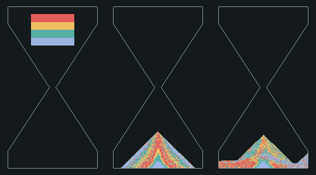
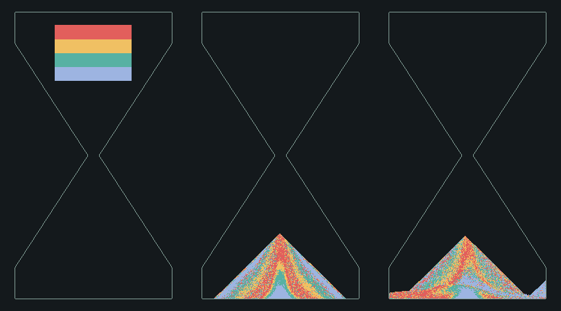

# v0.4.0 — HOURGLASS 検証記録

実施日：2026-11-15（日本時間）。コミット・push・公開は実行していません。

## 実施環境と区別

| 環境 | 結果 |
| --- | --- |
| Node v25.9.0 / Windows x64 / Intel Core i7-1355U | 自動テスト56件成功。既存42件を含む |
| Windows System.DrawingとNode物理による参照画像 | 実施。ブラウザのスクリーンショットではない |
| 実ブラウザ | 未確認。Computer Useの接続確認が `The browser access host is unavailable` を返した。実時間・FPSを取得していない |
| Windows版 iPhone Web Emulator 1.1.1 | 未確認。実エミュレータでの操作・計測は未実行 |
| iPhone Safari実機 | 未確認。縦向きロックONでの傾き、ロックOFFでの横表示・縦復帰、タッチ併用は未実施 |

## 直立の流下

実際の `sampleImage()` の描画命令をSystem.Drawingで縮小して取り込み、実際のHourglassEngineで流した。縦長は全画素不透明の色帯600×1000と300×1200を使用。すべて、上側残数0、壁侵入なし、色配列不変、リセットの初期配置一致を確認した。自動テストは100ステップごとと完了・反転後にグリッド上のID重複／欠損・壁侵入も検査する。

| 品質 | 入力 | 粒子数 | 最後の粒が中央を通過するシミュレーション時間 | 全粒静止のシミュレーション時間 |
| --- | --- | ---: | ---: | ---: |
| 標準180×300 | サンプル600×440 | 3,996 | 31.97秒 | 36.23秒 |
| 標準180×300 | 不透明縦長600×1000 | 4,018 | 27.15秒 | 33.05秒 |
| 標準180×300 | 不透明縦長300×1200 | 1,980 | 11.88秒 | 16.15秒 |
| 高精細270×450 | サンプル600×440 | 8,991 | 45.07秒 | 51.26秒 |
| 高精細270×450 | 不透明縦長600×1000 | 8,979 | 36.43秒 | 45.81秒 |
| 高精細270×450 | 不透明縦長300×1200 | 4,455 | 14.70秒 | 21.33秒 |

時間は標準60Hz／高精細90Hzへの換算。ブラウザで実測した時間・FPSではない。高精細は粒の量と穴の離散幅が変わるため、流下時間が標準と一致しない。生のCPU時間、条件、未取得のブラウザFPSは [node-results.json](node-results.json) に記録した。

上側の画像矩形をグリッド面積の7.5%以下、幅48%以下、高さ30%以下に抑え、全行で左右端が壁の内側に入るまで等比縮小する。粒を流しながら間引く処理はない。中央から真下へ積んだ場合でも、最終の山頂が穴より下に残ることをテストした。縦長300×1200も途中で詰まらず流れ切った。

## 比較画像

System.Drawingのサンプル参照：[標準・初期](sample-initial-standard.png) / [標準・流下後](sample-complete-standard.png) / [高精細・初期](sample-initial-high.png) / [高精細・流下後](sample-complete-high.png)。縦長の結果は同フォルダーの `dense-portrait-*` / `dense-tall-*`。

左から「色帯の初期状態」「まっすぐ」「途中で左寄せ→右寄せ→まっすぐ」。同一の粒子ID・色・個数から開始し、近隣セル移動だけで生成した。左右寄せで下側の裾と色の分布が変わり、中央へ戻すと残りも流れ切る。実ブラウザ表示ではなくNode物理の参照PNGである。





色帯試験は400ステップ直立→180ステップ左→180ステップ右→直立へ戻す手順。参照画像の青帯はアルファ160を保持している。色を交換・平均化する処理はない。

## 操作と回帰

- 初期はフリー。砂時計に入ると選択中の画像が上側で固定される。壁／輪郭は同じセルマスクから判定・描画する。
- 流下途中、流下完了後、6回の連続反転で、各IDの座標が正確に180°変換されることを検査。速度はゼロ、色・数・固定状態・重力は維持。2回で元配置へ戻る。
- モード往復で両配置を保持し、非表示モードの物理と復元の進捗が進まないことを実アプリのイベント／RAFハンドラーで確認。
- 画像・品質の成功時は両方が初期状態になる。選択キャンセル、デコード失敗、2番目のモードの画像変換失敗でも両配置を保持し、失敗した品質選択は元に戻す。
- 砂時計でも初回6秒待機後の手動復帰、左右の手動重力、傾きの右寄せ、横表示での物理停止・反転拒否、縦復帰後の続行と変換回数不変を模擬環境で確認。
- フリーの部分崩壊・高速スワイプ・一斉崩壊・復元・途中リセット・品質変更の既存テストを再実行した。`src/engine.js` のセル移動ルールと `src/tilt.js` の有効化後4秒監視は変更していない。

## 再実行

```sh
npm test
npm run reference:hourglass
npm run qa
```

参照画像生成はWindowsのSystem.Drawingが必要。ブラウザ計測は `http://127.0.0.1:5174/test/hourglass.html` を前面で開き「砂時計を比較して記録」。実アプリで標準・高精細のサンプル、縦長、色帯を流し、粒数・RGBAの集合・落ち切る時間・FPS・二重反転・リセットを測る。`browser-results.json` と `browser-*.png` は今回未生成。診断の更新に最大約750msの検出遅延がある。センサー許可・画面回転・実タッチはiPhone実機で別途確認する。
