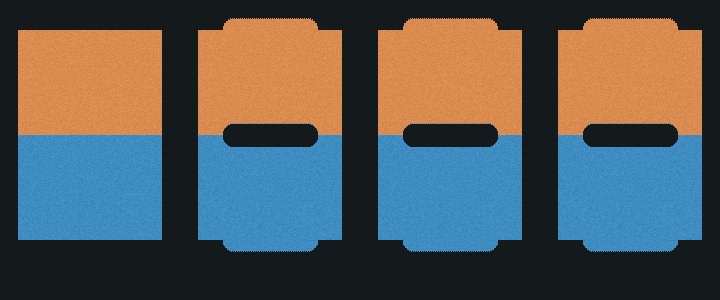
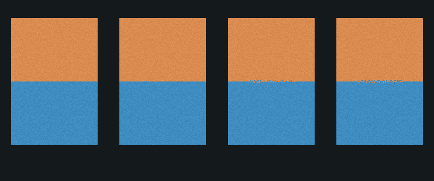
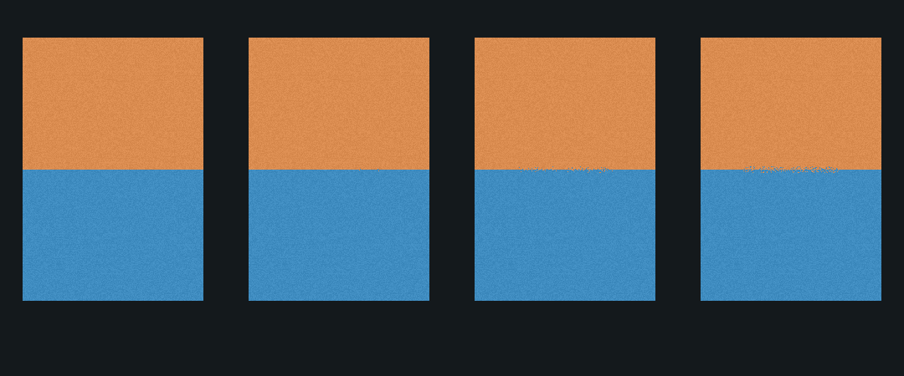

# SAND MOTION v0.6.3 — NATURAL SAND TRACE 最終検証

実施日：2026-11-21（日本時間）。作業再開時の変更を保持して検証・修正を完了。commit・push・公開は行っていません。変更したテキストはLFです。

## 原因と実装内容

v0.6.2は指の軌跡内の粒をまとめて溝の外へ移し、長い押出し連鎖で外周まで粒を動かしていたため、太く均一な黒い切り抜き線になっていました。1回の比較スワイプで対象粒は最大23セル（標準）／35セル（高精細）移動し、触れた細い範囲から離れた部分にも変化が及んでいました。

v0.6.3は次のように変更しました。

- ブラシ幅を小／中／大（標準換算の半径3／5／8セル）、押出力を弱／標準／強に分離。初期は小・標準。設定は通常砂のブラシとは別で、設定変更では画像や砂を再生成しません。
- 軌跡を標準換算1セル間隔で補間。中心ほど強く、外側ほど弱い確率分布で粒を動かします。主に進行方向の両脇へ、少量は前方向へ押します。速い払いは前方向の割合と移動上限を少し増やします。
- 近くの空きセルへ、粒を隣接セル単位で順に押す短い連鎖を使用。探索深さは標準3／高精細5セル、探索ノード上限48／72、補間点768、候補・探索検査100,000まで。処理上限を補間点へ配分します。
- 完全に密集した内部では、壁に触れず実行可能な2×2セルの4粒だけを隣接方向へ循環移動し、局所的に模様をほぐします。全粒が一斉に板状移動する処理、色の平均化、粒の重複、遠い場所への再配置はありません。実行可能な局所経路がなければ動かしません。
- 各IDの1入力区間あたりの移動回数は、ゆっくりなら標準1／高精細2、速い場合は標準2／高精細3まで。入力が止まれば動かしません。重力・傾きによる移動は停止したままです。
- 移動した粒だけ描画時に±2%の明暗差を加えます。RGBA配列や透明度は変更せず、未操作の粒には適用しません。
- 移動粒と近隣の自由粒を活動可能にします。なぞり砂中は物理更新を止めるため位置は変わらず、通常道具へ戻すと支えを失った休止粒も再開できます。

常に1セル1粒で、ID・色・個数と元位置を保持します。一時退避は不要です。通常の重力物理、砂時計、壁編集、傾きの監視、復元の補間方式は変更していません。

## 全自動テスト

**112件成功、失敗0。最後の全実行は約30.4秒。**

既存88件を実行し、標準・高精細のT01〜T12を24件追加しました。旧なぞり砂テストのうち、太い空白線を必須とする期待は、局所的な模様変化・操作領域の保持へ更新しています。粒子保存・描画数・壁・重力停止などの不変条件は維持しています。

| 項目 | 自動テストで確認した内容 |
| --- | --- |
| T01 | 中央をゆっくりなぞり、触れた範囲内だけで粒が移動。1回の移動距離上限・検査回数・表示用明暗の範囲を確認 |
| T02 | 高速でも局所移動。指離し後600更新で座標不変。静止入力では移動0 |
| T03・T04 | 同じ場所を10回・30回。各回で粒数・占有数・可視数・ID・色が一致し、模様は徐々に変化 |
| T05 | 縦・横・斜めの高速軌跡全域に反応。先頭だけに偏らない |
| T06 | 全体を多方向に繰り返しなぞり、各回で可視粒子数を確認 |
| T07 | 満杯の領域は空白を偽造せず局所循環のみ。8方向を壁で囲った1粒は移動0 |
| T08 | 壁の両側を繰り返し操作しても壁変更・貫通・粒の消失なし |
| T09 | 画面端と領域外を含む入力で画面外移動・占有不整合なし |
| T10 | 幅がグリッド倍率に比例。弱／強で反応量が変わり、色・個数は不変 |
| T11 | 復元とリセットで元の位置・色・個数・固定状態に正確に一致 |
| T12 | 通常道具へ戻しても配置を再生成せず、従来SandEngineと同じ重力結果へ復帰。休止中の近隣自由粒も起こす |

実アプリの模擬DOMテストでは実際のdrawハンドラーのRGBAを読み、30回・多方向操作の各回で着色画素数を検査しています。設定変更・モード往復の保持、通常道具、復元、即時リセットも確認しました。既存の砂時計流下・反転、壁の描画・消去と支持、傾き許可・初回待ち・監視・画面回転、画像サイズ・品質変更のテストも成功しました。

検証追加中のテスト変数名の重複を修正し、全件を再実行して成功しています。

## 粒子と描画数の保存

同じ不透明な色帯画像を使用したNode参照計測です。以下の全段階で色情報・IDを保持し、画面外粒子0でした。「可視数」は単なるdraw呼出数ではなく、実際に色が付いた独立した画素数です。

| 品質 | 段階 | 総粒子数 | グリッド占有数 | 可視数 |
| --- | --- | ---: | ---: | ---: |
| 標準180×300 | 操作前／1回／10回／30回 | 30,240 | 30,240 | 30,240 |
| 高精細270×450 | 操作前／1回／10回／30回 | 68,040 | 68,040 | 68,040 |

幅3種類×押出力3種類の高速斜めスワイプ30回も、両品質で全数一致、画面外0、操作範囲から離れた粒の変化0、作業バッファ再利用を確認しました。T06の多方向操作も全数一致しています。

## 比較画像

左から **操作前／1回／10回／30回**。同じ画像と軌跡を使い、旧版・新版それぞれの初期ブラシ幅で比較しています（旧半径12、新半径3の標準換算）。ブラシを細くした効果も含む比較です。新版では色付き粒子が細い範囲で入り混じり、離れた外周は変わりません。

### 標準・変更前 v0.6.2



### 標準・変更後 v0.6.3



### 高精細・変更前 v0.6.2


### 高精細・変更後 v0.6.3



これらはNodeで座標とRGBAから生成した参照PNGで、表示用の微小な明暗も反映しています。実ブラウザのCanvas撮影やiPhone録画ではありません。製品に画像保存機能は追加していません。

## 負荷計測

Windows x64 / Node v25.9.0 / Intel Core i7-1355U。各30回、単独で参照スクリプトを実行。以下は**押し分け関数のCPU時間**であり、Canvas描画・入力待ち・FPSを含みません。単回系列のため実行環境による変動があります。

| 品質 | 版 | CPU中央値 | CPU p95 | 1スワイプ内の最大移動 |
| --- | --- | ---: | ---: | ---: |
| 標準 | v0.6.2 | 0.264ms | 3.402ms | 23セル |
| 標準 | v0.6.3 | 0.232ms | 0.627ms | 1セル |
| 高精細 | v0.6.2 | 0.500ms | 2.559ms | 35セル |
| 高精細 | v0.6.3 | 0.724ms | 1.455ms | 2セル |

幅・力の9組合せでの高速斜めスワイプは、中央値が標準0.582〜3.508ms、高精細1.586〜2.316ms、p95の最大は標準4.438ms／高精細4.225msでした。全組合せで検査回数上限100,000以下、バッファ再利用、粒子／描画数保持を確認しました。

旧版は同じ場所を1回で大きく空けた後ほぼ変化しなくなる一方、新版は繰り返すたびに局所模様を動かします。したがって中央値だけで一律の高速化を主張しません。iPhoneの滑らかさ・実FPSは未測定です。詳細は [node-results.json](node-results.json)。

## 環境別の確認範囲

| 環境 | 状態 |
| --- | --- |
| Node自動テスト・参照ラスタ | 実施済み。全112件成功、保存数と局所性・負荷・比較PNGを確認 |
| 模擬DOMによる実アプリハンドラー | 実施済み。設定・状態保持・RGBAの可視数・重力停止・回帰を確認 |
| 静的検証・ローカル配信 | 構文・LF・HTML ID・参照先・配信MIMEを確認。通常の1画面レイアウトCSS、viewport、Canvasのtouch-actionと限定した非passiveイベント処理を維持 |
| 実ブラウザ | **未確認**。前回の接続制約とComputer Use停止を踏まえ、今回の依頼に従い再試行せず。他の検証は中断せず完了 |
| iPhone Safari実機 | **未確認**。ブラシの体感、バー展開時の収まり、指操作・ズーム防止、実FPSは実機で確認が必要 |

実ブラウザ用の検証ページは準備しましたが未実行で、browser-results.jsonは生成していません。模擬DOMの成功を実CSSレイアウトやSafariのジェスチャー抑止の証明として扱いません。

## iPhoneでの確認手順と残課題

1. ルートREADMEのHTTPS手順で開き、ヘッダーv0.6.3を確認。道具→なぞり砂（重力なし）を選ぶ。
2. 設定が小／標準であることを確認。不透明写真中央をゆっくり、次に速く縦横斜めになぞる。細い範囲で模様がほぐれるか、近隣の空きに粒が寄るかを確認する。
3. 同じ場所を10回・30回操作しても粒が消えず、触れていない外周が変わらないか確認。指を止める／離す／端末を傾ける操作で位置が変わらないことを確認する。
4. ブラシ3段階・力3段階、標準／高精細を比較。壁の近く・端・閉じ込めた粒を操作し、移動不能な粒を無理に押さないことと滑らかさを確認する。
5. 砂を戻す・リセット・通常道具への重力復帰・砂時計往復を確認する。画像サイズ・品質変更と取消も確認する。
6. Safariバー展開、縦画面390×844／375×667相当、文字拡大で操作へ届くか確認。設定をスクロールしても閉じる操作が残り、タッチ座標・ダブルタップ・長押しが妨げられないか確認する。

残課題は実機での感触・感度調整と実FPSです。1セル1粒で完全に詰まった内部は、粒を減らしたり遠くへ移したりせずに大きな空白溝を作れないため、現在は局所循環による模様のほぐしを優先しています。完全な実砂の安息角や高さ表現は再現していません。陰影は微小な粒状感だけで、高さに応じた盛り上がりの陰影は未実装です。

## 変更ファイルと再実行

- `src/trace.js`：新しい局所移動・設定定数・表示用明暗。
- `src/paths.js`：新処理への委譲、復元時の表示状態クリア。
- `src/app.js`、`index.html`：専用設定、表示時の粒状感、バージョン。
- `package.json`：v0.6.3、テストと参照計測コマンド。
- `test/natural-trace.test.js`、`test/trace.test.js`、`test/app-tilt.test.js`：新規T01〜T12と回帰・設定・可視数・休止粒復帰。
- `test/natural-reference.js`、`scripts/natural-trace-reference.mjs`、`scripts/reference-raster.mjs`：共通画像・軌跡、比較PNGと負荷計測。
- `scripts/fixtures/trace-v0.6.2.mjs`：変更前の押出しメソッドを保存した比較専用コード。製品からは読み込まない。
- `scripts/trace-reference.mjs`、`scripts/trace-visibility-reference.mjs`：過去版の計測コマンドは保存済みv0.6.2メソッドを読み込み、新版の動作を過去版の記録として保存しない。
- `test/natural-trace.html`、`test/natural-trace-browser.js`、`scripts/qa-serve.mjs`：未実行の実ブラウザ検証と専用JSON／PNG出力。
- `scripts/serve.mjs`：検証用mjsモジュールもJavaScript MIMEで配信。
- `README.md`、`docs/ENGINE.md`、`docs/IPHONE_CHECKLIST.md`、本フォルダー：説明・証跡。

通常物理の`src/engine.js`、`src/hourglass.js`、`src/tilt.js`、`src/reassembly.js`は変更していません。

```sh
npm test
npm run reference:natural-trace
npm start
```

ブラウザ連携が利用できる環境では `npm run qa` → `http://127.0.0.1:5174/test/natural-trace.html`。このページは合成PointerEventとPointer Captureの一時アダプターを使用するため、ネイティブの指操作・iPhone確認を別途行ってください。
