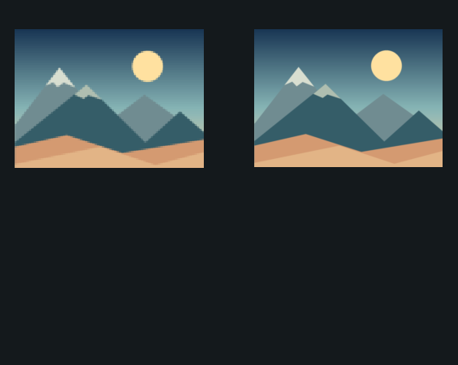

# v0.2.1 検証記録

## 変更と確認範囲

標準180×300を初期値のまま維持し、軽量120×200に加えて高精細270×450を追加しました。品質選択の前に、変更が画像の初期状態への再生成になることを表示します。元画像を高精細グリッドに再取り込みし、縦横比・透明セルの扱いを維持します。自動品質変更はありません。

表示上のCanvasとブラシ幅を同じにし、高精細の更新頻度を90Hz（標準60Hz）にして、細かいセルによる落下・押出しの遅さを補正しました。`engine.js` と `image.js` のルールは変更していません。

## 初期表示の比較画像

これは**ブラウザスクリーンショットではありません**。実際の `sampleImage()` の描画命令をWindows System.Drawingで再生し、各グリッドへ取り込んだ参照画像です。同じ表示サイズに最近傍で拡大しています。ブラウザによる縮小・アンチエイリアスとは差が出る場合があります。

| 品質 | グリッド | 写真の粒子矩形 | 実粒子数 | ブラウザ崩壊中FPS |
|---|---|---|---:|---|
| 標準 | 180×300 | 155×114 | 17,670 | 未測定 |
| 高精細 | 270×450 | 232×170 | 39,440 | 未測定 |

高精細は実粒子が標準の約2.23倍です。軽量のサンプルは7,828粒です。画像によって粒子数は変わります。

## 同じサンプルの崩壊・スワイプ・リセット

参照描画で取り込んだ色付き粒子に、実際の `SandEngine` と品質別の更新頻度を適用しました。2秒相当の一斉崩壊後、同じ相対座標の自由砂にブラシを加えて、さらに2秒相当進めています。これは固定時間を進めるNode試験で、ブラウザの実時間FPSではありません。

| 状態 | 標準 | 高精細 |
|---|---|---|
| 初期 | [画像](reference-initial-standard.png) | [画像](reference-initial-high.png) |
| 一斉崩壊2秒相当 | [画像](reference-collapse-standard.png) | [画像](reference-collapse-high.png) |
| スワイプ後2秒相当 | [画像](reference-swipe-standard.png) | [画像](reference-swipe-high.png) |
| 粒子数保存 | 成功 | 成功 |
| リセット後RGBA完全一致 | 成功 | 成功 |

孤立粒子を1秒進めた比較では、標準114セル／高さ300＝0.380、高精細174セル／高さ450＝0.387でした。継続して勢いを加える100msの押出し比較も、表示幅で正規化した差が0.01未満になることをテストしました。高精細だけがセルサイズ差によって約2/3の速さになる問題を補正しています。摩擦が1ステップ単位のため、勢いを加えるのをやめた後の減衰時間や軌跡は完全には一致しません。

## 性能記録

Windows x64 / Intel Core i7-1355U / Node.js v25.9.0。ブラウザ・描画・イベント処理は計測に含めていません。

`npm run benchmark`：30ステップのウォームアップ後、1,200ステップ。150ステップごとに重力を変更する、サンプルと同じ大きさの不透明粒子矩形で計測。

| 品質 | 平均 / step | P95 | 最大 |
|---|---:|---:|---:|
| 軽量 | 0.745ms | 1.712ms | 4.100ms |
| 標準 | 2.487ms | 5.133ms | 7.812ms |
| 高精細 | 8.049ms | 13.338ms | 28.401ms |

参照画像の実粒子を使った別試行では、2秒相当の崩壊に要した物理CPU時間が標準631.14ms、高精細2026.09ms、スワイプ後2秒相当が標準441.32ms、高精細1289.81msでした。値はバックグラウンド負荷等でも変動します。[生の記録](reference-results.json)も保存しています。

**高精細には大きな負荷があり、このPCの参照試行でも2秒相当の崩壊に物理だけで約2秒かかりました。** 描画込みの実時間速度・FPSを保証するものではありません。実機で高精細が重い場合は利用者が標準・軽量を選べます。アプリは自動で品質を変えません。

## 初回受信待ち

権限確認後は「端末を傾けてください」と表示し、初回の有効値を受けるまで受信を継続します。`starting` 中は4秒の受信断監視による手動復帰を行いません。待機中に重力を変更せず、手動矢印なら待機とリスナーを解除できます。null、beta/gammaが0/0など方向を決められない値を基準にしません。

自動テストではnull・0/0の後に6秒進めてもリスナーが残り、`Event` の `beta:0, gamma:-35`（`isTrusted:false`）を最初の有効値として採用し、次の `gamma:+35` で重力が変わることを確認しました。アプリ統合試験でも、初回待機中に直前の左向き重力が保たれます。

Windows版 iPhone Web Emulator 1.1.1での以前の事象について、4秒経過後のリスナー解除が原因だったと確定したものではありません。今回の変更と再現はコード上の経路・模擬イベントの確認です。

## 有効化後の5秒以上の静止：初回待ちとは別の結果

| 自動テスト条件 | 結果 |
|---|---|
| 同じ角度の有効イベントを6秒間継続受信→逆方向 | 傾きモードを維持し、逆方向へ変更できる |
| 有効化後、イベント自体を6秒間送らない→逆方向 | **操作不可を再現**。有効化後の既存4秒監視で手動に戻り、リスナー解除済み |

有効化後の受信断監視は今回維持しています。イベントを変化時にしか送らない環境では静止後にこの制限が発生します。初回待ちの修正とは区別した残課題です。実エミュレータやiPhoneが静止時にどう配信するかは今回未測定です。

## 環境別の検証結果

| 環境 | 結果 |
|---|---|
| Node自動テスト | **35件成功、0件失敗**。既存13、傾き17、品質4、アプリ統合1 |
| Windows参照描画 | 実施。初期・崩壊・スワイプPNG、粒子数保存、リセット完全一致 |
| PCブラウザ | QAページのHTTP 200は確認。ブラウザ操作は「現在URLを十分な確度で判定できない」とツール側で停止。初期表示・操作・崩壊中FPSのブラウザ実測は未確認 |
| Windows版 iPhone Web Emulator 1.1.1 | **未確認**。今回本体では実行していない |
| iPhone Safari実機 | **未確認**。ロックON/OFF、回転復帰、傾きとタッチ同時操作、FPSも未測定 |

## 再実行

- `npm test`：Nodeテスト。
- `npm run benchmark`：物理処理時間。
- `npm run reference`：WindowsのSystem.Drawingで参照画像と生の記録を生成。
- `npm run qa`：`http://127.0.0.1:5174/test/quality.html` のボタンを押してブラウザ比較を実行。実アプリを順番に動かし、初期Canvas、崩壊・合成スワイプ中のFPS、リセットを記録。タブは前面を維持する。`browser-results.json` とPNGを同フォルダーに保存する。

コミット・push・公開は行っていません。
