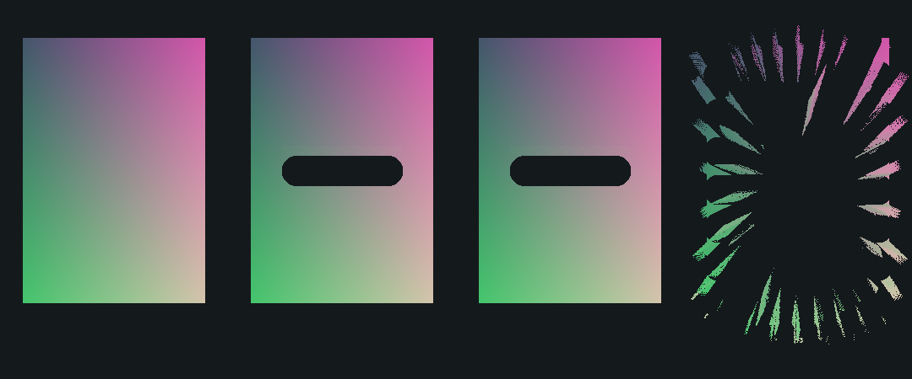
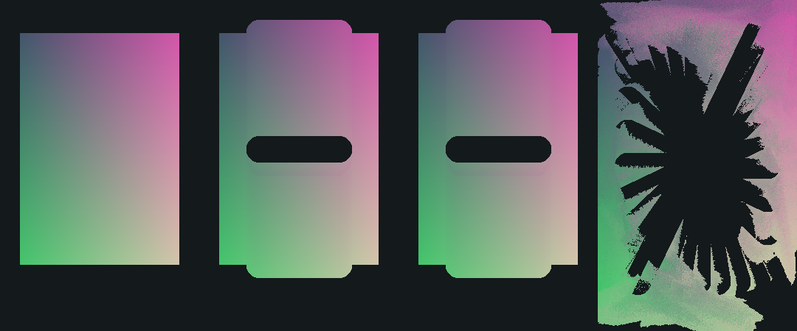

# v0.6.2 — TRACE PARTICLE VISIBILITY FIX

2026-11-21（日本時間）。変更ファイルはLF。コミット・push・公開なし。

## 原因

**コードとNode再現で確定：粒の重なりによる描画上書き。** v0.6.1の`traceSegment()`は、溝の縁が既に占有されていても粒の座標をそのセルへ移していた。`rebuildTraceGrid()`は同セルの最後のIDしかグリッドへ記録せず、`app.js`の`draw()`も同じ画素へRGBAを上書きしていた。総粒子数・ID・色配列は保持される一方、独立して見える粒は大幅に減っていた。

標準の多方向操作では30,240粒のうち5,145画素しか着色されず、高精細は68,040粒のうち11,322画素になった。全粒の描画呼び出しは行われ、画面外の粒は0、色情報の変化も0だった。壁への吸収や画面外移動ではない。粒は別の退避配列にあるのではなく、同じ座標を共有していた。通常道具への切替時にだけ重なりを解消する設計で、なぞり砂を続ける間は隠れた粒が復帰しなかった。

同じ直線だけの30回では減少が初回付近で止まるが、多方向に広げると約83%が隠れることを再現した。**iPhone録画そのものの原因との一致は推定**であり、録画・実機を直接解析した結果ではない。

以前のテストは粒数・ID・色が保持されることを確認していたが、なぞり砂中は重なりを許す整合性検査だった。着色画素数の減少を失敗にできていなかったため、今回ここを修正した。

## 必要な修正

- `src/paths.js`のなぞり砂だけを修正。溝の両脇へ向かう通り道で、**溝の外の空きセルが見つかったときだけ**、縁の砂を順に外へ押して対象粒を入れる。
- 壁と領域端を隣接セル単位で確認し、探索をグリッド長辺の半分までに制限。空き不足・壁で塞がる場合は動かさない。粒を消す／重ねる／壁を通す処理はない。
- 常に一粒一セルを保持し、なぞり砂中も通常と同じ厳密な整合性検査を使用。道具を戻す際の重なり解消処理は不要になったため削除。
- 押された固定砂も移動したものだけ自由粒へ変更。重力停止、速度ゼロ、指離し後の静止、ID・RGBA・原位置は保持。既存の復元・リセットで正確に戻る。
- 通常物理、壁の編集、砂時計、傾き監視、描画関数とUIレイアウトは変更していない。タイトルとpackageのバージョンはv0.6.2。

## 操作ごとの数値

同じ不透明画像データを、同じ軌跡・サイズで旧実装と修正後に処理した。標準180×300、高精細270×450。中央の直線を10回、続けて30回まで繰り返し、その後に広い範囲を交差する48本の多方向スワイプを行った。

| 品質 | 操作後 | 総粒子数・画面内描画呼出数 | 旧グリッド占有数＝旧着色画素数 | 修正後グリッド占有数＝修正後着色画素数 |
| --- | --- | ---: | ---: | ---: |
| 標準 | 初期 | 30,240 | 30,240 | 30,240 |
| 標準 | 同じ場所10回 | 30,240 | 28,147 | 30,240 |
| 標準 | 同じ場所30回 | 30,240 | 28,147 | 30,240 |
| 標準 | 多方向48本を追加 | 30,240 | 5,145 | 30,240 |
| 高精細 | 初期 | 68,040 | 68,040 | 68,040 |
| 高精細 | 同じ場所10回 | 68,040 | 63,140 | 68,040 |
| 高精細 | 同じ場所30回 | 68,040 | 63,140 | 68,040 |
| 高精細 | 多方向48本を追加 | 68,040 | 11,322 | 68,040 |

全行で画面外0・IDとRGBA保持。修正後は最大同セル粒数1、中央の連続した溝は標準65セル・高精細97セルで確認した。「描画呼出数」は同セルへの上書きも数えてしまうため、合格判定には**実際に色が残る画素数**を使った。不透明画像の1粒1画素であり、CSS拡縮後の端末の物理解像度の画素数ではない。

## 比較画像

各画像の左から、**初期／同じ場所10回／同じ場所30回／多方向48本追加後**。押し出された粒が写真の外周にも広がって残る。背景の穴は溝であり、修正後の着色面積は全段階で一定。

**標準・修正前（v0.6.1）**


**標準・修正後（v0.6.2）**


**高精細・修正前（v0.6.1）**



**高精細・修正後（v0.6.2）**



これらはNodeで粒の座標とRGBAを、アプリのdrawと同じ一粒一画素の上書き規則で描いた参照PNG。実ブラウザのCanvasを撮影したものではない。製品へ画像保存機能は追加していない。

## 検証結果と限界

| 環境 | 結果 |
| --- | --- |
| Node v25.9.0 / Windows x64 | **88件成功、失敗0、約16.1秒**。既存85件を再実行し、可視数の繰り返し検査2件と空き不足の検査1件を追加 |
| 実アプリの模擬DOM／Canvas | 標準・高精細の30回＋多方向操作の各スワイプ後に、実際のdrawが出力したRGBAの着色画素数を検査。毎回全粒数と一致。壁、傾き停止、復元、即時リセット、道具・モード切替も成功 |
| 実ブラウザ | **未確認**。接続が`Computer Use native pipe is unavailable`で失敗。実Canvas画像・CSS拡縮での見え方・FPSは未測定 |
| iPhone Safari実機 | **未確認**。操作感と録画上の改善は未確認 |

新規テストでは標準・高精細の全スワイプ後に、全IDとグリッドの一対一対応、画面内、着色画素数、色配列、個数を確認した。重力なしで300更新静止し、砂を戻す・リセット後の位置／固定状態も一致する。壁で囲った満杯の部屋では30回なぞっても押し分けず、粒や壁が変わらないことを確認した。既存の通常砂操作、壁支持・消去・斜めの貫通防止、砂時計の流下と反転、傾き操作も成功。

実機ではv0.6.2の表示を確認し、不透明写真の中央で10回・30回、次に縦横斜めに広くなぞり、粒が周辺へ残るか確認する。空きの少ない壁付近では移動が制限されること、指離し後は静止すること、砂を戻す・リセットで全体が復元されること、通常道具・壁・砂時計への往復を確認する。

## 再実行と記録

```sh
npm test
npm run reference:trace-visibility
npm run reference:trace
```

[修正前の数値](before-v0.6.1.json)はコード変更前に保存した証跡。[修正後の数値](after-v0.6.2.json)は参照スクリプトで再生成できる。誤ったベースライン上書きを防ぐため、v0.6.2上で修正前タグの指定は拒否する。[単回の溝・CPU計測](node-results.json)はブラウザFPSではない。

変更ファイル：`src/paths.js`、`index.html`、`package.json`、`test/trace.test.js`、`test/app-tilt.test.js`、`scripts/trace-reference.mjs`、新規`scripts/trace-visibility-reference.mjs`、`README.md`、`docs/ENGINE.md`、`docs/IPHONE_CHECKLIST.md`と本フォルダーの証跡。
